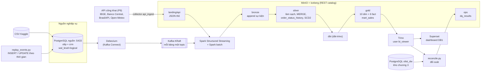

# Data Lakehouse cho Order Management (P10, mở rộng 1)

> Thiết kế viết trước khi code. Mọi số về máy lấy từ lần đo ngày 19/11/2026; số về hiệu năng của Lakehouse sẽ điền sau khi chạy thật (handoff P10).
> Trình bày theo thứ tự: **kiến trúc → triển khai → kết quả**. Kho ở chương 3 (PostgreSQL `olist_dw`) giữ nguyên; Lakehouse là hệ thống thứ hai, dựng song song và **đối soát với kho cũ**.

## 0. Máy chạy và cấu hình đã chọn

### 0.1 Kết quả kiểm tra (19/11/2026, Windows 10, PostgreSQL 18 đang chạy)

| Mục | Giá trị |
| --- | --- |
| CPU | AMD Ryzen 5 5600H, 6 nhân / 12 luồng |
| RAM tổng | 13,9 GB |
| RAM còn trống (counter `Available MBytes`, PostgreSQL chạy, VS Code + Claude + trình duyệt đang mở, 6 mẫu cách nhau 2 giây) | 5,1 GB |
| Cùng phép đo sau khi mở Docker Desktop, chưa chạy container | 2,5 GB |
| Bộ nhớ PostgreSQL trên Windows (10 tiến trình) | khoảng 0,67 GB resident |
| Ổ trống | C: 32,9 GB; D: 14,4 GB (dự án); H: 31,3 GB |
| Docker | Docker Desktop (cài theo người dùng), client và server 29.9.2, Compose v5.6.1, backend WSL2, đã chạy được |
| WSL | 3.0.5.0, kernel 6.18, phân phối Ubuntu và docker-desktop (WSL2) |
| `.wslconfig` trước khi đổi | `memory=4GB`, `swap=2GB` |

### 0.2 Chọn profile theo RAM còn trống, không theo RAM tổng

Quy tắc của `docs/prompts/P10-lakehouse.md` (RAM ≥ 16 GB thì `full`, nhỏ hơn thì `lite`) chỉ nhìn RAM tổng. Ở đây dùng thêm RAM còn trống thật:

1. RAM trống khi PostgreSQL chạy và các công cụ làm việc đang mở: **5,1 GB**.
2. Trừ phần Docker Desktop chiếm phía Windows (khoảng 0,75 GB) và biên an toàn 0,5 GB: còn khoảng **3,9 GB cho máy ảo WSL**.
3. Ngưỡng ước tính của stack: `full` cần khoảng 10 GB (thêm Airflow và Superset chạy thường trực, Spark một master và nhiều worker), `lite` khoảng 6 GB, `lite` rút gọn (xem 0.3) khoảng 4 GB.

Kết luận: **profile `lite`**, chạy ở dạng rút gọn khi mở các công cụ làm việc, và chỉ nâng lên mức 6 GB khi đo hiệu năng với các công cụ đã đóng. `full` không phù hợp với máy này.

### 0.3 Giới hạn bộ nhớ WSL (`C:\Users\<tên>\.wslconfig`)

```ini
[wsl2]
memory=4GB
swap=4GB
processors=6

[experimental]
autoMemoryReclaim=gradual
```

- Windows và PostgreSQL còn lại 13,9 − 4 = **9,9 GB** (yêu cầu là ít nhất 4 GB; ngưỡng này bảo đảm cả khi nâng lên 6 GB, còn 7,9 GB).
- `memory=4GB` lấy từ RAM trống thật ở mục 0.2. `processors=6` để Windows và PostgreSQL còn 6 luồng. `swap=4GB` (tăng từ 2 GB) để chịu đỉnh ngắn hạn, đổi lại chậm hơn khi dùng tới. `autoMemoryReclaim=gradual` trả bộ nhớ đệm không dùng về cho Windows.
- Đã kiểm chứng: sau `wsl --shutdown`, `docker info` báo `MemTotal` = 4,1 GB; Ubuntu thấy 6 nhân và vùng swap 4 GB; không có cảnh báo khoá lạ.
- Đo hiệu năng (bước 9) với VS Code, Claude và trình duyệt đã đóng: đổi `memory=6GB`, chạy `wsl --shutdown`, ghi lại trong handoff.
- File cũ được lưu ở `%USERPROFILE%\.wslconfig.bak-2026-11-19`.

### 0.4 Điều kiện bắt buộc trước khi chạy stack: giới hạn bộ nhớ ảo (commit limit) của Windows

Lỗi `OutOfMemory` của PostgreSQL khi dựng lại ở P9 có nguyên nhân rất có thể không phải thiếu RAM vật lý mà là chạm giới hạn bộ nhớ ảo (commit limit) của Windows:

| Phép đo | Giá trị |
| --- | --- |
| Commit limit (RAM + file phân trang) | khoảng 22 GB |
| File phân trang | cố định 8,2 GB, không tự quản lý (`AutomaticManagedPagefile = False`), mới dùng 0,2 GB |
| Đã cấp (committed) khi nhàn rỗi, chưa có Docker | 17,2 GB (78%) |
| Đã cấp khi mở Docker Desktop, chưa chạy container | 20,1–20,2 GB (90–94%) |
| Một máy ảo Hyper-V không xác định (tiến trình `vmmem`, `vmwp` khởi động 11:39) | cấp 4,1 GB, dùng thật 0,7 GB; không dừng được bằng `wsl --shutdown` |

Chỉ còn khoảng 2 GB trước khi chạm giới hạn, trong khi máy ảo WSL cần thêm tới 2,2 GB (cấu hình 4 GB) hoặc 4,2 GB (6 GB). Khi chạm giới hạn, Windows từ chối cấp bộ nhớ cho **bất kỳ** tiến trình nào, kể cả PostgreSQL.

Hai việc cho Phú, cần quyền quản trị, làm một trong hai (làm cả hai thì tốt nhất):

1. Tăng file phân trang lên 16 GB cố định hoặc để hệ thống tự quản lý (ổ C: còn 32,9 GB). PowerShell chạy bằng "Run as administrator":
   ```powershell
   $cs = Get-CimInstance Win32_ComputerSystem
   Set-CimInstance -InputObject $cs -Property @{AutomaticManagedPagefile = $true}
   # hoặc cố định: wmic pagefileset where name="C:\\pagefile.sys" set InitialSize=16384,MaximumSize=16384
   ```
   Khởi động lại máy để có hiệu lực.
2. Kiểm tra máy ảo Hyper-V 4 GB đang chạy (Hyper-V Manager hoặc `Get-VM` bằng quyền quản trị); nếu không dùng thì tắt, giải phóng 4,1 GB.

Chưa làm một trong hai việc này thì stack `lite` có thể chạy được từng phần nhưng vẫn có nguy cơ lặp lại lỗi hết bộ nhớ.

### 0.5 Hai profile và những gì khác nhau

| | `lite` (chọn) | `full` (không chọn) |
| --- | --- | --- |
| Điều phối | script Python `lakehouse/scripts/run_daily.py` | Airflow (3 DAG) |
| Superset | chỉ bật khi demo (`--profile demo`) | chạy thường trực |
| Spark | một node, chạy chế độ `local[2]` (driver và executor trong một JVM) | master + 1 worker (hoặc nhiều) |
| Trino | một coordinator kiêm worker, heap 1 GB | như `lite` |
| Bộ nhớ ước tính | 4–6 GB | khoảng 10 GB |

Ngân sách bộ nhớ dự kiến của `lite` (giới hạn `mem_limit` mỗi container; số thật sẽ ghi từ `docker stats` ở bước 9):

| Dịch vụ | Dự kiến (MB) |
| --- | ---: |
| PostgreSQL nguồn + catalog | 250 |
| Kafka (KRaft, heap 256 MB) | 450 |
| Kafka Connect + Debezium (heap 384 MB) | 600 |
| MinIO | 150 |
| Iceberg REST catalog | 300 |
| Spark (`local[2]`, streaming hoặc batch, chạy một lúc một việc) | 1.200 |
| Trino (heap 768 MB) | 1.100 |
| Cộng | khoảng 4.050 |

Ở mức `memory=4GB` Spark và Trino không chạy nặng cùng lúc: quy trình là thu nhận (Spark streaming) rồi dừng Spark và bật Trino/dbt. Ở mức 6 GB chạy cùng lúc được.

## 1. So sánh Data Warehouse, Data Lake, Lakehouse

| Tiêu chí | Data Warehouse (chương 3) | Data Lake | Lakehouse (P10) |
| --- | --- | --- | --- |
| Dữ liệu lưu | bảng đã làm sạch, mô hình sao | tệp thô mọi định dạng (JSON, CSV, Parquet) | tệp cột (Parquet) kèm lớp siêu dữ liệu bảng |
| Schema | schema-on-write | schema-on-read | cả hai: Bronze đọc thô, Silver/Gold có schema |
| Giao dịch ACID, cập nhật, xoá | có | không | có (Iceberg) |
| Lịch sử, quay về phiên bản cũ | không (ghi đè, trừ SCD2 viết tay) | không | có: snapshot, time travel, rollback |
| Lưu trữ và tính toán | gắn trên một máy | tách (object storage + engine) | tách (MinIO + Spark/Trino) |
| Dữ liệu bán cấu trúc | khó | tốt | tốt (Bronze giữ JSON nguyên) |
| Nạp | lô (batch) | lô hoặc luồng | luồng (CDC) và lô |
| Chi phí | thấp ở quy mô nhỏ | thấp | cao hơn về hạ tầng, đổi lại mở rộng được |
| Hợp với | BI, báo cáo | khoa học dữ liệu, lưu trữ thô | cả hai trên cùng một bản dữ liệu |

## 2. Giới hạn của kho ở chương 3 và cách Lakehouse giải quyết

| Giới hạn của kho chương 3 | Biểu hiện trong dự án | Cách Lakehouse giải quyết |
| --- | --- | --- |
| Nạp theo lô, theo đợt hằng tháng | `simulate_increment` chèn 1 tháng rồi `run_pipeline` nạp; dữ liệu cũ đi trễ tới một đợt | **CDC**: Debezium đọc WAL của PostgreSQL nguồn, mỗi thay đổi thành một sự kiện Kafka; Spark Structured Streaming ghi Bronze/Silver trong vài chục giây |
| `fact_order_fulfillment` ghi đè trạng thái | mỗi đơn chỉ còn trạng thái cuối; không biết đơn ở trạng thái nào vào ngày T | Bronze giữ **mọi sự kiện**; `silver.order_status_history` (valid_from, valid_to, is_current) trả lời "đơn này ở trạng thái nào lúc T"; Iceberg time travel cho cả bảng |
| Không giữ dữ liệu thô | staging bị xoá và nạp lại mỗi lô full; chỉ `rejected_rows` giữ dòng lỗi | Bronze **append-only**, không sửa; có thể dựng lại Silver/Gold từ Bronze bất cứ lúc nào |
| Lưu trữ và tính toán gắn trên một máy | PostgreSQL vừa lưu vừa tính; truy vấn nặng ảnh hưởng nạp | Dữ liệu ở MinIO, tính bằng Spark và Trino; thêm engine không phải di chuyển dữ liệu |
| Power BI Import phải refresh | CSV xuất từ kho; dashboard chỉ mới khi Refresh | Superset đọc `gold` qua Trino (truy vấn trực tiếp); Power BI vẫn dùng được qua ODBC/Trino nếu cần |

Điều Lakehouse **không** làm tốt hơn kho cũ ở quy mô này: truy vấn nhỏ trên PostgreSQL nhanh hơn, và hạ tầng tốn nhiều bộ nhớ hơn. Phần kết quả (bước 9) đo cả hai chiều, không chỉ chiều có lợi.

## 3. Kiến trúc

### 3.1 Bảng kiến trúc

| Tầng | Công cụ | Vai trò | Vì sao chọn | Phiên bản (image) |
| --- | --- | --- | --- | --- |
| Nguồn nghiệp vụ | PostgreSQL | `oltp` + `crm` (nạp bằng `etl.load_source`), bật `wal_level=logical`, cổng 5433 | CDC của Debezium đọc WAL; cổng khác 5432 để không đụng PostgreSQL trên Windows | `postgres:17.7` |
| Nguồn API | `api_ingest/` (P9) | JSON thô → landing zone trên MinIO | dùng lại, không viết lại | Python 3.11 (image dựng riêng) |
| Thu nhận | Debezium (Kafka Connect) | đọc WAL, mỗi bảng một topic | chuẩn de facto cho CDC PostgreSQL | `quay.io/debezium/connect:3.2.0.Final` |
| Bus sự kiện | Apache Kafka, KRaft | lưu sự kiện, phát lại | không cần ZooKeeper, ít bộ nhớ hơn | `apache/kafka:3.9.1` |
| Lưu trữ | MinIO (S3) | object storage cho bucket `lakehouse` | API S3 chuẩn; xem 3.4 về nguồn image | `bitnamilegacy/minio:2025.7.23-debian-12-r5` |
| Định dạng bảng | Apache Iceberg (spec v2) | ACID, time travel, MERGE, đổi schema | thầy yêu cầu table format có ACID; mở, nhiều engine đọc được | thư viện 1.10.0 |
| Catalog | Iceberg REST catalog, backend JDBC trên PostgreSQL | tên bảng → vị trí metadata, bền sau khi khởi động lại | REST là giao thức chung của Spark và Trino | `apache/iceberg-rest-fixture:1.10.0` |
| Xử lý | Spark Structured Streaming + Spark batch | Kafka → Bronze → Silver (luồng); SCD2 (lô) | đọc Kafka và ghi Iceberg trong cùng engine; MERGE | `apache/spark:3.5.6` + `iceberg-spark-runtime-3.5_2.12:1.10.0` + `spark-sql-kafka-0-10_2.12:3.5.6` |
| Mô hình hoá | dbt + adapter dbt-trino | Silver → Gold, test, tài liệu, lineage | cùng tên bảng/cột của kho; test khai báo | `dbt-core` và `dbt-trino` 1.10.x (ghim ở bước 5) |
| Truy vấn | Trino, connector Iceberg | SQL phân tán trên Gold; user `bi_viewer` chỉ đọc `gold` | đọc Iceberg qua REST; phân quyền theo schema | `trinodb/trino:477` |
| Trực quan | Apache Superset | dashboard DB1 trên Gold | mã nguồn mở, có driver Trino | `apache/superset:5.0.0` + driver `trino` |
| Điều phối | Airflow (`full`) / `run_daily.py` (`lite`) | dbt run + test, bảo trì, kiểm tra luồng | Airflow chuẩn công nghiệp; `lite` bỏ vì tốn bộ nhớ | `apache/airflow:2.10.5` |

Tag được ghim cho mọi image, không dùng `latest`. Các tag trên đã được kiểm tra là tồn tại bằng `docker manifest inspect` (trừ MinIO, xem 3.4); việc chạy thử từng image nằm ở bước 2.

### 3.2 Vì sao bộ phiên bản này tương thích

- **Iceberg 1.10.0** là phiên bản chung: runtime cho Spark 3.5 (Scala 2.12) và catalog REST cùng dòng 1.10; bảng ghi theo **spec v2** (có xoá theo hàng, cần cho MERGE) mà Trino 477 đọc và ghi được.
- **Spark 3.5.6** chọn thay cho 4.0 vì dòng 3.5 là bản hỗ trợ dài hạn, có runtime Iceberg và connector Kafka cùng số phiên bản Scala (2.12); tránh rủi ro ghép bản mới nhất.
- **Debezium 3.2** chạy trên Kafka Connect của Kafka 3.9 và đọc PostgreSQL 17 bằng plugin `pgoutput` có sẵn (không cần cài thêm).
- **Trino 477** có connector Iceberg dùng REST catalog và hệ tệp S3 gốc; không cần Hive Metastore.
- **dbt-trino** ghim cùng dòng dbt-core 1.10; sẽ ghi số cụ thể ở bước 5 sau khi cài.

### 3.3 Sơ đồ



PNG: `figures/5-1_kien_truc_lakehouse.png` (bản nháp, nhóm vẽ lại bằng draw.io); file chỉnh sửa: `docs/diagrams/lakehouse-kien-truc.drawio`; mã Mermaid: `docs/lakehouse.mmd`. Cả ba sinh từ `python scripts/gen_lakehouse_diagram.py`.

### 3.4 Về image MinIO

Kho image chính thức của MinIO (`minio/minio` trên Docker Hub, `quay.io/minio/minio`) **không còn tải được** vào ngày 19/11/2026 (`docker manifest inspect` báo "denied" và "object not found"; MinIO ngừng phát hành image bản cộng đồng từ cuối 2025). Dùng `bitnamilegacy/minio:2025.7.23-debian-12-r5`, vẫn là chương trình MinIO, tag bị đóng băng tại 2025.7.23 và không còn bản vá bảo mật. Chấp nhận được cho đồ án chạy trên laptop; dịch vụ chỉ lộ cổng ra `localhost`. Vì mọi thành phần chỉ dùng API S3, có thể đổi sang SeaweedFS hoặc Garage bằng cách thay một service và hai biến môi trường (`S3_ENDPOINT`, khoá truy cập).

Nếu bước 2 phát hiện image này không chạy, phương án dự phòng là `chrislusf/seaweedfs:3.97` (có tag ghim, được duy trì).

## 4. Bảng Bronze, Silver, Gold

Ký hiệu cách ghi: **append** (chỉ thêm), **MERGE** (cập nhật hoặc thêm theo khoá, giữ bản `ts_ms` mới nhất), **thay bảng** (`CREATE OR REPLACE` / ghi đè toàn bảng, dbt `table`).

### 4.1 Bronze (`bronze`): sự kiện thô, giữ nguyên

Cấu trúc chung: `key`, `payload` (JSON), `op` (c / u / d / r), `ts_ms`, `source_table`, `kafka_partition`, `kafka_offset`, `ingested_at`.

| Bảng | Nguồn | Grain | Cách ghi |
| --- | --- | --- | --- |
| `bronze.oltp_customers`, `oltp_geolocation`, `oltp_orders`, `oltp_order_items`, `oltp_order_payments`, `oltp_order_reviews`, `oltp_products`, `oltp_sellers`, `oltp_product_category_name_translation` | topic Debezium của 9 bảng `oltp` | 1 dòng = 1 sự kiện thay đổi | append |
| `bronze.crm_mql`, `bronze.crm_closed_deals` | topic của 2 bảng `crm` | 1 dòng = 1 sự kiện | append |
| `bronze.api_ibge_estados`, `api_ibge_municipios`, `api_ibge_populacao`, `api_ibge_pib`, `api_ibge_ipca`, `api_bcb_sgs`, `api_brasilapi_feriados`, `api_openmeteo_geocoding`, `api_openmeteo_weather` | JSON trong `landing/api/<nguồn>/<ngày>/` | 1 dòng = 1 tệp JSON của một lần gọi (schema-on-read, JSON giữ nguyên) | append |

### 4.2 Silver (`silver`): làm sạch theo quy tắc ODS, có khoá

| Bảng | Grain | Cách ghi | Ghi chú |
| --- | --- | --- | --- |
| `silver.customers`, `orders`, `order_items`, `order_payments`, `order_reviews`, `products`, `sellers`, `mql`, `closed_deals`, `geolocation_zip`, `category_translation` | khoá chính của bảng ODS tương ứng | MERGE | khử trùng, chuẩn hoá zip và thành phố, tọa độ ngoài khung Brazil bị loại, khoảng thời gian âm thành NULL, review trùng giữ bản mới nhất |
| `silver.<bảng>_rejected` | 1 dòng = 1 bản ghi bị loại | append | kèm mã lỗi; không bỏ âm thầm |
| `silver.order_status_history` | (order_id, valid_from) | MERGE (đóng dòng cũ, thêm dòng mới) | cột `status`, `valid_from`, `valid_to`, `is_current` |
| `silver.customer_address_scd2` | (customer_unique_id, valid_from) | MERGE của Iceberg (Spark batch) | khớp logic `dim_customer` của kho chương 3 |
| `silver.ibge_municipio`, `ibge_population`, `ibge_gdp`, `fx_usd_brl`, `ipca_month`, `holiday_official`, `weather_station`, `weather_daily`, `city_ibge_match` | như `ods.*` của P9 | MERGE | cùng quy tắc chuẩn hoá và ghép bốn tầng của P9 |

### 4.3 Gold (`gold`): cùng star schema với kho chương 3

| Bảng | Grain | Cách ghi |
| --- | --- | --- |
| 10 dimension: `dim_date`, `dim_geography` (đã làm giàu IBGE), `dim_customer` (SCD2), `dim_seller`, `dim_product`, `dim_order_status`, `dim_payment_type`, `dim_lead_origin`, `dim_lead_profile`, `dim_sales_rep` | như `DW_DESIGN.md`, mỗi dim có dòng Unknown khoá −1 | thay bảng (dbt `table`), `dim_customer` incremental |
| 6 fact: `fact_order_item`, `fact_order_fulfillment`, `fact_payment`, `fact_review`, `fact_lead_funnel`, `fact_seller_monthly` | như `DW_DESIGN.md` | thay bảng hoặc incremental theo khoá |
| `gold.mart_sales_*` | các view/bảng tương đương `mart_sales` cho dashboard DB1 | thay bảng |
| (tuỳ chọn) `gold.order_alerts`, `gold.order_late_scores` | đơn quá hạn; điểm dự báo giao trễ | append / thay bảng |

Tên bảng và tên cột giữ **đúng** `docs/DW_DESIGN.md`; không đổi.

### 4.4 Ops (`ops`)

`ops.dq_results` (kết quả kiểm tra chất lượng), `ops.reconciliation` (kết quả đối soát với kho cũ), `ops.maintenance_log` (số file trước/sau khi gộp).

## 5. Luồng sự kiện của một đơn hàng

Ví dụ một đơn thật (chọn ở bước 7), đi qua các tầng:

| Thời điểm | Sự kiện ở PostgreSQL nguồn | Kafka | Bronze | Silver |
| --- | --- | --- | --- | --- |
| Lúc mua | INSERT `orders` (`status=created`, `order_purchase_timestamp`) cùng INSERT `customers`, `order_items`, `order_payments` | `op=c` trên các topic tương ứng | thêm 1 dòng cho mỗi sự kiện | MERGE vào `orders`...; thêm dòng `created` vào `order_status_history` (`is_current=true`) |
| Lúc duyệt | UPDATE `orders` (`status=approved`, `order_approved_at`) | `op=u` | thêm 1 dòng (before/after) | MERGE `orders`; đóng dòng `created` (`valid_to`), thêm dòng `approved` |
| Giao cho hãng vận chuyển | UPDATE (`status=shipped`, `order_delivered_carrier_date`) | `op=u` | thêm 1 dòng | tương tự |
| Giao cho khách | UPDATE (`status=delivered`, `order_delivered_customer_date`) | `op=u` | thêm 1 dòng | tương tự |
| Sau khi nhận | INSERT `order_reviews` | `op=c` | thêm 1 dòng | MERGE `order_reviews` (review trùng giữ bản mới nhất) |
| Đơn bị huỷ | UPDATE (`status=canceled`) thay cho các bước sau lúc duyệt | `op=u` | thêm 1 dòng | đóng dòng hiện tại, thêm `canceled` |

Debezium giao **ít nhất một lần** (at-least-once): một sự kiện có thể đến hai lần. Silver dùng MERGE theo khoá và `ts_ms` để lần đến thứ hai không tạo dòng mới.

Câu hỏi mà kho chương 3 không trả lời được, Lakehouse trả lời:

```sql
-- Đơn này ở trạng thái nào lúc T?
SELECT status FROM silver.order_status_history
WHERE order_id = :id AND valid_from <= TIMESTAMP :t AND (valid_to IS NULL OR valid_to > TIMESTAMP :t);
```

## 6. Phạm vi và kiểm soát rủi ro

- **Không dùng** SQLite hay DuckDB file thay Lakehouse: lưu trữ là object storage (MinIO) cộng table format có ACID (Iceberg).
- Không đụng database `olist_dw`: PostgreSQL nguồn của Lakehouse là container riêng, cổng 5433.
- Mật khẩu ở `lakehouse/.env` (không commit); `lakehouse/.env.example` đi kèm.
- Dữ liệu volume của Docker không commit (thêm vào `.gitignore`).
- Nếu hết lượt giữa chừng: dừng sau bước đang làm, ghi tiến độ vào handoff P10 rồi commit.

## 7. Trạng thái các bước

| Bước | Nội dung | Trạng thái |
| --- | --- | --- |
| 0 | Kiểm tra máy, chọn cấu hình | xong (mục 0); đang chờ Phú xử lý commit limit (mục 0.4) trước khi chạy stack |
| 1 | Thiết kế | xong (tài liệu này) |
| 2–13 | Hạ tầng, thu nhận, Silver, Gold, đối soát, tính năng, vận hành, đo, Superset, kiểm thử, tài liệu | chưa làm |
