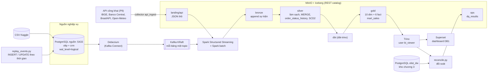

# Data Lakehouse cho Order Management (P10, mở rộng 1)

> Thiết kế viết trước khi code. Mọi số về máy lấy từ lần đo ngày 19/11/2026; số về hiệu năng của Lakehouse sẽ điền sau khi chạy thật (handoff P10).
> Trình bày theo thứ tự: **kiến trúc → triển khai → kết quả**. Kho ở chương 3 (PostgreSQL `olist_dw`) giữ nguyên; Lakehouse là hệ thống thứ hai, dựng song song và **đối soát với kho cũ**.

## 0. Máy chạy và cấu hình đã chọn

### 0.1 Kết quả kiểm tra (19/11/2026, Windows 10, PostgreSQL 18 đang chạy)

| Mục | Giá trị |
| --- | --- |
| CPU | AMD Ryzen 5 5600H, 6 nhân / 12 luồng |
| RAM tổng | 13,9 GB |
| RAM còn trống (counter `Available MBytes`, PostgreSQL chạy, VS Code + Claude + trình duyệt đang mở, 6 mẫu cách nhau 2 giây) | 5,1 GB |
| Cùng phép đo sau khi mở Docker Desktop, chưa chạy container | 2,5 GB |
| Bộ nhớ PostgreSQL trên Windows (10 tiến trình) | khoảng 0,67 GB resident |
| Ổ trống | C: 32,9 GB; D: 14,4 GB (dự án); H: 31,3 GB |
| Docker | Docker Desktop (cài theo người dùng), client và server 29.9.2, Compose v5.6.1, backend WSL2, đã chạy được |
| WSL | 3.0.5.0, kernel 6.18, phân phối Ubuntu và docker-desktop (WSL2) |
| `.wslconfig` trước khi đổi | `memory=4GB`, `swap=2GB` |

### 0.2 Chọn profile theo RAM còn trống, không theo RAM tổng

Quy tắc của `docs/prompts/P10-lakehouse.md` (RAM ≥ 16 GB thì `full`, nhỏ hơn thì `lite`) chỉ nhìn RAM tổng. Ở đây dùng thêm RAM còn trống thật:

1. RAM trống khi PostgreSQL chạy và các công cụ làm việc đang mở: **5,1 GB**.
2. Trừ phần Docker Desktop chiếm phía Windows (khoảng 0,75 GB) và biên an toàn 0,5 GB: còn khoảng **3,9 GB cho máy ảo WSL**.
3. Ngưỡng ước tính của stack: `full` cần khoảng 10 GB (thêm Airflow và Superset chạy thường trực, Spark một master và nhiều worker), `lite` khoảng 6 GB, `lite` rút gọn (xem 0.3) khoảng 4 GB.

Kết luận: **profile `lite`**, chạy ở dạng rút gọn khi mở các công cụ làm việc, và chỉ nâng lên mức 6 GB khi đo hiệu năng với các công cụ đã đóng. `full` không phù hợp với máy này.

### 0.3 Giới hạn bộ nhớ WSL (`C:\Users\<tên>\.wslconfig`)

```ini
[wsl2]
memory=4GB
swap=4GB
processors=6

[experimental]
autoMemoryReclaim=gradual
```

- Windows và PostgreSQL còn lại 13,9 − 4 = **9,9 GB** (yêu cầu là ít nhất 4 GB; ngưỡng này bảo đảm cả khi nâng lên 6 GB, còn 7,9 GB).
- `memory=4GB` lấy từ RAM trống thật ở mục 0.2. `processors=6` để Windows và PostgreSQL còn 6 luồng. `swap=4GB` (tăng từ 2 GB) để chịu đỉnh ngắn hạn, đổi lại chậm hơn khi dùng tới. `autoMemoryReclaim=gradual` trả bộ nhớ đệm không dùng về cho Windows.
- Đã kiểm chứng: sau `wsl --shutdown`, `docker info` báo `MemTotal` = 4,1 GB; Ubuntu thấy 6 nhân và vùng swap 4 GB; không có cảnh báo khoá lạ.
- Đo hiệu năng (bước 9) với VS Code, Claude và trình duyệt đã đóng: đổi `memory=6GB`, chạy `wsl --shutdown`, ghi lại trong handoff.
- File cũ được lưu ở `%USERPROFILE%\.wslconfig.bak-2026-11-19`.

### 0.4 Điều kiện bắt buộc trước khi chạy stack: giới hạn bộ nhớ ảo (commit limit) của Windows

Lỗi `OutOfMemory` của PostgreSQL khi dựng lại ở P9 có nguyên nhân rất có thể không phải thiếu RAM vật lý mà là chạm giới hạn bộ nhớ ảo (commit limit) của Windows:

| Phép đo | Giá trị |
| --- | --- |
| Commit limit (RAM + file phân trang) | khoảng 22 GB |
| File phân trang | cố định 8,2 GB, không tự quản lý (`AutomaticManagedPagefile = False`), mới dùng 0,2 GB |
| Đã cấp (committed) khi nhàn rỗi, chưa có Docker | 17,2 GB (78%) |
| Đã cấp khi mở Docker Desktop, chưa chạy container | 20,1–20,2 GB (90–94%) |
| Một máy ảo Hyper-V không xác định (tiến trình `vmmem`, `vmwp` khởi động 11:39) | cấp 4,1 GB, dùng thật 0,7 GB; không dừng được bằng `wsl --shutdown` |

Chỉ còn khoảng 2 GB trước khi chạm giới hạn, trong khi máy ảo WSL cần thêm tới 2,2 GB (cấu hình 4 GB) hoặc 4,2 GB (6 GB). Khi chạm giới hạn, Windows từ chối cấp bộ nhớ cho **bất kỳ** tiến trình nào, kể cả PostgreSQL.

Hai việc cho Phú, cần quyền quản trị, làm một trong hai (làm cả hai thì tốt nhất):

1. Tăng file phân trang lên 16 GB cố định hoặc để hệ thống tự quản lý (ổ C: còn 32,9 GB). PowerShell chạy bằng "Run as administrator":
   ```powershell
   $cs = Get-CimInstance Win32_ComputerSystem
   Set-CimInstance -InputObject $cs -Property @{AutomaticManagedPagefile = $true}
   # hoặc cố định: wmic pagefileset where name="C:\\pagefile.sys" set InitialSize=16384,MaximumSize=16384
   ```
   Khởi động lại máy để có hiệu lực.
2. Kiểm tra máy ảo Hyper-V 4 GB đang chạy (Hyper-V Manager hoặc `Get-VM` bằng quyền quản trị); nếu không dùng thì tắt, giải phóng 4,1 GB.

Chưa làm một trong hai việc này thì stack `lite` có thể chạy được từng phần nhưng vẫn có nguy cơ lặp lại lỗi hết bộ nhớ.

**Cập nhật 19/11/2026 (chiều):** Phú đã tăng file phân trang lên 15.000 MB cố định. Đo lại sau khi khởi động lại máy và chạy cả stack `lite` (nhàn rỗi): commit limit 28,5 GB, đã cấp 16,1 GB (57%); RAM còn trống 1,7 GB. Giới hạn bộ nhớ ảo không còn là nút thắt; nút thắt còn lại là RAM vật lý, nên Spark và Trino không nên cùng chạy nặng ở mức `memory=4GB` (mục 0.5).

### 0.5 Hai profile và những gì khác nhau

| | `lite` (chọn) | `full` (không chọn) |
| --- | --- | --- |
| Điều phối | script Python `lakehouse/scripts/run_daily.py` | Airflow (3 DAG) |
| Superset | chỉ bật khi demo (`--profile demo`) | chạy thường trực |
| Spark | một node, chạy chế độ `local[2]` (driver và executor trong một JVM) | master + 1 worker (hoặc nhiều) |
| Trino | một coordinator kiêm worker, heap 1 GB | như `lite` |
| Bộ nhớ ước tính | 4–6 GB | khoảng 10 GB |

Ngân sách bộ nhớ dự kiến của `lite` (giới hạn `mem_limit` mỗi container; số thật sẽ ghi từ `docker stats` ở bước 9):

| Dịch vụ | Dự kiến (MB) |
| --- | ---: |
| PostgreSQL nguồn + catalog | 250 |
| Kafka (KRaft, heap 256 MB) | 450 |
| Kafka Connect + Debezium (heap 384 MB) | 600 |
| MinIO | 150 |
| Iceberg REST catalog | 300 |
| Spark (`local[2]`, streaming hoặc batch, chạy một lúc một việc) | 1.200 |
| Trino (heap 768 MB) | 1.100 |
| Cộng | khoảng 4.050 |

Ở mức `memory=4GB` Spark và Trino không chạy nặng cùng lúc: quy trình là thu nhận (Spark streaming) rồi dừng Spark và bật Trino/dbt. Ở mức 6 GB chạy cùng lúc được.

## 1. So sánh Data Warehouse, Data Lake, Lakehouse

| Tiêu chí | Data Warehouse (chương 3) | Data Lake | Lakehouse (P10) |
| --- | --- | --- | --- |
| Dữ liệu lưu | bảng đã làm sạch, mô hình sao | tệp thô mọi định dạng (JSON, CSV, Parquet) | tệp cột (Parquet) kèm lớp siêu dữ liệu bảng |
| Schema | schema-on-write | schema-on-read | cả hai: Bronze đọc thô, Silver/Gold có schema |
| Giao dịch ACID, cập nhật, xoá | có | không | có (Iceberg) |
| Lịch sử, quay về phiên bản cũ | không (ghi đè, trừ SCD2 viết tay) | không | có: snapshot, time travel, rollback |
| Lưu trữ và tính toán | gắn trên một máy | tách (object storage + engine) | tách (MinIO + Spark/Trino) |
| Dữ liệu bán cấu trúc | khó | tốt | tốt (Bronze giữ JSON nguyên) |
| Nạp | lô (batch) | lô hoặc luồng | luồng (CDC) và lô |
| Chi phí | thấp ở quy mô nhỏ | thấp | cao hơn về hạ tầng, đổi lại mở rộng được |
| Hợp với | BI, báo cáo | khoa học dữ liệu, lưu trữ thô | cả hai trên cùng một bản dữ liệu |

## 2. Giới hạn của kho ở chương 3 và cách Lakehouse giải quyết

| Giới hạn của kho chương 3 | Biểu hiện trong dự án | Cách Lakehouse giải quyết |
| --- | --- | --- |
| Nạp theo lô, theo đợt hằng tháng | `simulate_increment` chèn 1 tháng rồi `run_pipeline` nạp; dữ liệu cũ đi trễ tới một đợt | **CDC**: Debezium đọc WAL của PostgreSQL nguồn, mỗi thay đổi thành một sự kiện Kafka; Spark Structured Streaming ghi Bronze/Silver trong vài chục giây |
| `fact_order_fulfillment` ghi đè trạng thái | mỗi đơn chỉ còn trạng thái cuối; không biết đơn ở trạng thái nào vào ngày T | Bronze giữ **mọi sự kiện**; `silver.order_status_history` (valid_from, valid_to, is_current) trả lời "đơn này ở trạng thái nào lúc T"; Iceberg time travel cho cả bảng |
| Không giữ dữ liệu thô | staging bị xoá và nạp lại mỗi lô full; chỉ `rejected_rows` giữ dòng lỗi | Bronze **append-only**, không sửa; có thể dựng lại Silver/Gold từ Bronze bất cứ lúc nào |
| Lưu trữ và tính toán gắn trên một máy | PostgreSQL vừa lưu vừa tính; truy vấn nặng ảnh hưởng nạp | Dữ liệu ở MinIO, tính bằng Spark và Trino; thêm engine không phải di chuyển dữ liệu |
| Power BI Import phải refresh | CSV xuất từ kho; dashboard chỉ mới khi Refresh | Superset đọc `gold` qua Trino (truy vấn trực tiếp); Power BI vẫn dùng được qua ODBC/Trino nếu cần |

Điều Lakehouse **không** làm tốt hơn kho cũ ở quy mô này: truy vấn nhỏ trên PostgreSQL nhanh hơn, và hạ tầng tốn nhiều bộ nhớ hơn. Phần kết quả (bước 9) đo cả hai chiều, không chỉ chiều có lợi.

## 3. Kiến trúc

### 3.1 Bảng kiến trúc

| Tầng | Công cụ | Vai trò | Vì sao chọn | Phiên bản (image) |
| --- | --- | --- | --- | --- |
| Nguồn nghiệp vụ | PostgreSQL | `oltp` + `crm` (nạp bằng `etl.load_source`), bật `wal_level=logical`, cổng 5433 | CDC của Debezium đọc WAL; cổng khác 5432 để không đụng PostgreSQL trên Windows | `postgres:17.7` |
| Nguồn API | `api_ingest/` (P9) | JSON thô → landing zone trên MinIO | dùng lại, không viết lại | Python 3.11 (image dựng riêng) |
| Thu nhận | Debezium (Kafka Connect) | đọc WAL, mỗi bảng một topic | chuẩn de facto cho CDC PostgreSQL | `quay.io/debezium/connect:3.2.0.Final` |
| Bus sự kiện | Apache Kafka, KRaft | lưu sự kiện, phát lại | không cần ZooKeeper, ít bộ nhớ hơn | `apache/kafka:3.9.1` |
| Lưu trữ | MinIO (S3) | object storage cho bucket `lakehouse` | API S3 chuẩn; xem 3.4 về nguồn image | `bitnamilegacy/minio:2025.4.22-debian-12-r1` |
| Định dạng bảng | Apache Iceberg (spec v2) | ACID, time travel, MERGE, đổi schema | thầy yêu cầu table format có ACID; mở, nhiều engine đọc được | thư viện 1.10.0 |
| Catalog | Iceberg REST catalog, backend JDBC trên PostgreSQL | tên bảng → vị trí metadata, bền sau khi khởi động lại | REST là giao thức chung của Spark và Trino | `apache/iceberg-rest-fixture:1.10.0` + driver `postgresql-42.7.4` (image dựng riêng `olist-lakehouse/iceberg-rest:1.10.0-pg42.7.4`, xem 3.5) |
| Xử lý | Spark Structured Streaming + Spark batch | Kafka → Bronze → Silver (luồng); SCD2 (lô) | đọc Kafka và ghi Iceberg trong cùng engine; MERGE | `apache/spark:3.5.6` + `iceberg-spark-runtime-3.5_2.12:1.10.0` + `spark-sql-kafka-0-10_2.12:3.5.6` |
| Mô hình hoá | dbt + adapter dbt-trino | Silver → Gold, test, tài liệu, lineage | cùng tên bảng/cột của kho; test khai báo | `dbt-core` và `dbt-trino` 1.10.x (ghim ở bước 5) |
| Truy vấn | Trino, connector Iceberg | SQL phân tán trên Gold; user `bi_viewer` chỉ đọc `gold` | đọc Iceberg qua REST; phân quyền theo schema | `trinodb/trino:477` |
| Trực quan | Apache Superset | dashboard DB1 trên Gold | mã nguồn mở, có driver Trino | `apache/superset:5.0.0` + driver `trino` |
| Điều phối | Airflow (`full`) / `run_daily.py` (`lite`) | dbt run + test, bảo trì, kiểm tra luồng | Airflow chuẩn công nghiệp; `lite` bỏ vì tốn bộ nhớ | `apache/airflow:2.10.5` |

Tag được ghim cho mọi image, không dùng `latest`. Các tag trên đã được kiểm tra là tồn tại bằng `docker manifest inspect` (trừ MinIO, xem 3.4); việc chạy thử từng image nằm ở bước 2.

### 3.2 Vì sao bộ phiên bản này tương thích

- **Iceberg 1.10.0** là phiên bản chung: runtime cho Spark 3.5 (Scala 2.12) và catalog REST cùng dòng 1.10; bảng ghi theo **spec v2** (có xoá theo hàng, cần cho MERGE) mà Trino 477 đọc và ghi được.
- **Spark 3.5.6** chọn thay cho 4.0 vì dòng 3.5 là bản hỗ trợ dài hạn, có runtime Iceberg và connector Kafka cùng số phiên bản Scala (2.12); tránh rủi ro ghép bản mới nhất.
- **Debezium 3.2** chạy trên Kafka Connect của Kafka 3.9 và đọc PostgreSQL 17 bằng plugin `pgoutput` có sẵn (không cần cài thêm).
- **Trino 477** có connector Iceberg dùng REST catalog và hệ tệp S3 gốc; không cần Hive Metastore.
- **dbt-trino** ghim cùng dòng dbt-core 1.10; sẽ ghi số cụ thể ở bước 5 sau khi cài.

### 3.3 Sơ đồ



PNG: `figures/5-1_kien_truc_lakehouse.png` (bản nháp, nhóm vẽ lại bằng draw.io); file chỉnh sửa: `docs/diagrams/lakehouse-kien-truc.drawio`; mã Mermaid: `docs/lakehouse.mmd`. Cả ba sinh từ `python scripts/gen_lakehouse_diagram.py`.

### 3.4 Về image MinIO

Kho image chính thức của MinIO (`minio/minio` trên Docker Hub, `quay.io/minio/minio`) **không còn tải được** vào ngày 19/11/2026 (`docker manifest inspect` báo "denied" và "object not found"; MinIO ngừng phát hành image bản cộng đồng từ cuối 2025). Dùng `bitnamilegacy/minio:2025.4.22-debian-12-r1`, vẫn là chương trình MinIO, tag bị đóng băng tại 2025.7.23 và không còn bản vá bảo mật. Chấp nhận được cho đồ án chạy trên laptop; dịch vụ chỉ lộ cổng ra `localhost`. Vì mọi thành phần chỉ dùng API S3, có thể đổi sang SeaweedFS hoặc Garage bằng cách thay một service và hai biến môi trường (`S3_ENDPOINT`, khoá truy cập).

**Console của MinIO (cập nhật 19/11/2026).** Bản `2025.7.23` mở API ở cổng 9000 nhưng **không phục vụ giao diện web** ở cổng 9001 (build mới của MinIO không còn đóng gói console; log không có dòng `WebUI`, cổng không lắng nghe). Đã chuyển sang `2025.4.22-debian-12-r1` (bản cuối còn console); dữ liệu cũ đọc được nguyên vẹn (kiểm tra trước trên một bản sao của volume: bucket `lakehouse` 334 MiB, 5.331 object, giống hệt; Trino vẫn đọc được các bảng Iceberg). Mở `http://127.0.0.1:9001`, tài khoản `lakehouse`, mật khẩu là `LH_MINIO_PASSWORD` trong `lakehouse/.env`.

Bước 2 đã chạy thử: image này lên, qua healthcheck, tạo được bucket `lakehouse` và Spark/Trino ghi và đọc được qua S3. Phương án dự phòng nếu sau này lỗi: `chrislusf/seaweedfs:3.97` (có tag ghim, được duy trì).

### 3.5 Kết quả chạy thử hạ tầng (Bước 2)

- **Image REST phải dựng thêm.** Image `apache/iceberg-rest-fixture:1.10.0` chỉ có driver SQLite (kiểm tra bằng cách mở jar: không có `org/postgresql/Driver`), nên catalog sẽ nằm trong tệp bên trong container và mất khi container bị tạo lại. `lakehouse/iceberg-rest/Dockerfile` thêm `postgresql-42.7.4.jar` và khởi động cùng jar bằng `java -cp` (lệnh `java -jar` bỏ qua `-cp`). Kiểm chứng: tạo 4 namespace, khởi động lại container REST, danh sách namespace vẫn còn đủ; bảng `iceberg_namespace_properties` trong database `iceberg_catalog` của PostgreSQL có 4 dòng.
- **Đường ghi và đọc đầy đủ:** Spark (`local[2]`) tạo bảng `ops.smoke` bằng Iceberg qua REST, ghi 2 dòng thành 2 tệp Parquet và 2 tệp metadata trong `s3://lakehouse/warehouse/ops/smoke/`; Trino đọc lại đúng 2 dòng; `snapshots` ghi nhận 1 snapshot kiểu `append`.
- **Bộ nhớ khi nhàn rỗi** (`docker stats`): Trino 820 MB, Connect 455 MB, Kafka 380 MB, REST 240 MB, MinIO 175 MB, Spark 122 MB, PostgreSQL 58 MB; cộng khoảng 2,25 GB, thấp hơn dự toán ở mục 0.5.

### 3.6 Kết quả chạy thử thu nhận (Bước 3)

- **Nguồn:** `etl.load_source --initial` (chính mã của dự án, trỏ biến môi trường `DB_HOST/DB_PORT/DB_USER/DB_PASSWORD` sang container, cổng 5433) nạp 1.273.620 dòng vào `oltp` và `crm` trong 11,1 giây; số dòng từng bảng trùng với lô đầu của kho chương 3. `olist_dw` không bị đụng tới.
- **Debezium:** connector `olist-source` (PostgreSQL, `pgoutput`, slot `olist_slot`, publication `olist_pub`) chụp snapshot 11 bảng trong khoảng 35 giây (hơn 30.000 sự kiện mỗi giây); 11 topic `olist.<schema>.<bảng>`, mỗi topic một partition. Số sự kiện mỗi topic **bằng đúng số dòng nguồn**: geolocation 1.000.163, order_items 51.234, order_payments 47.871, order_reviews 45.370, customers 45.430, orders 45.430, products 32.951, sellers 3.095, mql 2.002, product_category_name_translation 71, closed_deals 3 (tổng 1.273.620). Cách mã hoá: `timestamp` thành micro giây từ epoch, `date` thành số ngày từ epoch, `numeric` thành chuỗi (`decimal.handling.mode=string`).
- **Phát lại 11 tháng** (`lakehouse/scripts/replay_events.py`): lịch 446.935 sự kiện cho 54.011 đơn mới, thời gian mô phỏng 01/01/2018 → 14/11/2018: 54.011 INSERT đơn, 160.791 UPDATE đơn (đi qua các mốc duyệt, giao vận chuyển, giao khách, huỷ…), cùng khách, dòng hàng, thanh toán, review, 5.998 MQL và 839 deal. Chạy thử 3.000 sự kiện đầu: khoảng 5.000 sự kiện mỗi giây vào PostgreSQL; các UPDATE xuất hiện trên topic `olist.oltp.orders` với `op=u` và ảnh `after` đầy đủ. Tiến độ lưu ở `public.replay_state` (cùng giao dịch với sự kiện, không bị Debezium bắt) nên chạy lại không áp sự kiện hai lần.
- **API:** collector `api_ingest/` giữ nguyên; `upload_landing.py` chép 73 tệp (4,92 MB) từ `data/raw/api/` lên `s3://lakehouse/landing/api/...`. Spark (`spark/bronze_api.py`, đọc bằng `s3a://`) tạo 4 bảng `bronze.api_*` với 73 dòng (9 + 3 + 6 + 55), JSON giữ nguyên; chạy lại thêm 0 dòng.

### 3.7 Kết quả chạy thử luồng Bronze → Silver (Bước 4, phần đã xong)

`lakehouse/spark/stream_bronze_silver.py`: một ứng dụng Spark Structured Streaming (Kafka → Bronze → Silver), micro-batch có tham số `--trigger-seconds` (mặc định 30) và `--max-offsets` (số sự kiện tối đa mỗi lô, mặc định 100.000). Silver áp lại quy tắc làm sạch của ODS (`sql/30_ods/020_ods_procs.sql`) và ghi bằng MERGE theo khoá chính; một sự kiện chỉ thay dòng có sẵn khi `ts_ms` không cũ hơn.

**Nạp bù toàn bộ Kafka (lô đầu):** 13 micro-batch, 1.276.620 sự kiện (1.273.620 của snapshot + 3.000 sự kiện phát lại thử), khoảng 10 phút, trung bình khoảng 2.100 sự kiện mỗi giây. Lô đầu 99.995 sự kiện: Bronze 12,9 giây, Silver 28,2 giây; các lô sau Bronze 6–13 giây, Silver 29–50 giây (geolocation chiếm khoảng 78% sự kiện và chỉ vào Bronze).

**Kết quả đối chiếu:** Bronze có 1.276.620 dòng, bằng đúng tổng offset của 11 topic Kafka. Silver bằng đúng bảng nguồn: orders 45.971, customers 45.971, order_items 51.834, order_payments 48.443, order_reviews 45.370, products 32.951, sellers 3.095, mql 2.116, closed_deals 3, category_translation 71; các bảng `*_rejected` còn 0 dòng; `silver.order_status_history` 97.096 dòng.

**Hai lỗi đã gặp và cách sửa (ghi lại vì dễ lặp lại):**
1. *Orphan tạm thời.* Các topic được Spark đọc theo tỉ lệ, nên đơn có thể đến trước khách hàng của nó vài lô. Giống ODS, dòng mồ côi vào `silver.<bảng>_rejected` (mã `orphan`) và được thử lại ở mọi lô; khi cha đến thì dòng tự rời bảng loại. Ở lô đầu có tới khoảng 8.000 đơn chờ cùng lúc; đến lô cuối còn 0.
2. *Mất dữ liệu âm thầm khi thử lại orphan.* Bản đầu chỉ `persist()` tập ứng viên, nhưng sau khi `DELETE` các orphan cũ trong bảng `*_rejected`, Spark tính lại mọi DataFrame đã cache có phụ thuộc vào bảng vừa đổi, nên tập ứng viên mất đúng phần orphan đang chờ. Hai lần chạy đầu Silver chỉ có 24.765 trên 45.971 đơn (Bronze vẫn đủ), và log từng lô có tổng đơn hợp lệ + orphan đúng bằng số sự kiện mới, không phải số ứng viên. Sửa bằng `localCheckpoint()` (sao chép dữ liệu ra khỏi bảng, cắt lineage). Phát hiện nhờ đối chiếu Silver với nguồn, không phải nhờ log lỗi: đây là lý do bài kiểm thử "Silver = nguồn" là bắt buộc (Bước 12).

### 3.8 Phát lại 11 tháng, Silver địa lý, SCD2 khách và Silver API (Bước 4, phần còn lại)

**Mốc cắt giữa nạp bù và phát lại.** Nạp ban đầu (`etl.load_source --initial`) gồm mọi bản ghi có mốc thời gian đến hết **31/12/2017** (đơn theo `order_purchase_timestamp`, MQL theo `first_contact_date`, deal theo `won_date`; bảng tham chiếu nạp đủ). Phần phát lại (`replay_events.py`) là mọi thứ từ **01/01/2018**, thời gian mô phỏng từ 01/01/2018 đến 14/11/2018 (mốc cuối của dữ liệu). Các con số Silver ở mục 3.7 (45.971 đơn, 3 deal) là trạng thái **tại mốc này cộng 3.000 sự kiện phát lại thử** (đến 01/01/2018 18:35, 541 đơn đầu tiên của năm 2018): 45.430 + 541 = 45.971; không phải chỉ đến 31/12/2017.

**Phát lại.** Lịch phát lại gồm 446.935 sự kiện cho 54.011 đơn mới: 54.011 INSERT đơn, **160.791 UPDATE đơn** (trạng thái đi qua các mốc duyệt, giao vận chuyển, giao khách, huỷ…), 54.011 khách, 61.416 dòng hàng, 56.015 thanh toán, 53.854 review, 5.998 MQL, 839 deal. Lịch này được áp dụng thành hai lần, nên phải tách khi đếm:

| Phần | Sự kiện | Đơn mới | Ghi chú |
| --- | ---: | ---: | --- |
| Snapshot Debezium (nạp ban đầu đến 31/12/2017) | 1.273.620 | 45.430 (có sẵn) | bằng đúng số dòng nguồn |
| Chạy thử (3.000 sự kiện đầu của lịch, đến 01/01/2018 18:35) | 3.000 | 541 | đã vào Kafka và Bronze ở lần nạp bù đầu (1.276.620) |
| **Lần chạy tính giờ** (`--restart`, speed 30.000) | **443.935** | 53.470 | 3.000 sự kiện đầu bị bỏ qua vì đã áp dụng (không đổi dòng nào nên Debezium không phát gì) |
| **Tổng trong Kafka và Bronze** | **1.720.555** | 99.441 | 1.273.620 + 3.000 + 443.935 |

Theo từng topic: `olist.oltp.orders` có 260.232 sự kiện = 99.441 INSERT + 160.791 UPDATE. Con số `events_applied = 446.935` trong `public.replay_state` đếm cả 3.000 sự kiện bị bỏ qua, nên **tốc độ của lần chạy tính giờ là 443.935 / 947,5 giây = 468,5 sự kiện mỗi giây** (không phải 471,7; số cũ chia cả phần bỏ qua). Tham số: `--speed 30000` (30.000 giây mô phỏng mỗi giây thật), 200 sự kiện mỗi giao dịch nguồn, trong lúc luồng Spark chạy liên tục (micro-batch 30 giây, tối đa 100.000 sự kiện mỗi lô). Bronze có đúng 1.720.555 dòng.

**Nhịp phát và năng lực xử lý là hai con số khác nhau.** 468,5 sự kiện/giây là *nhịp nguồn tạo sự kiện* do `replay_events.py` quyết định (tốc độ mô phỏng, tốn thời gian ở các COMMIT trên PostgreSQL), không phải giới hạn của luồng. *Năng lực xử lý* đo ở lần nạp bù: 1.276.620 sự kiện trong khoảng 10 phút, **khoảng 2.100 sự kiện mỗi giây**, tức cao gấp khoảng 4,5 lần nhịp phát; vì vậy khi chạy liên tục luồng bắt kịp nguồn (mỗi lô 30 giây chỉ nhận khoảng 14.000 sự kiện, xa mức tối đa 100.000).

*Hai lỗi của `replay_events.py` đã sửa:* (1) danh sách sự kiện từng phụ thuộc trạng thái database (bỏ các đơn đã chèn), nên số thứ tự sự kiện đổi giữa các lần chạy và lần chạy lại bỏ sót sự kiện, vi phạm khoá ngoại; nay sinh chỉ từ CSV, nên tiến độ `last_seq` đáng tin; (2) UPDATE nay có điều kiện chỉ đi tiến (không đưa đơn về trạng thái trước), nên chạy lại với `--restart` an toàn.

**Bộ nhớ khi chạy liên tục** (lấy mẫu mỗi 30 giây, 46 mẫu, đỉnh MiB): Spark 1.534 trên giới hạn 1.536 (chạm giới hạn nhưng không bị kill), Trino 857, Connect 408, Kafka 339, MinIO 183, PostgreSQL 169, REST 152; cộng các đỉnh khoảng 3,6 GB, dưới trần WSL 4 GB.

**Silver còn lại (`silver_batch.py`, Spark batch, chạy sau khi luồng dừng):**
- `silver.geolocation_zip`: 19.015 dòng (bằng `ods.geolocation_zip`), `silver.geolocation_rejected`: 42 dòng toạ độ ngoài khung Brazil.
- `silver.customer_address_scd2`: 96.338 phiên bản của 96.096 khách (96.096 phiên bản hiện hành), ghi bằng MERGE trên (customer_unique_id, effective_from); khớp `dim_customer` của kho (96.339 dòng gồm 1 dòng Unknown).
- Silver API (đọc từ `bronze.api_*`): 5.571 đô thị, 16.710 dòng dân số và 16.710 dòng PIB, 1.827 ngày tỷ giá, 60 tháng IPCA, 65 ngày lễ, 27 trạm, 29.592 ngày thời tiết. Ghép (bang, thành phố) với đô thị IBGE qua 4 tầng: exact 3.124 cặp (9.006 zip), normalized 2.334 cặp (9.428 zip), fuzzy 9 cặp (16 zip), override 8 cặp (8 zip), chưa khớp 715 cặp (719 zip): **trùng từng số với P9**.

**Đối soát cuối Bước 4** (sau khi phát lại xong): `silver.orders` 99.441, `customers` 99.441, `order_items` 112.650, `order_payments` 103.886, `order_reviews` 99.224, `products` 32.951, `sellers` 3.095, `mql` 8.000, `closed_deals` 842, `geolocation_zip` 19.015: **bằng bảng nguồn trong `olist_src` và bằng bảng `ods.*` của `olist_dw`** ở cả 10 bảng; các bảng `*_rejected` của luồng có 0 dòng; `order_status_history` 310.725 dòng.

### 3.9 Gold bằng dbt và đối soát với kho chương 3 (Bước 5 và 6)

**Gold (dbt-core 1.10.23 + dbt-trino 1.10, Trino 477).** `lakehouse/dbt`: 10 dimension, 6 fact (đúng tên bảng và tên cột của `DW_DESIGN.md`, dòng Unknown khoá −1), 4 bảng mart cho Superset (`mart_sales_daily`, `mart_sales_category_month`, `mart_sales_state_month`, `mart_category_pareto`, cùng cột với `mart_sales` của kho). Dùng lại 6 seed của thư mục `seeds/` của kho (`seed-paths`) và lịch `dim_date_base` sinh từ chính `etl.build_dim_date.build_frame()`. Dimension địa lý và ngày đã được làm giàu bằng dữ liệu API (IBGE, Banco Central, BrasilAPI) như ở chương 3. Chạy 20 model: **70 giây**; 71 phép kiểm thử dbt (`unique`, `not_null`, `relationships`, `accepted_values`, kiểm thử tự viết `unique_combination` cho grain của fact, và ba kiểm thử riêng: Σ price và số dòng của `fact_order_item` bằng Silver, số đơn và Σ order_value bằng Silver, các phiên bản SCD2 của một khách không chồng nhau) đều đạt. Ảnh lineage: `figures/5-1_dbt_lineage.png` (vẽ từ `manifest.json`; có thể thay bằng ảnh chụp của `dbt docs serve`).

**Đối soát (`lakehouse/scripts/reconcile.py`).** Cùng một câu SQL được chạy trên PostgreSQL (`olist_dw.dw.*`) và Trino (`iceberg.gold.*`). Với mỗi bảng: số dòng, tổng các số đo, checksum md5 của khoá tự nhiên đã sắp xếp, và checksum md5 của **toàn bộ nội dung nghiệp vụ** từng dòng. Khoá thay thế khác nhau giữa hai hệ thống (đánh số theo thứ tự nạp), nên mọi khoá ngoại được dịch ngược về giá trị tự nhiên của dòng dimension mà nó trỏ tới (khách = `customer_unique_id` + `effective_from`, sản phẩm = `product_id`, ...): một dòng fact chỉ khớp khi trỏ đúng cùng các dòng dimension. Kết quả ghi vào `iceberg.ops.reconciliation`.

| Bảng | Số dòng kho | Số dòng Gold | Tổng tiền kho | Tổng tiền Gold | Tổng các số đo | Checksum khoá | Checksum nội dung |
| --- | ---: | ---: | ---: | ---: | :---: | :---: | :---: |
| `dim_date` | 1.828 | 1.828 | – | – | khớp | khớp | khớp |
| `dim_geography` | 19.178 | 19.178 | – | – | khớp | khớp | khớp (trừ cột `city` của 2 zip, xem dưới) |
| `dim_customer` | 96.339 | 96.339 | – | – | khớp | khớp | khớp |
| `dim_seller` | 3.558 | 3.558 | – | – | khớp | khớp | khớp |
| `dim_product` | 32.952 | 32.952 | – | – | khớp | khớp | khớp |
| `dim_order_status` | 9 | 9 | – | – | khớp | khớp | khớp |
| `dim_payment_type` | 6 | 6 | – | – | khớp | khớp | khớp |
| `dim_lead_origin` | 11 | 11 | – | – | khớp | khớp | khớp |
| `dim_lead_profile` | 503 | 503 | – | – | khớp | khớp | khớp |
| `dim_sales_rep` | 55 | 55 | – | – | khớp | khớp | khớp |
| `fact_order_item` | 112.650 | 112.650 | 13591643.70 | 13591643.70 | khớp | khớp | khớp |
| `fact_payment` | 103.886 | 103.886 | 16008872.12 | 16008872.12 | khớp | khớp | khớp |
| `fact_order_fulfillment` | 99.441 | 99.441 | 13591643.70 | 13591643.70 | khớp | khớp | khớp |
| `fact_review` | 99.224 | 99.224 | – | – | khớp | khớp | khớp |
| `fact_lead_funnel` | 8.000 | 8.000 | – | – | khớp | khớp | khớp |
| `fact_seller_monthly` | 36.583 | 36.583 | 13494400.74 | 13494400.74 | khớp | khớp | khớp |

Ngoại lệ có giải thích, `dim_geography`: mode() of the city over the points of the zip is an exact tie (97 vs 97 points: 'mogi-guacu' / 'mogi guacu', and the same for pingo-d'agua / pingo-d agua). PostgreSQL breaks the tie with the sort order of its locale (hyphen before space), Spark with the code point order (space before hyphen). Not reproducible without copying the collation of the Windows PostgreSQL; chapter 3 is not changed.

GMV (Σ price của dòng hàng thuộc đơn không phải Failed): kho 13494400.74, Gold 13494400.74: khớp.

**Dung sai của các phép so đã nới (tất cả, không có dung sai nào khác).** Mặc định mọi phép so là bằng nhau tuyệt đối (số dòng, tổng, md5 của khoá, md5 của nội dung từng dòng). Ba chỗ được nới, mỗi chỗ vì một lý do kỹ thuật cụ thể và đều áp dụng cho cả hai phía:
1. **Số có chữ số thập phân thay đổi giữa hai hệ thống** (`late_rate`, `avg_review_score` của `fact_seller_monthly`, cộng tổng của chúng): PostgreSQL lưu `numeric` không ràng buộc, Trino lưu `decimal(p, s)`, nên cùng một giá trị in ra khác số chữ số 0 cuối (`1018.1426` và `1018.142600…`). Cả hai phía được làm tròn về **4 chữ số thập phân** trước khi so. Dung sai: 0,00005 (nửa đơn vị của chữ số thứ tư) với hai cột tỉ lệ này; các số tiền (`gmv`, `freight`, `price`…) **không** nới, vẫn bằng nhau tuyệt đối.
2. **Toạ độ số thực** (`latitude`, `longitude` của `dim_geography`): PostgreSQL đổi `double` sang `numeric` 15 chữ số có nghĩa rồi làm tròn, Trino làm tròn giá trị nhị phân, nên một số zip lệch nhau 1e-6. Cả hai phía cùng cắt `floor(x · 10^6)` thành số nguyên rồi so. Dung sai: dưới 1e-6 độ (khoảng 0,11 m), tức bỏ qua phần sau chữ số thập phân thứ sáu.
3. **Ngoại lệ có giải thích** (cột `city` của hai zip 13848 và 35348 trong `dim_geography`, xem dưới): so riêng, không gộp vào phép so chung.

**Hai lỗi do đối soát tìm ra (của Gold hoặc của cách so sánh, không phải của kho):**
1. `fact_review.has_comment_message` và `comment_length` lệch (40.950 so với 40.968; 2.800.913 so với 2.804.417): `trim()` của Trino bỏ cả xuống dòng và tab, còn `trim()` của PostgreSQL chỉ bỏ dấu cách; 18 review chỉ có ký tự xuống dòng bị tính là "không có bình luận". Đã sửa model để chỉ bỏ dấu cách ở hai đầu.
2. `fact_seller_monthly` và `dim_geography` lệch ở phép so sánh: số cùng giá trị nhưng khác số chữ số 0 cuối (`1018.1426` và `1018.142600…`), và toạ độ số thực làm tròn khác nhau 1e-6 ở vài zip. Đã sửa phép so sánh (định dạng 4 chữ số thập phân cố định; cắt `floor(x·10^6)` giống nhau ở hai bên).

**Một ngoại lệ có giải thích.** `dim_geography.city` khác ở đúng 2 zip (13848 và 35348, tức 0,01% số dòng): hai cách viết của tên thành phố có số điểm bằng nhau (97 và 97). `mode()` của PostgreSQL chọn theo thứ tự collation của locale (dấu gạch ngang trước dấu cách), Spark chọn theo thứ tự mã ký tự (dấu cách trước). Không tái hiện được nếu không sao chép collation của PostgreSQL trên Windows và không thể đổi chương 3. Phép đối soát vẫn chặt: mọi cột khác của hai zip này khớp, và mọi dòng còn lại khớp cả cột `city`.

## 4. Bảng Bronze, Silver, Gold

Ký hiệu cách ghi: **append** (chỉ thêm), **MERGE** (cập nhật hoặc thêm theo khoá, giữ bản `ts_ms` mới nhất), **thay bảng** (`CREATE OR REPLACE` / ghi đè toàn bảng, dbt `table`).

### 4.1 Bronze (`bronze`): sự kiện thô, giữ nguyên

Cấu trúc chung: `key`, `payload` (JSON), `op` (c / u / d / r), `ts_ms`, `source_table`, `kafka_partition`, `kafka_offset`, `ingested_at`.

| Bảng | Nguồn | Grain | Cách ghi |
| --- | --- | --- | --- |
| `bronze.oltp_customers`, `oltp_geolocation`, `oltp_orders`, `oltp_order_items`, `oltp_order_payments`, `oltp_order_reviews`, `oltp_products`, `oltp_sellers`, `oltp_product_category_name_translation` | topic Debezium của 9 bảng `oltp` | 1 dòng = 1 sự kiện thay đổi | append |
| `bronze.crm_mql`, `bronze.crm_closed_deals` | topic của 2 bảng `crm` | 1 dòng = 1 sự kiện | append |
| `bronze.api_ibge`, `bronze.api_bcb`, `bronze.api_holidays`, `bronze.api_weather` | JSON trong `s3://lakehouse/landing/api/<nguồn>/<ngày>/` | 1 dòng = 1 tệp JSON (kể cả `manifest.json`) với các cột `source`, `run_date`, `file_name`, `payload` (JSON nguyên văn), `payload_bytes`, `sha256`, `ingested_at` (schema-on-read) | append; tệp đã có (cùng `sha256`) bị bỏ qua |

### 4.2 Silver (`silver`): làm sạch theo quy tắc ODS, có khoá

| Bảng | Grain | Cách ghi | Ghi chú |
| --- | --- | --- | --- |
| `silver.customers`, `orders`, `order_items`, `order_payments`, `order_reviews`, `products`, `sellers`, `mql`, `closed_deals`, `geolocation_zip`, `category_translation` | khoá chính của bảng ODS tương ứng | MERGE | khử trùng, chuẩn hoá zip và thành phố, tọa độ ngoài khung Brazil bị loại, khoảng thời gian âm thành NULL, review trùng giữ bản mới nhất |
| `silver.<bảng>_rejected` | 1 dòng = 1 bản ghi bị loại | append | kèm mã lỗi; không bỏ âm thầm |
| `silver.order_status_history` | (order_id, valid_from) | MERGE (đóng dòng cũ, thêm dòng mới) | cột `status`, `valid_from`, `valid_to`, `is_current` |
| `silver.customer_address_scd2` | (customer_unique_id, valid_from) | MERGE của Iceberg (Spark batch) | khớp logic `dim_customer` của kho chương 3 |
| `silver.ibge_municipio`, `ibge_population`, `ibge_gdp`, `fx_usd_brl`, `ipca_month`, `holiday_official`, `weather_station`, `weather_daily`, `city_ibge_match` | như `ods.*` của P9 | MERGE | cùng quy tắc chuẩn hoá và ghép bốn tầng của P9 |

### 4.3 Gold (`gold`): cùng star schema với kho chương 3

| Bảng | Grain | Cách ghi |
| --- | --- | --- |
| 10 dimension: `dim_date`, `dim_geography` (đã làm giàu IBGE), `dim_customer` (SCD2), `dim_seller`, `dim_product`, `dim_order_status`, `dim_payment_type`, `dim_lead_origin`, `dim_lead_profile`, `dim_sales_rep` | như `DW_DESIGN.md`, mỗi dim có dòng Unknown khoá −1 | thay bảng (dbt `table`), `dim_customer` incremental |
| 6 fact: `fact_order_item`, `fact_order_fulfillment`, `fact_payment`, `fact_review`, `fact_lead_funnel`, `fact_seller_monthly` | như `DW_DESIGN.md` | thay bảng hoặc incremental theo khoá |
| `gold.mart_sales_*` | các view/bảng tương đương `mart_sales` cho dashboard DB1 | thay bảng |
| (tuỳ chọn) `gold.order_alerts`, `gold.order_late_scores` | đơn quá hạn; điểm dự báo giao trễ | append / thay bảng |

Tên bảng và tên cột giữ **đúng** `docs/DW_DESIGN.md`; không đổi.

### 4.4 Ops (`ops`)

`ops.dq_results` (kết quả kiểm tra chất lượng), `ops.reconciliation` (kết quả đối soát với kho cũ), `ops.maintenance_log` (số file trước/sau khi gộp).

## 5. Luồng sự kiện của một đơn hàng

Ví dụ một đơn thật (chọn ở bước 7), đi qua các tầng:

| Thời điểm | Sự kiện ở PostgreSQL nguồn | Kafka | Bronze | Silver |
| --- | --- | --- | --- | --- |
| Lúc mua | INSERT `orders` (`status=created`, `order_purchase_timestamp`) cùng INSERT `customers`, `order_items`, `order_payments` | `op=c` trên các topic tương ứng | thêm 1 dòng cho mỗi sự kiện | MERGE vào `orders`...; thêm dòng `created` vào `order_status_history` (`is_current=true`) |
| Lúc duyệt | UPDATE `orders` (`status=approved`, `order_approved_at`) | `op=u` | thêm 1 dòng (before/after) | MERGE `orders`; đóng dòng `created` (`valid_to`), thêm dòng `approved` |
| Giao cho hãng vận chuyển | UPDATE (`status=shipped`, `order_delivered_carrier_date`) | `op=u` | thêm 1 dòng | tương tự |
| Giao cho khách | UPDATE (`status=delivered`, `order_delivered_customer_date`) | `op=u` | thêm 1 dòng | tương tự |
| Sau khi nhận | INSERT `order_reviews` | `op=c` | thêm 1 dòng | MERGE `order_reviews` (review trùng giữ bản mới nhất) |
| Đơn bị huỷ | UPDATE (`status=canceled`) thay cho các bước sau lúc duyệt | `op=u` | thêm 1 dòng | đóng dòng hiện tại, thêm `canceled` |

Debezium giao **ít nhất một lần** (at-least-once): một sự kiện có thể đến hai lần. Silver dùng MERGE theo khoá và `ts_ms` để lần đến thứ hai không tạo dòng mới.

Câu hỏi mà kho chương 3 không trả lời được, Lakehouse trả lời:

```sql
-- Đơn này ở trạng thái nào lúc T?
SELECT status FROM silver.order_status_history
WHERE order_id = :id AND valid_from <= TIMESTAMP :t AND (valid_to IS NULL OR valid_to > TIMESTAMP :t);
```

## 6. Phạm vi và kiểm soát rủi ro

- **Không dùng** SQLite hay DuckDB file thay Lakehouse: lưu trữ là object storage (MinIO) cộng table format có ACID (Iceberg).
- Không đụng database `olist_dw`: PostgreSQL nguồn của Lakehouse là container riêng, cổng 5433.
- Mật khẩu ở `lakehouse/.env` (không commit); `lakehouse/.env.example` đi kèm.
- Dữ liệu volume của Docker không commit (thêm vào `.gitignore`).
- Nếu hết lượt giữa chừng: dừng sau bước đang làm, ghi tiến độ vào handoff P10 rồi commit.

## 7. Trạng thái các bước

| Bước | Nội dung | Trạng thái |
| --- | --- | --- |
| 0 | Kiểm tra máy, chọn cấu hình | xong (mục 0); commit limit đã xử lý (mục 0.4) |
| 1 | Thiết kế | xong (tài liệu này) |
| 2 | Hạ tầng: Compose, healthcheck, `check_health.py` | xong (mục 3.5, handoff P10) |
| 3 | Thu nhận: nạp nguồn, Debezium, replay, API → MinIO → Bronze | xong (mục 3.6) |
| 4 | Bronze → Silver (luồng) | xong (mục 3.7 và 3.8): Silver = nguồn = ODS của kho chương 3 ở mọi bảng |
| 5 | Silver → Gold bằng dbt | xong (mục 3.9): 20 model, 71 phép kiểm thử dbt đạt |
| 6 | Đối soát Gold với kho chương 3 | xong (mục 3.9): 16/16 bảng khớp, 2 zip lệch tên thành phố do quy tắc chọn khi hoà điểm (có giải thích); Phú đã duyệt |
| 7 | Time travel Iceberg | xong: `lakehouse/scripts/time_travel.py`, `handoff/2026-11-19-P10-timetravel.md` |
| 8 | Vận hành (Airflow) | **bỏ**: profile lite vận hành bằng script (docker compose, `check_health.py`, `replay_events.py`, `wait_log.py`) |
| 9 | Đo độ trễ và thông lượng | xong: 6 lần thử + đợt dồn việc, `handoff/2026-11-19-P10-latency.md`, `figures/5-1_latency.png`; ảnh Spark UI do Phú chụp |
| 10 | Superset DB1 | chưa làm (cần tải image Superset; làm ở mạng ổn định) |
| 11 | Tính năng tuỳ chọn | **bỏ** |
| 12 | Kiểm thử | xong: `lakehouse/tests` (18 phép nhanh: Silver = nguồn, Bronze = Kafka; `--run-slow` chạy thêm 71 phép dbt và đối soát 16 bảng) |
| 13 | Slide, Q&A, handoff | slide 5.1 xong (25 trang, `slides/sections/04-mo-rong.tex`), Q&A 53–61, handoff; chương báo cáo `report/chapters/5-1-lakehouse.tex` chưa viết |
