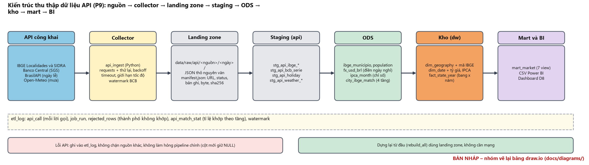

# Thu thập dữ liệu thực tế từ API để làm giàu kho (P9, mở rộng 2)

> Thiết kế viết ngày 18/11/2026, trước khi dựng; số liệu kết quả nằm ở `handoff/2026-11-18-P9-results.md` (sinh tự động từ database và từ manifest của lần thu thập thật). Mã: `api_ingest/` (hướng dẫn chạy: `api_ingest/README.md`).

## 1. Bài toán

Bộ Olist chỉ có dữ liệu nội bộ của sàn và là ảnh chụp tĩnh (09/2016–10/2018). Nó không tự trả lời được:

| Câu hỏi | Cần thêm dữ liệu | Nguồn |
| --- | --- | --- |
| Bang nào mua nhiều nhất **theo đầu người**, khác gì xếp hạng theo GMV tuyệt đối? | dân số theo bang và đô thị, PIB | IBGE SIDRA |
| Phân cấp hành chính chính thức của đô thị (vùng → bang → mesorregião → microrregião → đô thị) | danh mục đô thị kèm mã IBGE | IBGE Localidades |
| Tăng trưởng GMV **thực** sau khi trừ lạm phát là bao nhiêu? | chỉ số giá IPCA | Banco Central do Brasil |
| GMV tính bằng **USD** là bao nhiêu, đồng real mất giá ảnh hưởng thế nào? | tỷ giá USD/BRL theo ngày | Banco Central do Brasil |
| Ngày lễ chính thức có ảnh hưởng số đơn không? Cờ ngày lễ hiện có (thư viện `holidays`) có đủ không? | ngày lễ quốc gia | BrasilAPI |
| (Tuỳ chọn) Mưa có làm giao trễ không? | lượng mưa theo ngày ở 27 thủ phủ | Open-Meteo |

## 2. Bảng nguồn API

Mã bảng và mã chuỗi được kiểm tra trực tiếp trên API (metadata và lời gọi thử) trước khi viết code; collector còn tự đối chiếu mã biến và đơn vị với metadata của IBGE mỗi lần chạy.

| Endpoint | Dữ liệu | Định dạng | Cập nhật thật của nguồn | Giới hạn gọi | Giấy phép, điều khoản |
| --- | --- | --- | --- | --- | --- |
| `servicodados.ibge.gov.br/api/v1/localidades/estados`, `/municipios` | 27 bang; 5.571 đô thị với microrregião, mesorregião, vùng; vùng trung gian và tức thời | JSON (2,4 MB cho đô thị) | khi IBGE đổi danh mục (đô thị mới lập, ví dụ Boa Esperança do Norte, MT) | không công bố hạn mức; collector giữ ≥ 0,5 giây giữa hai lời gọi | dữ liệu mở của chính phủ Brazil (IBGE) |
| `servicodados.ibge.gov.br/api/v3/agregados/6579` (biến 9324, "População residente estimada", đơn vị Pessoas), cấp N6 | dân số ước tính từng đô thị, 2016–2018 | JSON (0,85 MB) | hằng năm (kỳ 2001–2026 có trong metadata) | như trên | như trên |
| `…/agregados/5938` (biến 37, "PIB a preços correntes", Mil Reais), cấp N6 | PIB đô thị giá hiện hành, 2016–2018 | JSON (0,87 MB) | hằng năm, chậm hơn 2 năm (đến 2023) | như trên | như trên |
| `…/agregados/1737` (biến 63 biến động tháng %, 2266 chỉ số, Dec/1993 = 100) | IPCA do IBGE: dùng **đối chiếu** chuỗi BCB | JSON | hằng tháng | như trên | như trên |
| `api.bcb.gov.br/dados/serie/bcdata.sgs.1/dados` | tỷ giá USD/BRL, giá bán, theo ngày làm việc ("Taxa de câmbio – Livre – Dólar americano (venda) – diário") | JSON | mỗi ngày làm việc | từ 26/03/2025 truy vấn theo khoảng ngày bị giới hạn 10 năm; collector xin cửa sổ ≤ 5 năm | ODbL (ghi trong catalog dữ liệu mở của BCB) |
| `api.bcb.gov.br/dados/serie/bcdata.sgs.433/dados` | IPCA, biến động tháng (%) | JSON | hằng tháng | như trên | ODbL |
| `brasilapi.com.br/api/feriados/v1/<năm>` | ngày lễ quốc gia (tên, loại, thứ) | JSON | hằng năm | không công bố hạn mức; ≥ 0,5 giây giữa hai lời gọi | dịch vụ cộng đồng, dữ liệu công khai |
| `geocoding-api.open-meteo.com/v1/search`, `archive-api.open-meteo.com/v1/archive` (biến `precipitation_sum`) | toạ độ thủ phủ (loại `PPLA`/`PPLC`) và mưa ngày 2016–2018 | JSON | hằng ngày (độ trễ vài ngày) | gói miễn phí dùng phi thương mại; collector ≥ 1,5 giây giữa hai lời gọi | CC BY 4.0 (đã đọc trang licence của Open-Meteo): phải ghi nguồn "Weather data by Open-Meteo.com"; gói miễn phí dành cho dùng phi thương mại (đúng với bài tập này) |

Về mã chuỗi: chuỗi BCB 1 được xác nhận bằng catalog dữ liệu mở của BCB (tên chuỗi). Catalog không có trang mô tả riêng cho chuỗi 433, nên chuỗi này được xác nhận bằng cách **so với IBGE SIDRA 1737, biến 63 "IPCA – Variação mensal"**: giá trị trùng khớp cả 60 tháng 2016–2020 (ví dụ 12/2016 = 0,30; 01/2017 = 0,38; 08/2018 = −0,09), và test của dự án so chỉ số nối từ chuỗi 433 với chỉ số IBGE 2266 (chênh lệch 0,000).

## 3. Kiến trúc

*Bản nháp sinh tự động (`scripts/p9_results.py`); file chỉnh sửa: `docs/diagrams/api-kien-truc.drawio`. Vẽ theo lớp, nối với kiến trúc các lớp ở chương 3.*

`collector → landing zone (JSON thô) → staging (schema api) → ODS (chuẩn hoá và ghép) → kho (làm giàu dimension, thêm fact) → mart_market → Power BI`

- **Collector** (`api_ingest/collect.py`, `http.py`): `requests` có thử lại tối đa 5 lần với backoff luỹ thừa (1,5 / 3 / 6 / 12 giây) cho lỗi mạng và HTTP 429, 5xx; timeout (kết nối 10 giây, đọc 120 giây); khoảng cách tối thiểu giữa hai lời gọi tới cùng một máy chủ; User-Agent chung `olist-dwbi-student-project/1.0` (không có email cá nhân).
- **Landing zone** `data/raw/api/<nguồn>/<ngày chạy>/<tên>.json`: nội dung phản hồi nguyên văn (byte for byte), kèm `manifest.json` (URL, thời điểm gọi, HTTP status, số bản ghi, byte, sha256, thời gian, số lần thử). Không commit (`data/raw/` nằm trong `.gitignore`).
- **Idempotent và tăng dần:** chạy lại cùng ngày ghi đè cùng file; staging nạp bằng `TRUNCATE + COPY` (nguồn thay toàn bộ có kiểm soát: danh mục, dân số, PIB, ngày lễ) hoặc upsert theo khoá tự nhiên (chuỗi Banco Central, chỉ xin phần sau watermark `etl_log.watermark`).
- **Nhật ký:** `etl_log.api_call` ghi từng lời gọi; `etl_log.job_run` ghi từng job (layer `api` cho collector và staging, `api_ods` cho ODS và ghép, để số liệu giám sát của pipeline bán hàng không đổi). Lỗi gọi API không chặn nguồn khác và không làm hỏng pipeline chính: các cột mới của kho giữ NULL.
- **Dựng lại:** `rebuild_all.py` dùng landing zone (`--with-api --api-offline`), không cần mạng.

### Bảng tần suất thu thập đề xuất

| Dữ liệu | Tần suất của nguồn | Tần suất thu thập đề xuất | Cách nạp |
| --- | --- | --- | --- |
| Tỷ giá USD/BRL | mỗi ngày làm việc | hằng ngày | tăng dần theo watermark |
| IPCA | hằng tháng | hằng tháng | tăng dần theo watermark |
| Dân số ước tính | hằng năm | hằng năm (sau khi IBGE công bố) | thay toàn bộ |
| PIB đô thị | hằng năm, trễ khoảng 2 năm | hằng năm | thay toàn bộ |
| Ngày lễ quốc gia | hằng năm | hằng năm (cuối năm cho năm sau) | thay toàn bộ |
| Danh mục đô thị | khi IBGE đổi | hằng quý hoặc khi có đô thị mới | thay toàn bộ, đối chiếu bảng ghép |
| Mưa (tuỳ chọn) | hằng ngày | hằng tuần cho lịch sử | thay toàn bộ cửa sổ |

## 4. Thay đổi schema (không đổi khoá nào)

Mọi thay đổi ghi ở `docs/DW_DESIGN.md` (nhật ký 18/11) và từ điển dữ liệu (comment tiếng Việt trong DB).

| Đối tượng | Thay đổi |
| --- | --- |
| Schema mới | `api` (staging), `mart_market` |
| `api.stg_api_*` (9 bảng) | `ibge_estado`, `ibge_municipio`, `ibge_populacao`, `ibge_pib`, `ibge_ipca`, `bcb_serie`, `holiday`, `weather_station`, `weather_daily` |
| `ods.*` mới | `ibge_municipio`, `ibge_population`, `ibge_gdp`, `fx_usd_brl`, `ipca_month`, `holiday_official`, `weather_station`, `weather_daily`, `city_ibge_match`; view `v_geo_city_pair`; hàm `name_key` |
| `etl_log.*` mới | `api_call`, `api_match_stat` |
| `dw.dim_geography` | thêm `ibge_municipio_code`, `microrregiao`, `mesorregiao`, `populacao_2016`, `populacao_2017`, `populacao_2018`, `match_method` |
| `dw.dim_date` | thêm `usd_brl`, `ipca_index`, `is_holiday_official`, `holiday_name_official` |
| `dw.fact_state_year` (mới) | periodic snapshot, grain = bang × năm: `year_date_key`, `state_code`, `state_name`, `region`, `population`, `gdp_thousand_brl`, `gmv`, `orders`, `customers`, `sellers`, `etl_batch_id` |
| `mart_market` (7 view) | `v_gmv_per_capita_state`, `v_gmv_per_capita_city`, `v_gmv_usd_month`, `v_gmv_real_month`, `v_holiday_effect`, `v_holiday_diff`, `v_late_by_rain` |
| Hạt giống | `seeds/city_ibge_override.csv` (tầng 4 của bảng ghép) |

Quy tắc giữ nguyên: khoá thay thế không đổi (cột mới thêm cuối bảng, cập nhật bằng `UPDATE`); khi chưa nạp dữ liệu API các cột mới là NULL và bốn dashboard DB1–DB4 cho đúng số cũ.

## 5. Ghép thành phố Olist với đô thị IBGE

Olist lưu tên thành phố đã chuẩn hoá ở tầng ODS (chữ thường, không dấu) còn IBGE dùng tên có dấu, viết hoa và có ký tự như `'`. Ghép theo (bang, tên) qua bốn tầng, đếm tỉ lệ khớp sau mỗi tầng (`etl_log.api_match_stat`):

1. **Khớp đúng:** `lower(tên IBGE) = tên Olist`, cùng bang.
2. **Chuẩn hoá:** sau `unaccent`, chữ thường, mọi dãy ký tự không phải chữ và số thành một dấu cách (ví dụ `Sant'Ana` → `sant ana`); chỉ nhận khi khoá duy nhất trong bang.
3. **Fuzzy:** `rapidfuzz.fuzz.ratio` giữa hai tên đã chuẩn hoá, **chỉ trong cùng bang**, nhận khi điểm ≥ 95 và ứng viên thứ hai thấp hơn ít nhất 10 điểm (chỉ một ứng viên). Ngưỡng 95 chọn bằng cách đọc ứng viên: mọi cặp ≥ 95 đều là biến thể chính tả đúng; ở 90–94 đã có ghép sai (ví dụ `boa vista de minas` → *Bela Vista de Minas* điểm 92), nên bị loại.
4. **Ghép tay** `seeds/city_ibge_override.csv`: các biến thể chính tả đã kiểm tra từng dòng (mã IBGE phải tồn tại và cùng bang, nếu không báo lỗi).

Cặp không khớp (phần lớn là quận, huyện, khu dân cư không phải đô thị) ghi `etl_log.rejected_rows` kèm lý do, không bỏ âm thầm.

## 6. Kết quả, kiểm thử và dashboard

Số liệu, bảng và hình: `handoff/2026-11-18-P9-api.md` và `handoff/2026-11-18-P9-results.md`. Kiểm thử: `sql/90_tests/050_api_tests.sql` (20 phép) và `tests/test_api_ingest.py` (pytest). Dashboard D8: `huong-dan/dashboards/D8.md`.
