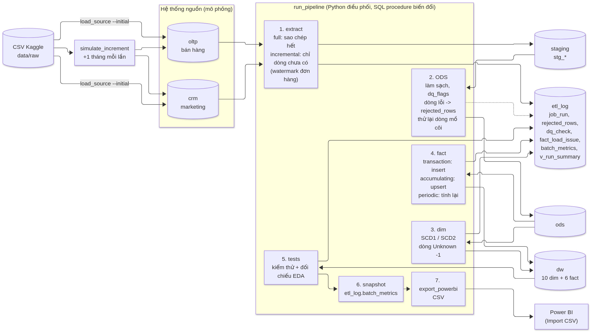
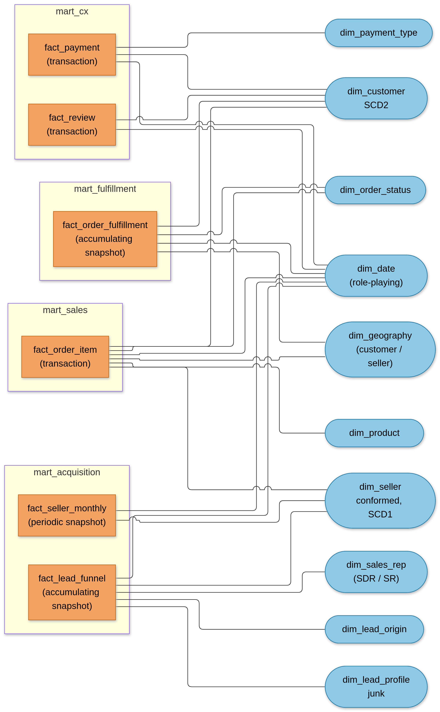
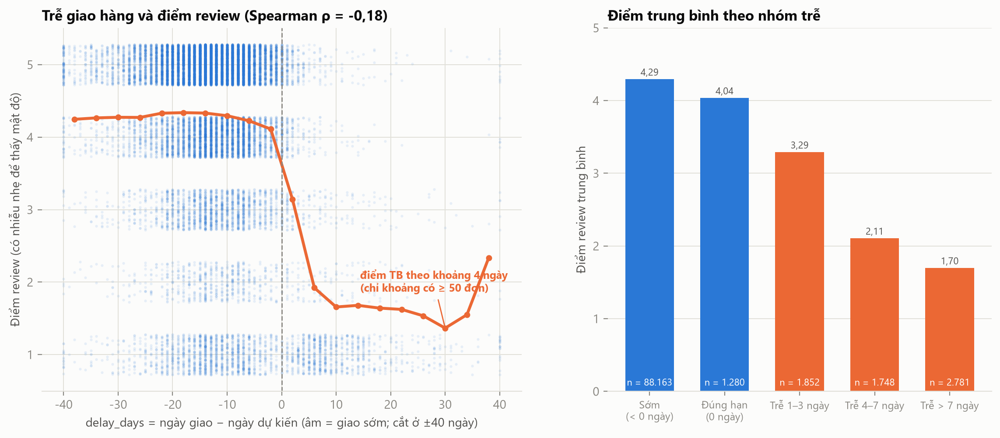
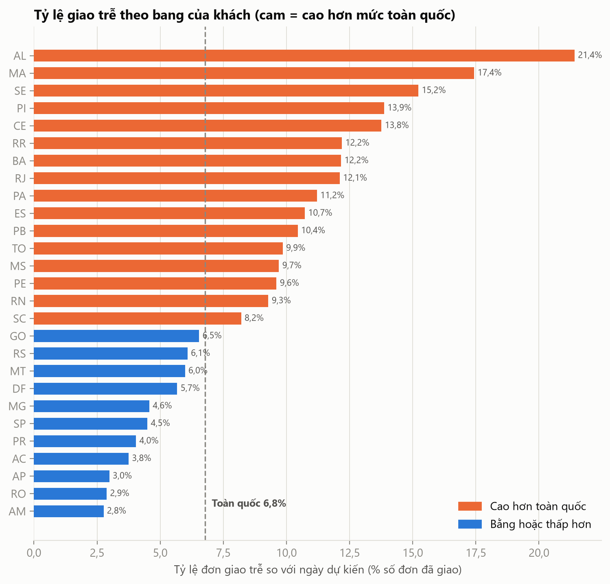
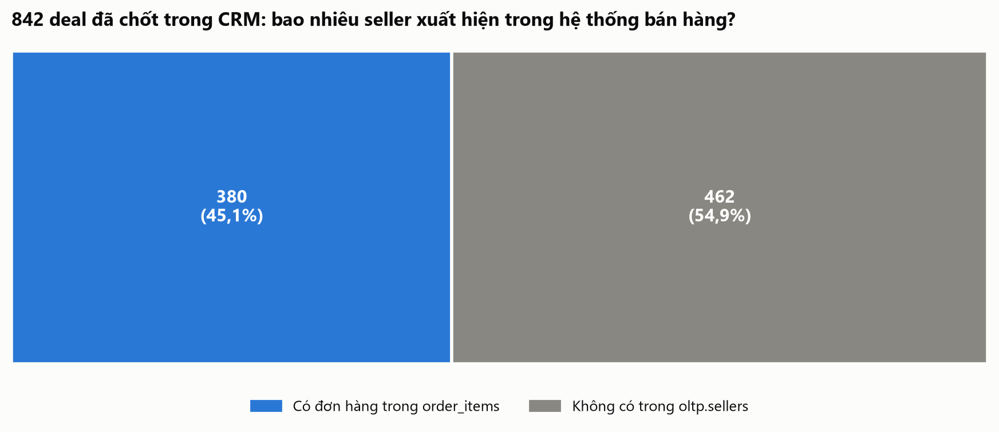
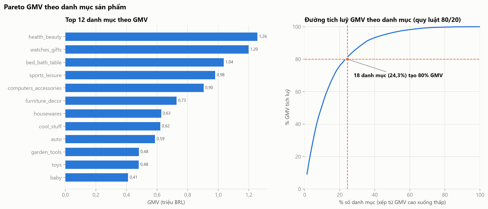
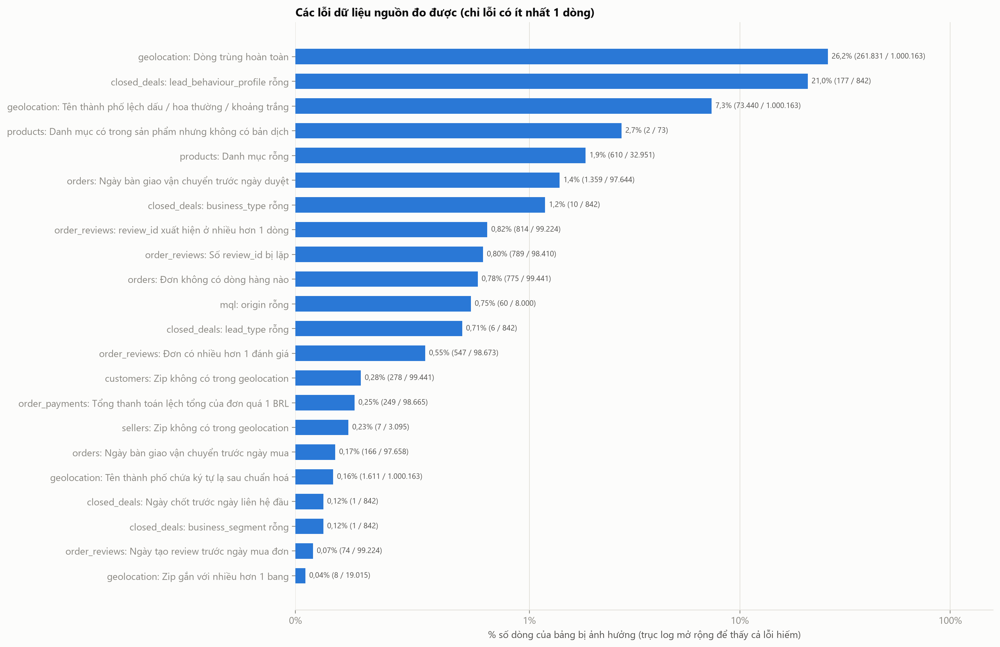
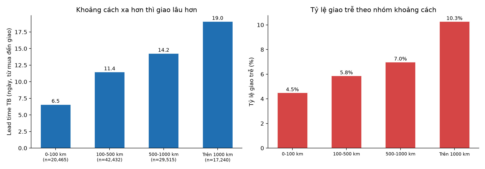
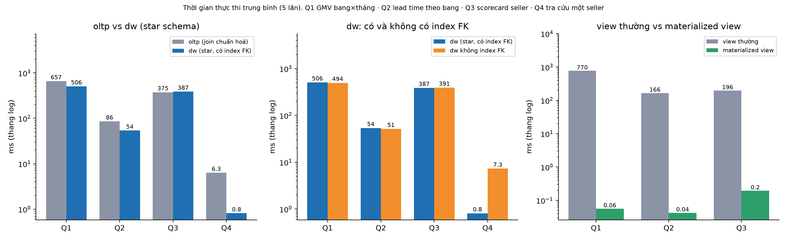

# Tổng quan dự án Olist – Kho dữ liệu & BI (cập nhật 05/11/2026, sau P7)

> 📘 **Bộ hướng dẫn cho cả nhóm: [`huong-dan/00-BAT-DAU-TU-DAY.md`](../huong-dan/00-BAT-DAU-TU-DAY.md)** – lộ trình đọc theo việc (dựng dashboard / viết báo cáo / làm slide), pipeline bằng lời, thuật ngữ, từ điển dữ liệu, 47 câu hỏi đáp, nghiệp vụ (nháp) và hướng dẫn từng dashboard DB1–DB4.
> 📝 **Báo cáo LaTeX (khung 88 trang PDF, đã biên dịch được): [`report/README.md`](../report/README.md)** · **Slide Beamer (theme HUST, 114 slide nội dung + 10 slide dự phòng, 133 trang PDF): [`slides/README.md`](../slides/README.md)** · dàn bài: [`slides/slide-script.md`](../slides/slide-script.md).

*Đây là trang tổng quan số liệu và phát hiện. Điểm vào của tài liệu là [`huong-dan/00-BAT-DAU-TU-DAY.md`](../huong-dan/00-BAT-DAU-TU-DAY.md) (bản đồ tài liệu và lộ trình đọc theo công việc). Mọi số liệu lấy từ truy vấn thật trên trạng thái cuối của kho; chi tiết và cách truy ngược nằm ở các file `handoff/2026-11-05-P0.md` … `P7-*.md`. Hình hiển thị ngay trong trang này khi mở trên GitHub.*

## 1. Dự án làm gì
Xây **kho dữ liệu** cho chủ đề **Quản lý đơn hàng** của Olist (sàn kết nối người bán nhỏ với các sàn TMĐT lớn ở Brazil), cộng quy trình **thu hút người bán (seller)** từ bộ Marketing Funnel. Kho trả lời: doanh thu bao nhiêu, đơn đi mất bao lâu ở từng chặng, giao trễ ảnh hưởng đánh giá ra sao, seller đến từ kênh marketing nào thì bán tốt.

**Trạng thái**: phần dữ liệu đã xong và chạy được từ đầu đến cuối bằng **một lệnh** (`python scripts/rebuild_all.py --drop`, khoảng 7 phút; lần dựng lại từ đầu cho kết quả giống hệt lần trước: 16/16 bảng dim/fact khớp số dòng, tổng tiền và checksum nội dung; 136/136 kiểm thử đạt, thêm 6/6 đối chiếu EDA). **Còn lại cho cả nhóm: dựng 4 dashboard Power BI, vẽ lại sơ đồ, viết báo cáo (> 100 trang) và slide (> 100 trang)**; báo cáo trước lớp tuần 12 (30/11–6/12/2026).

## 2. Các lớp của hệ thống

| Lớp | Nội dung | Số bảng | Số dòng (trạng thái cuối) |
| --- | --- | ---: | ---: |
| **Nguồn** `oltp` (bán hàng) + `crm` (marketing) | hai hệ thống nguồn mô phỏng từ 11 file CSV Kaggle (121,18 MB) | 9 + 2 | 1.550.922 + 8.842 = 1.559.764 |
| **Staging** `staging` | bản sao thô của nguồn, có mã lô nạp | 11 | 1.559.764 |
| **ODS** `ods` | dữ liệu đã làm sạch, có cờ chất lượng; dòng lỗi ghi `rejected_rows` (42 dòng toạ độ ngoài Brazil), không xoá dữ liệu âm thầm | 18 | 678.183 |
| **Kho** `dw` | 10 bảng chiều + 6 bảng fact (lược đồ hình sao / constellation) | 16 | 614.223 |
| **Data mart** `mart_*` | 4 mart, 17 view (4 là materialized view) cho dashboard | 17 view | xem mục 4 |
| **Giám sát** `etl_log` | nhật ký chạy, dòng bị loại, kết quả kiểm thử, chỉ số từng lô | 6 + 3 view | 2.546 |
| **Power BI** | 37 file CSV xuất từ kho (79,5 MB) → 4 dashboard | – | – |

Nạp dữ liệu: ban đầu đến 31/12/2017 (45.430 đơn), sau đó **11 đợt hằng tháng** (01/2018 → 11/2018) mô phỏng cập nhật; kết quả bằng đúng một lần nạp full. Sơ đồ kho theo data mart (fact màu cam, chiều màu xanh); chi tiết hơn: `figures/3-3-4_erd_dw.png`:

## 3. Bảng chiều và bảng fact (trạng thái cuối)
| Chiều | Grain | Số dòng | SCD |
| --- | --- | ---: | --- |
| dim_date | 1 ngày (2016-01-01 → 2020-12-31) | 1.828 | – |
| dim_geography | 1 mã bưu chính (zip) | 19.178 | 1 |
| dim_customer | 1 phiên bản địa chỉ của 1 khách thật | 96.339 | **2** (96.096 khách) |
| dim_seller | 1 seller (chiều dùng chung bán hàng và funnel) | 3.558 | 1 |
| dim_product | 1 sản phẩm (13 nhóm ngành hàng) | 32.952 | 1 |
| dim_order_status / dim_payment_type / dim_lead_origin | 1 giá trị | 9 / 6 / 11 | 1 |
| dim_lead_profile | 1 tổ hợp hồ sơ deal (junk dimension) | 503 | – |
| dim_sales_rep | 1 nhân viên-vai trò (SDR / SR) | 55 | – |

| Fact | Loại | Grain | Số dòng |
| --- | --- | --- | ---: |
| fact_order_item | Transaction | 1 dòng hàng của 1 đơn | 112.650 |
| fact_order_fulfillment | Accumulating snapshot | 1 đơn (5 mốc thời gian) | 99.441 |
| fact_payment | Transaction | 1 lần thanh toán | 103.886 |
| fact_review | Transaction | 1 review của 1 đơn | 99.224 |
| fact_lead_funnel | Accumulating snapshot | 1 khách tiềm năng (MQL) | 8.000 |
| fact_seller_monthly | Periodic snapshot (dày đặc) | 1 seller × 1 tháng | 36.583 |

(Số dòng chiều gồm dòng Unknown khoá −1. Tổng `price` ở fact khớp từng đồng với CSV nguồn: 13.591.643,70 BRL.)

## 4. Data mart
| Mart | View (số dòng) | Dùng cho |
| --- | --- | --- |
| mart_sales | v_sales_daily (614), v_sales_category_month (1.282), v_sales_state_month (558), v_category_pareto (74), v_geo_state (27), v_geo_zip (14.889) | DB1, DB3 |
| mart_fulfillment | v_fulfillment_order (99.441), v_fulfillment_state_month (565), v_status_funnel (125), v_shipping_distance (112.650) | DB2, DB3 |
| mart_cx | v_review_vs_delay (105), v_payment_mix_month (90), v_customer_rfm (94.983), v_customer_cohort (220) | DB2 |
| mart_acquisition | v_funnel_by_origin_month (113), v_seller_scorecard (3.095), v_seller_by_channel (7) | DB4 |

## 5. KPI tổng (toàn bộ dữ liệu; đối chiếu số trên Power BI với `powerbi/measures.md`)
| KPI | Giá trị | Ghi chú |
| --- | ---: | --- |
| **GMV** | **13,49 triệu BRL** (13.494.400,74) | Σ giá hàng của đơn **không** thuộc nhóm Failed (hủy / không khả dụng) |
| Tổng giá hàng `price` mọi đơn | 13,59 triệu BRL (13.591.643,70) | **khác GMV** vì gồm cả hàng của đơn Failed |
| Orders (đơn có doanh thu) / đơn đã đặt | 98.199 / 99.441 | |
| AOV | 137,42 BRL | GMV ÷ Orders |
| Phí vận chuyển / giá hàng | 16,6% | |
| Tỷ lệ giao đúng hạn / giao trễ | 93,2% / 6,8% | 96.470 đơn đã giao, 6.534 trễ |
| Tỷ lệ hủy (Failed) | 1,24% | 1.234 đơn |
| Lead time TB (mua → giao) | 12,6 ngày | |
| **Ngày hứa giao TB so với ngày giao thực tế** | hứa **24,4** ngày, thực tế **12,6** ngày → giao sớm hơn lời hứa **11,8 ngày** | 91,9% đơn giao sớm hơn dự kiến |
| Điểm review TB / % tiêu cực | 4,09 / 14,7% | 99.224 review |
| Khách quay lại mua (≥ 2 đơn) | 3,12% | 2.997 / 96.096 khách |
| MQL → seller (chốt deal) | 10,5% (842 / 8.000) | thời gian chốt TB 48,5 ngày |
| Seller chốt deal đã có đơn | 45,0% (379 / 842) | tức 4,74% số MQL trở thành seller có đơn bán được; TB 51,9 ngày từ chốt đến đơn đầu |

## 6. Bảy phát hiện chính
### 1) Giao trễ làm điểm đánh giá sụp
Đơn giao sớm có điểm review TB **4,29**; trễ 1–3 ngày còn **3,29**; trễ 4–7 ngày **2,11**; trễ hơn 7 ngày chỉ **1,70** (79,2% review tiêu cực, so với 9,2% ở đơn giao sớm).

### 2) Trễ giao hàng tập trung ở miền Bắc / Đông Bắc; ngày dự kiến quá rộng rãi
Toàn quốc chỉ 6,8% đơn trễ và 91,9% đơn giao sớm hơn dự kiến, nhưng lead time trung vị **20,2 ngày** ở vùng Norte so với **8,7 ngày** ở Sudeste (gấp 2,3 lần); bang AL trễ tới **21,4%** đơn.

### 3) Funnel marketing chỉ nối được với một phần bán hàng
Trong 842 thương vụ đã chốt chỉ **380 seller (45,1%)** có đơn ở mọi trạng thái (trong kho, `first_sale_date` chỉ tính đơn không thuộc nhóm Failed nên có **379 seller, 45,0%** có đơn bán được; số này dùng ở dashboard DB4); 462 seller (54,9%) chưa bán gì. 380 seller này tạo 674.005 BRL = **4,99%** GMV toàn sàn. Tỷ lệ chốt chung 10,5% (cao nhất `paid_search` 12,3%, thấp nhất `email` 3,0%).

### 4) Quy luật 80/20 rõ ở danh mục, seller thì phân tán
**18/74 danh mục (24,3%)** tạo 80% GMV (đứng đầu `health_beauty`, 9,3%). **540/3.053 seller (17,7%)** tạo 80% GMV nhưng 5 seller lớn nhất chỉ chiếm 7,7%.

### 5) Bảng toạ độ địa lý "bẩn" nhất
1 triệu dòng toạ độ nhưng chỉ 19.015 mã bưu chính: **93,5%** mã có nhiều toạ độ khác nhau, **26,2%** dòng trùng hoàn toàn, **7,3%** tên thành phố lệch dấu. Đo được **45 loại lỗi** dữ liệu; ODS xử lý hết, không xoá dữ liệu.

### 6) Seller càng xa khách thì phí vận chuyển, lead time và tỷ lệ trễ càng cao
Từ dưới 100 km lên trên 1.000 km: phí vận chuyển TB tăng **11,75 → 31,65 BRL** (24% → 43% giá hàng), lead time **6,5 → 19,0 ngày**, tỷ lệ trễ **4,5% → 10,3%**; tương quan Spearman khoảng cách ~ phí vận chuyển 0,63, ~ lead time 0,54. Khoảng cách TB 598 km; 36% dòng hàng có seller và khách cùng bang.

### 7) Materialized view nhanh hơn view thường hàng trăm đến hàng chục nghìn lần; star schema không phải lúc nào cũng nhanh hơn
Đọc mart tổng hợp sẵn mất dưới 1 ms so với 150–750 ms khi tính lại; chỉ mục khoá ngoại làm truy vấn chọn lọc một seller nhanh gấp ~9 lần; truy vấn quét toàn bộ trên dữ liệu còn nhỏ chỉ nhanh hơn 1,0–1,6 lần so với lược đồ chuẩn hoá.

Ngoài ra: dữ liệu đơn dùng được là **01/2017–08/2018** (99,6% số đơn; 2016 chỉ 329 đơn, 09–10/2018 chỉ 20 đơn) nên dashboard xu hướng lọc 2017-01 → 2018-08; vùng Sudeste chiếm 64,3% GMV năm 2017; mã bưu chính trong bản dữ liệu này không bị mất số 0 đầu như dự đoán ban đầu.

## 7. Quyết định thiết kế đã chốt
Đầy đủ (và nhật ký có ngày): `docs/DW_DESIGN.md`. Các dòng "chốt 05/11" có thể được nhóm xem lại trước mốc chốt thiết kế 12/11; mọi thay đổi phải sửa `DW_DESIGN.md` trước.

| Chủ đề | Quyết định | Lý do / hệ quả |
| --- | --- | --- |
| Phạm vi | Chủ đề Order Management + tích hợp Marketing Funnel (nối qua `seller_id`) | thêm nguồn thứ hai, quy trình thu hút seller, 6 fact thuộc cả 3 loại |
| Công nghệ | PostgreSQL 18 cài trực tiếp, không Docker, không SQL Server/SSAS | OLAP theo mô hình **ROLAP** (SQL + Power BI); khác MOLAP ở `olap-examples.md` |
| Địa lý | Không dùng PostGIS; khoảng cách bằng haversine SQL thuần | đủ cho bài toán; so sánh với PostGIS ở `P7-geo.md` |
| Khách | `dim_customer` dùng **SCD2** | chỉ 0,26% khách đổi zip, thêm 242 dòng; ví dụ SCD thật |
| Seller | `dim_seller` SCD1, chiều dùng chung; 462 deal chưa bán vẫn có dòng (địa chỉ Unknown) | hiển thị như một kết quả, không phải lỗi |
| Snapshot seller-tháng | **dày đặc** đến tháng cuối có đơn (36.583 dòng) | đo được seller ngừng bán |
| Ngành hàng | 13 nhóm (tách Pet; "Auto, Tools & Construction") | `seeds/category_group.csv` |
| Zip thiếu toạ độ | vẫn tạo dòng địa lý, lat/lng trống (167 zip khi đủ dữ liệu) | không mất đơn nào |
| Mốc nạp đầu | 2017-12-31, rồi 11 đợt hằng tháng | funnel "lấp đầy dần" để trình bày |
| Dòng lỗi | không xoá, không bỏ âm thầm: ghi `rejected_rows`, cờ `dq_flags`, khoảng thời gian âm → NULL + đếm | kiểm toán được |
| KPI | GMV không tính đơn Failed; `Orders` = đơn có doanh thu; thêm "ngày hứa giao" (`promised_days`) | AOV nhất quán; ngày dự kiến quá rộng nên cần so với thực tế |
| `dim_date` | 2016-01-01 → 2020-12-31 | có dòng hàng với hạn bàn giao năm 2020 |
| Kênh marketing | `unknown` là nhóm riêng, không gộp với `other` | `unknown` có tỷ lệ chốt cao nhất (16,7%) |
| Power BI | một file `.pbix` chung, nạp CSV (Import) qua tham số `DataFolder`; Publish to web | cả nhóm dựng dashboard; CSV chia sẻ qua Drive vì > 50 MB |

## 8. Danh sách hình (`figures/`)
| Hình | Nội dung | Mục báo cáo (sau P8) |
| --- | --- | --- |
| `3-2-4_erd_oltp.png` | ERD hai hệ thống nguồn (bản nháp tự động) | 2.5 |
| `3-2-1_bpmn_don_hang.png`, `3-2-2_bpmn_thu_hut_seller.png`, `3-2-3_business_model_canvas.png`, `3-2-5_cay_nghiep_vu.png`, `3-2-6_cay_yeu_cau_phan_tich.png`, `2-3_cay_phan_tich_DB1…DB4.png` | nghiệp vụ (BẢN NHÁP): BPMN, canvas, các cây | 3.1, 3.2.1–3.2.2, 3.3.5 |
| `3-3-1_*.png` (17 hình) | EDA: lỗi dữ liệu, tỷ lệ rỗng, phân bố, Pareto, đơn theo tháng, review, tương quan, trễ vs review, freight vs cân nặng, lead time theo vùng, trễ theo bang, funnel (5 hình) | 3.1 |
| `3-3-4_erd_dw.png`, `3-3-4_constellation.png` | ERD kho; constellation theo data mart (bản nháp tự động) | 3.5 |
| `3-4-1_pipeline.png` | pipeline / các lớp (bản nháp tự động) | 3.3 |
| `3-4-3_before_after_*.png` (6 hình) | mẫu dữ liệu trước/sau làm sạch (orders, products, sellers, geolocation, mql, closed_deals) | 3.3 |
| `3-5-1_benchmark.png` | thời gian truy vấn: oltp vs dw, index FK, view vs materialized view | 3.5 |
| `3-5-2_distance_vs_freight.png`, `3-5-2_distance_vs_leadtime.png` | khoảng cách seller → khách với phí vận chuyển, lead time, tỷ lệ trễ | 3.1 |

## 9. Chưa làm hoặc còn hạn chế (nói thẳng)
- **Chưa có dashboard Power BI nào.** `powerbi/model.md` (quan hệ, M, phân cấp, DB1–DB4) và `measures.md` (DAX) được viết cùng số kỳ vọng tính bằng SQL, nhưng **chưa ai chạy trên Power BI Desktop**; lúc dựng lần đầu có thể gặp lỗi cú pháp hoặc giao diện nhỏ, hãy ghi lại để sửa tài liệu.
- **Cơ chế thử lại dòng mồ côi** (dòng con đến trước dòng cha thì được nạp ở đợt sau) **mới chỉ được chứng minh bằng kịch bản test** (`python -m etl.test_orphan_retry`, chạy trong mỗi lần pipeline); trong 11 đợt thật không có dòng mồ côi nào xảy ra vì nguồn luôn nạp cha trước.
- Mô phỏng cập nhật chỉ **thêm** bản ghi mới với trạng thái cuối; không mô phỏng được đơn đổi trạng thái giữa chừng hay sửa/xoá bản ghi nguồn.
- Sơ đồ PNG trong `figures/` (ERD, constellation, pipeline) là **bản nháp tự động**, bố cục dây nối còn rối; cần vẽ lại bằng draw.io để đưa vào báo cáo.
- CSV cho Power BI **79,5 MB** (> 50 MB) nên không nằm trong git; **link Google Drive chưa có** (Phú tải thư mục lên rồi dán link vào `exports/README.md`).
- Dữ liệu: 2016 và 09–10/2018 rất thưa; chỉ 45,0% deal chốt có đơn bán được nên so sánh theo kênh có cỡ mẫu nhỏ (luôn ghi cỡ mẫu); toạ độ là trung vị theo zip (không phải địa chỉ thật) và khoảng cách haversine là đường chim bay.
- Hiệu năng: benchmark gọn (4 truy vấn, một laptop, một người dùng); không đo phân vùng bảng, cấu hình PostgreSQL, nhiều người dùng đồng thời.
- Kho điều phối bằng lệnh Python (không có lịch tự chạy hay Airflow); chưa có phân quyền theo người dùng ngoài mật khẩu trong `.env`.
- Các số liệu và hình EDA (mục 3.1) tính từ lần chạy EDA trước; sau lần dựng lại từ đầu chưa chạy lại `scripts/eda/run_all.py` (dữ liệu nguồn không đổi nên kết quả giống nhau).
- Nhóm chưa xem lại các quyết định "chốt 05/11" trước mốc chốt thiết kế 12/11; nếu đổi (ví dụ SCD2 → SCD1) phải sửa `DW_DESIGN.md` rồi chạy lại `rebuild_all.py`.

## 10. Mục báo cáo → file nguồn → hình dùng
Từ P8 (13/11), báo cáo và slide xếp theo **barem chấm điểm** (11 mục + mở rộng): Chương 1 tổng quan lý thuyết · 2 Khảo sát · 3 Phân tích và thiết kế · 4 Dashboard và BI · 5 Mở rộng · 6 Kết luận. Mỗi mục cấp 2 (x.y) là một file trong `report/chapters/`; mục không có file nguồn tự động (lý thuyết, kết luận) do nhóm tự viết. Hình giữ nguyên tên file cũ để nhóm vẽ lại đúng tên; hình mới đặt theo số mục mới.

| Mục báo cáo | File `.tex` (`report/chapters/`) | File handoff nguồn (đoạn nháp + số liệu) | Hình / file dùng |
| --- | --- | --- | --- |
| 1 Tổng quan lý thuyết DW và BI (rút gọn ~10 trang) | `01-tong-quan-ly-thuyet.tex` | khung ý chính trong file; giáo trình | – |
| 2.1 Quy trình nghiệp vụ, mô hình kinh doanh | `2-1-nghiep-vu.tex` | `huong-dan/05-nghiep-vu-nhap.md` (BPMN, Business Model Canvas, cây nghiệp vụ; **bản nháp cần sửa**) | `3-2-1_bpmn_don_hang.png`, `3-2-2_bpmn_thu_hut_seller.png`, `3-2-3_business_model_canvas.png`, `3-2-5_cay_nghiep_vu.png` |
| 2.2 Yêu cầu phân tích | `2-2-yeu-cau.tex` | `huong-dan/05-nghiep-vu-nhap.md` mục 5 | `3-2-6_cay_yeu_cau_phan_tich.png` |
| 2.3 KPI và cây phân tích | `2-3-kpi.tex` | `powerbi/measures.md`, `huong-dan/dashboards/DB1.md … DB4.md` | `2-3_cay_phan_tich_DB1…DB4.png` |
| 2.4 Dữ liệu nguồn (quy mô, tần suất, taxonomy, data flow) | `2-4-du-lieu-nguon.tex` | `2026-11-05-P0.md`, `stats.md` | xem `2026-11-14-P8.md` |
| 2.5 ERD OLTP và mapping | `2-5-erd-oltp.tex` | `2026-11-05-P0.md`, `P4.md`; `docs/mapping_oltp_olap.md`, `docs/mapping.csv` | `3-2-4_erd_oltp.png` |
| 3.1 Khám phá dữ liệu (EDA, gồm khoảng cách địa lý) | `3-1-kham-pha.tex` | `2026-11-05-P1.md`, `profiling.md`, `data-quality.md`, `distributions.md`, `correlations.md`, `funnel.md`, `design-questions.md`; `2026-11-05-P7-geo.md`, `geo-distance.md` | `3-3-1_*.png`, `3-5-2_distance_vs_freight.png`, `3-5-2_distance_vs_leadtime.png`, `exports/eda_sample.xlsx` |
| 3.2 Kiến trúc kho dữ liệu | `3-2-kien-truc.tex` | `huong-dan/01-pipeline-bang-loi.md`, `docs/DW_DESIGN.md` mục 3 | `docs/diagrams/kien-truc-cac-lop.drawio`, `docs/diagrams/pipeline-etl.drawio`, `3-4-1_pipeline.png` |
| 3.3 ETL (ODS, môi trường, làm sạch, đối soát, nạp tăng dần) | `3-3-etl.tex` | `2026-11-05-P2.md`, `P5.md`, `before-after-samples.md`, `rebuild-report.md` | `3-4-3_before_after_*.png` (6 hình), bảng các đợt |
| 3.4 Hệ thống chiều khái niệm (dimension) | `3-4-chieu-khai-niem.tex` | `2026-11-05-P3.md`, `stats.md` | `3-3-4_erd_dw.png`; sơ đồ phân cấp (vẽ) |
| 3.5 Data model OLAP (fact, mô hình vật lý, mart, OLAP, hiệu năng) | `3-5-data-model.tex` | `2026-11-05-P4.md`, `P6.md`, `P7-perf.md`; `docs/DW_DESIGN.md` mục 4, 7; `olap-examples.md`, `benchmark.md` | `3-3-4_erd_dw.png`, `3-3-4_constellation.png`, `3-5-1_benchmark.png` |
| 4 Dashboard và bài học | `4-dashboard.tex` | `huong-dan/dashboards/DB1.md … DB4.md`, `powerbi/model.md`, `powerbi/measures.md` | ảnh dashboard `4_DBx_<mô-tả>.png` (khi dựng xong) |
| 5.1 Mở rộng: Data lakehouse (khung, P10 điền) | `5-1-lakehouse.tex` | – | – |
| 5.2 Mở rộng: Thu thập dữ liệu từ API (khung, P9 điền) | `5-2-thu-thap-api.tex` | – | – |
| 6 Kết luận và bài học kinh nghiệm | `06-ket-luan.tex` | – | – |

Slide (`slides/sections/`): `00-mo-dau` · `01-khao-sat` (2.1–2.5) · `02-phan-tich-thiet-ke` (3.1–3.5) · `03-dashboard` (4) · `04-mo-rong` (5) · `05-tong-ket` (6) · `99-du-phong`; mỗi slide hiện nhãn mục barem ở góc trên bên phải. Mỗi file phase có mục "Gợi ý slide (2–4 slide)"; ghép theo thứ tự bảng trên.

## 11. Việc cho nhóm (chưa gán người)
1. **Phú dựng DB1 (Tổng quan và doanh thu) và file `.pbix` gốc trước**, làm theo `powerbi/model.md` từ mục 1: cài Power BI Desktop → tải CSV từ Drive → tạo tham số `DataFolder` và hàm `fnCsv` → nạp bảng → tạo quan hệ → tạo measure từ `powerbi/measures.md` → **đối chiếu với bảng "giá trị kỳ vọng" ở cuối `measures.md`** (ví dụ GMV toàn bộ phải ra 13.494.400,74). Ghi lại mọi chỗ tài liệu hướng dẫn chưa đúng hoặc khó hiểu và báo Phú để sửa.
2. **Sau khi DB1 khớp số**, bốn thành viên chia nhau dựng **DB1–DB4** (mỗi người một dashboard; Phú tổng hợp vào file `.pbix` gốc; bảng visual gợi ý ở mục 8 của `model.md`; lọc 2017-01 → 2018-08). Giám sát ETL không còn là dashboard: số liệu ở mục 3.3 của báo cáo. Xong thì **Publish to web** (mục 9 của `model.md`).
3. **Vẽ lại sơ đồ bằng draw.io** từ bản nháp: ERD nguồn (gạch chân cột dùng sang OLAP), hệ thống chiều và phân cấp, data model logic / vật lý (fact màu cam, chiều màu xanh, nhóm theo mart), pipeline có logo công nghệ (PostgreSQL, Python, Power BI, GitHub); xuất PNG 200 dpi vào `figures/`.
4. **Viết báo cáo và slide** theo bảng ở mục 10 (đoạn nháp tiếng Việt có sẵn ở mỗi file phase); kiểm tra ngẫu nhiên số liệu trong handoff (so với `stats.md` hoặc truy vấn lại).
5. **Họp 12/11**: xem lại các quyết định đã chốt (mục 7) và `design-questions.md`.
6. Tải thư mục `exports/powerbi/` lên Google Drive và dán link vào `exports/README.md`; khi cần chạy lại toàn bộ: `python scripts/rebuild_all.py --drop`.

## 12. Danh mục file
| File | Nội dung |
| --- | --- |
| `00-TONG-QUAN.md` | trang này (hướng dẫn chi tiết cho từng việc: `huong-dan/`) |
| `2026-11-05-P0.md` … `P6.md` | từng phase: đã làm, số liệu, việc cho nhóm, đoạn nháp, gợi ý slide |
| `2026-11-05-P7-perf.md`, `P7-geo.md` | hiệu năng; cơ sở dữ liệu địa lý |
| `stats.md` | số dòng mọi bảng, các chiều (phân cấp, dòng mẫu), các fact |
| `olap-examples.md` | 17 truy vấn OLAP (roll-up, drill-down, slice, dice, pivot) + ROLAP vs MOLAP |
| `benchmark.md`, `geo-distance.md`, `rebuild-report.md` | bảng số đo hiệu năng; khoảng cách địa lý; kiểm chứng dựng lại từ đầu |
| `profiling.md`, `data-quality.md`, `distributions.md`, `correlations.md`, `funnel.md`, `design-questions.md`, `excel-toolpak-guide.md`, `before-after-samples.md` | số liệu EDA và làm sạch (sinh tự động) |

Ngoài `handoff/`: `powerbi/` (model.md, measures.md, theme.json), `exports/` (CSV Power BI, `README.md` link Drive), `docs/` (đặc tả, sơ đồ `.mmd`, mapping), `README.md` (cách chạy một lệnh, cấu trúc thư mục).
