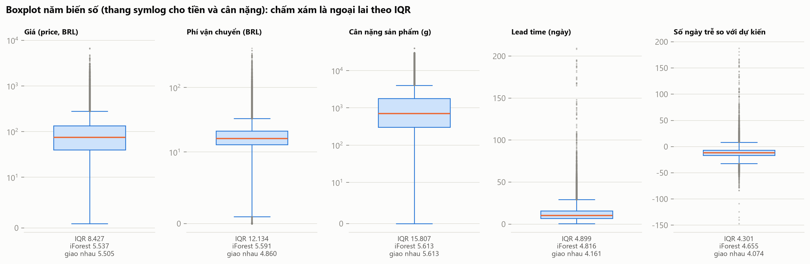
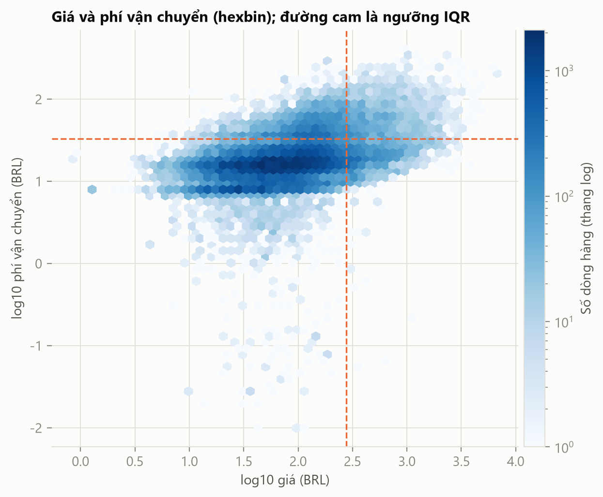
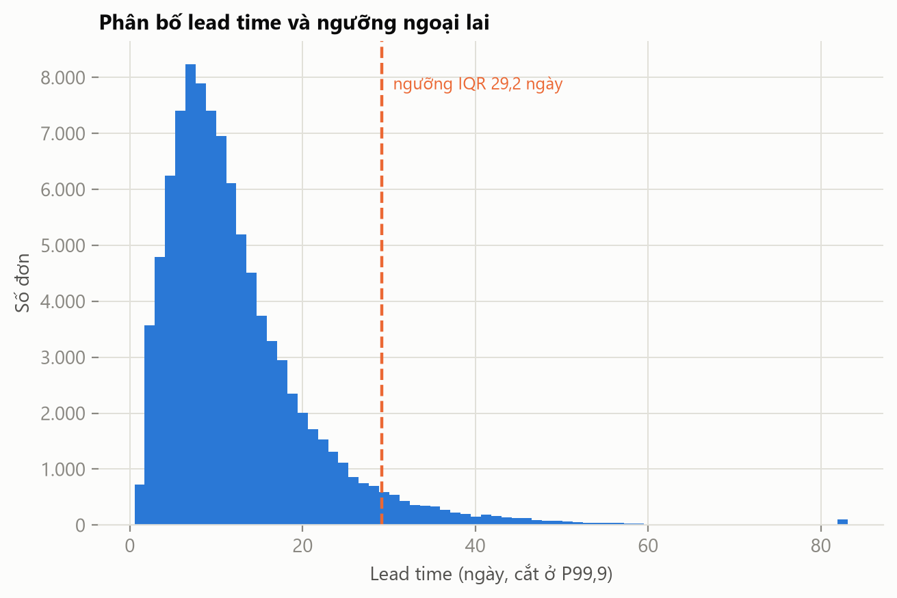
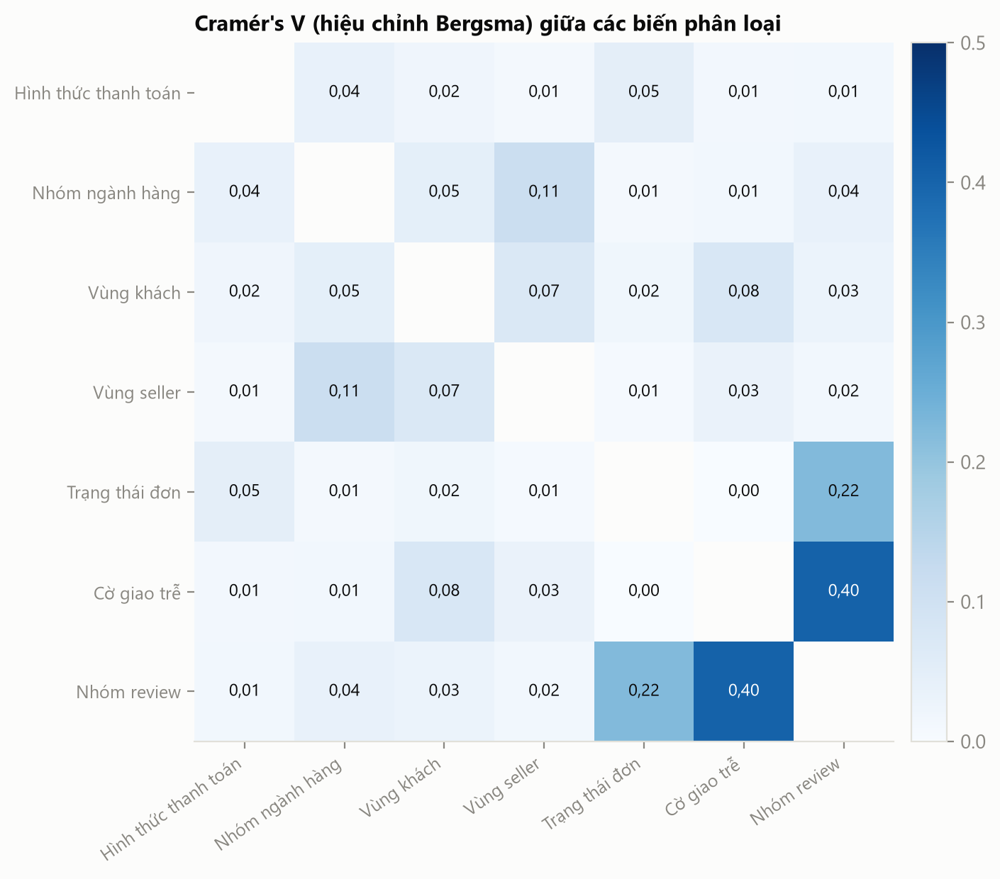
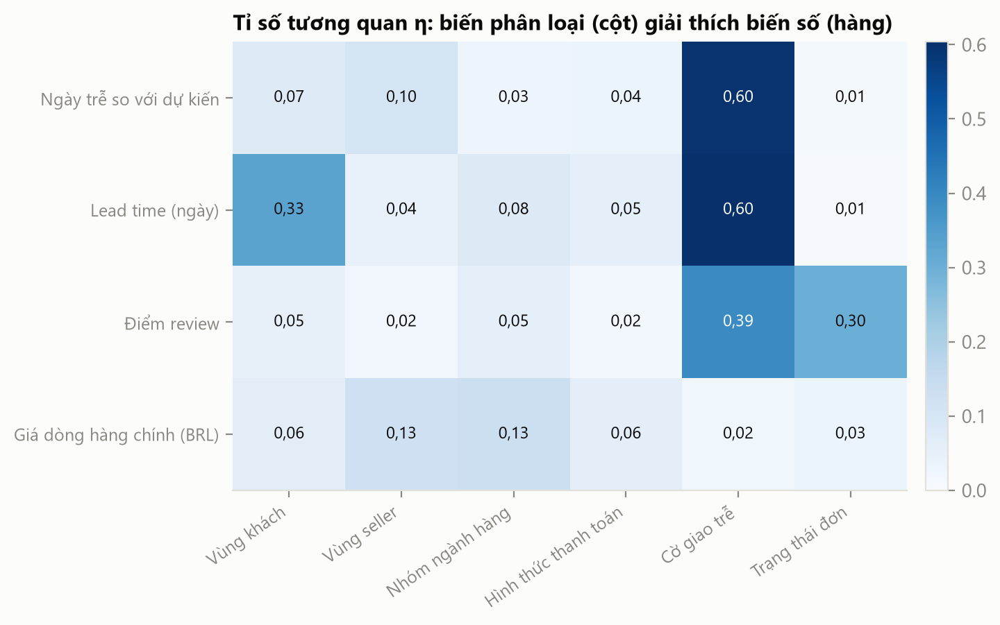
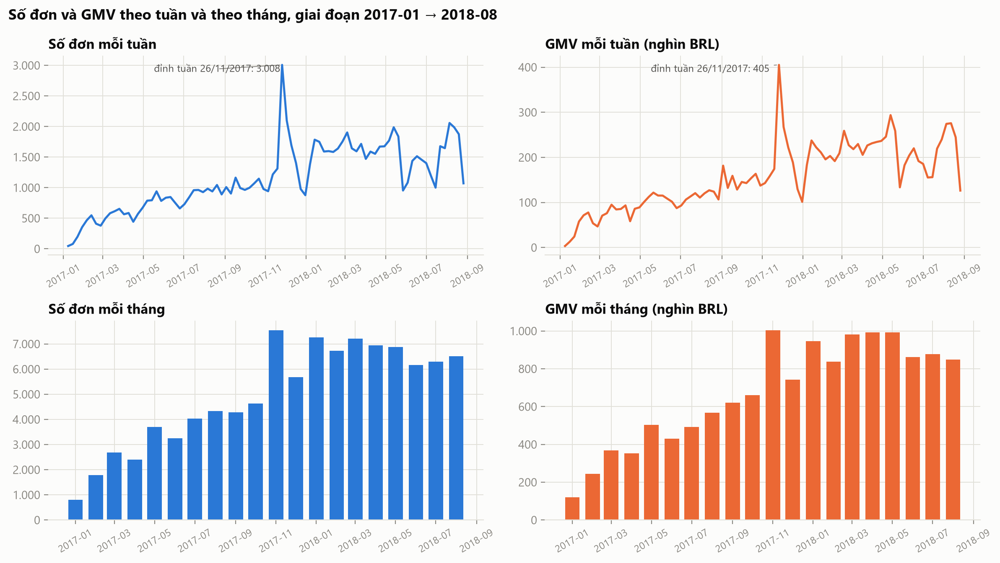
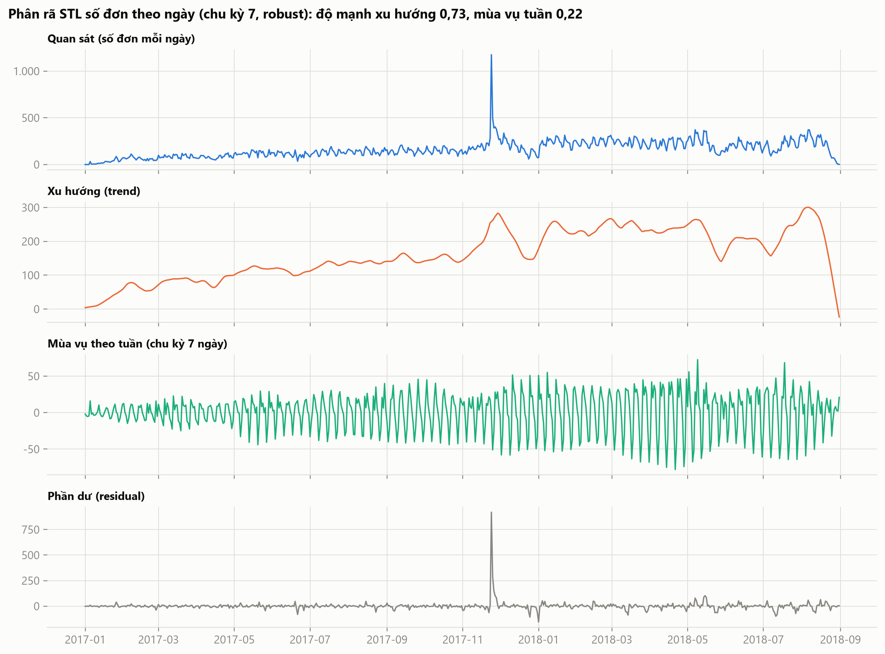
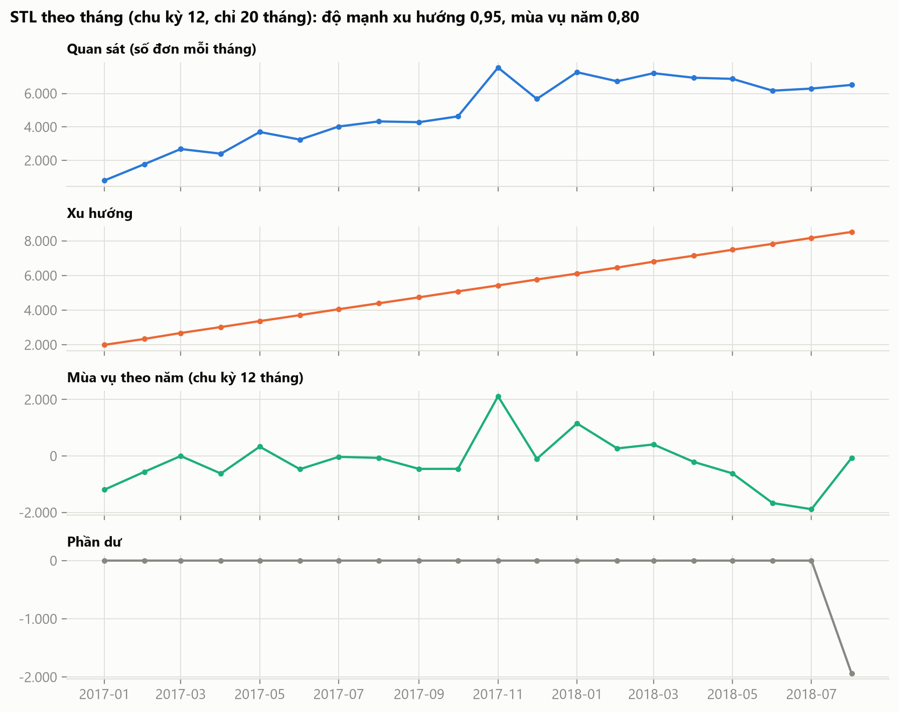
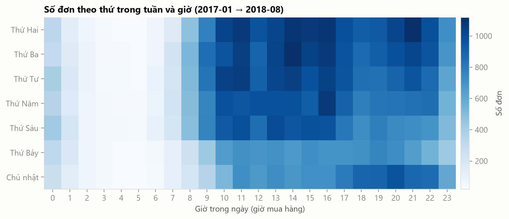
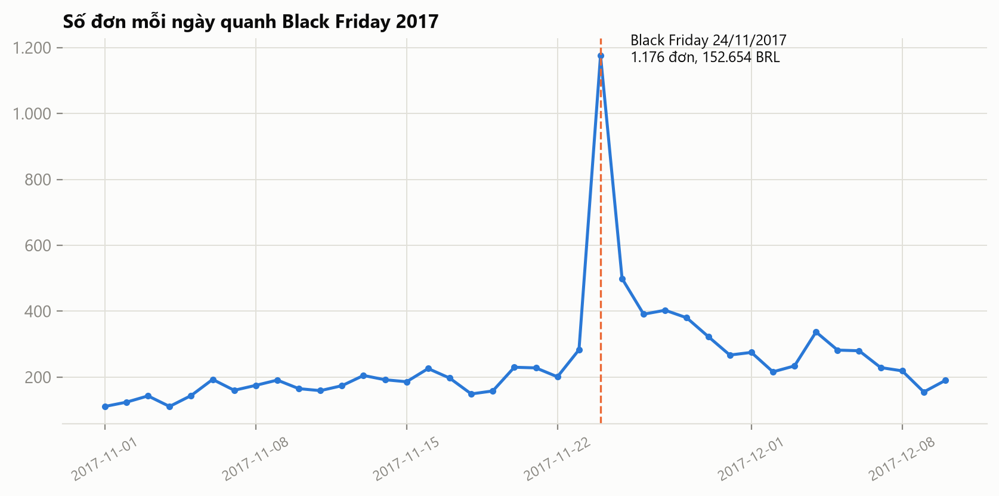

# P8-D – Khám phá dữ liệu bổ sung (14/11/2026)

*Sinh tự động bởi các script `scripts/eda/p8_*.py` trên database `olist_full`; mỗi mục do một script ghi, chạy lại script để cập nhật. Mọi số liệu lấy từ truy vấn thật.*

<!-- sec:outliers -->
## D1. Ngoại lai (IQR và Isolation Forest)

Hai phương pháp: **IQR** (ngoại lai nếu ngoài [Q1 − 1,5·IQR, Q3 + 1,5·IQR]) và **Isolation Forest** (scikit-learn, `n_estimators = 200`, **`contamination = 0,05`**, **`random_state = 42`**; mô hình một chiều cho từng biến). Giá, phí vận chuyển và cân nặng tính trên 112.650 dòng hàng; lead time và số ngày trễ tính trên 96.476 đơn đã giao.

| Biến | n | Ngưỡng dưới | Ngưỡng trên | IQR | iForest | Giao nhau | Chỉ IQR | Chỉ iForest |
| --- | ---: | --- | --- | ---: | ---: | ---: | ---: | ---: |
| Giá (price, BRL) | 112.650 | -102,60 | 277,40 | 8.427 | 5.537 | 5.505 | 2.922 | 32 |
| Phí vận chuyển (BRL) | 112.650 | 0,98 | 33,25 | 12.134 | 5.591 | 4.860 | 7.274 | 731 |
| Cân nặng sản phẩm (g) | 112.632 | -1.950,00 | 4.050,00 | 15.807 | 5.613 | 5.613 | 10.194 | 0 |
| Lead time (ngày) | 96.476 | -6,66 | 29,15 | 4.899 | 4.816 | 4.161 | 738 | 655 |
| Số ngày trễ so với dự kiến | 96.476 | -32,00 | 8,00 | 4.301 | 4.655 | 4.074 | 227 | 581 |

Tổng ngoại lai theo từng biến (cộng các biến, có thể trùng dòng): IQR 45.568, iForest 26.212, giao nhau 24.213.

### Ví dụ dòng ngoại lai (cả hai phương pháp cùng đánh dấu)

| Biến | order_id | price | freight | weight_g | danh mục | bang khách |
| --- | --- | --- | --- | --- | --- | --- |
| Giá (price, BRL) | 0812eb90… | 6.735,00 | 194,31 | 30.000 | utilidades_domesticas | MS |
| Giá (price, BRL) | fefacc66… | 6.729,00 | 193,21 | 5.660 | pcs | ES |
| Giá (price, BRL) | f5136e38… | 6.499,00 | 227,66 | 7.400 | artes | SP |
| Phí vận chuyển (BRL) | a77e1550… | 979,00 | 409,68 | 14.675 | bebes | PI |
| Phí vận chuyển (BRL) | 076d1555… | 2.338,08 | 375,28 | 30.000 | utilidades_domesticas | PR |
| Phí vận chuyển (BRL) | 3fde74c2… | 2.338,08 | 375,28 | 30.000 | utilidades_domesticas | SC |
| Cân nặng sản phẩm (g) | 6ecf1a40… | 80,00 | 12,06 | 40.425 | cama_mesa_banho | SP |
| Cân nặng sản phẩm (g) | 4a45f9f6… | 80,00 | 16,32 | 40.425 | cama_mesa_banho | SC |
| Cân nặng sản phẩm (g) | 9223919b… | 80,00 | 16,32 | 40.425 | cama_mesa_banho | PR |
| Lead time (ngày) | ca075935… | 229,90 | – | – | automotivo | ES |
| Lead time (ngày) | 1b3190b2… | 144,99 | – | – | cool_stuff | RJ |
| Lead time (ngày) | 440d0d17… | 159,90 | – | – | consoles_games | PA |
| Số ngày trễ so với dự kiến | 1b3190b2… | 144,99 | – | – | cool_stuff | RJ |
| Số ngày trễ so với dự kiến | ca075935… | 229,90 | – | – | automotivo | ES |
| Số ngày trễ so với dự kiến | 47b40429… | 399,00 | – | – | casa_construcao | SP |

### Giữ hay loại?

- 12.134 dòng có phí vận chuyển ngoại lai: cân nặng trung vị 5.700 g, so với trung vị toàn bộ 700 g; phần lớn là hàng nặng hoặc giao xa.
- Giá ngoại lai tập trung ở các danh mục beleza_saude (1.157 dòng), relogios_presentes (975 dòng), esporte_lazer (485 dòng); giá lớn nhất 6.735,00 BRL, nhỏ nhất 0,85 BRL (không có giá bằng 0 hoặc âm).
- Có 8 dòng hàng có cân nặng bằng 0 g (vô lý về vật lý, đây là lỗi dữ liệu nguồn chứ không phải ngoại lai thống kê); cân nặng lớn nhất 40.425 g.
- 4.899 đơn có lead time ngoại lai (trên 29,2 ngày), lớn nhất 210 ngày; các đơn này phần lớn trễ so với ngày dự kiến (76,9% đơn trễ), tức là chậm thật chứ không phải nhập sai.
- Không có lead time âm trong tập đơn đã giao (0 đơn); ngày trễ âm lớn (giao sớm hơn dự kiến) chiếm phần lớn ngoại lai của biến trễ vì ngày dự kiến rất rộng rãi.

**Kết luận:** giữ toàn bộ ngoại lai về giá, phí vận chuyển, lead time và số ngày trễ, vì đó là ngoại lai hợp lệ (hàng đắt, hàng nặng, giao xa, giao chậm thật) và chính là đối tượng phân tích (giao trễ, phí vận chuyển cao); loại chúng sẽ làm sai GMV và che mất vấn đề giao hàng. Riêng các dòng có cân nặng bằng 0 g là lỗi dữ liệu nguồn: không loại dòng hàng (vẫn có doanh thu), chỉ không dùng cân nặng của chúng khi phân tích phí theo cân nặng. Để giảm ảnh hưởng của ngoại lai lên thống kê mô tả, báo cáo dùng trung vị thay cho trung bình.

### Hình

- Giá, phí vận chuyển và cân nặng có đuôi phải rất dài (hộp hẹp, nhiều chấm ngoại lai) nên phải vẽ bằng thang symlog; ở ba biến này IQR đánh dấu nhiều hơn iForest (8.427 so với 5.537 ở giá; 12.134 so với 5.591 ở phí; 15.807 so với 5.613 ở cân nặng), còn ở lead time và số ngày trễ hai phương pháp gần nhau (4.899 so với 4.816; 4.301 so với 4.655).

- Tương quan Spearman giữa giá và phí vận chuyển là 0,43 (mức vừa); phần lớn dòng hàng nằm ở vùng giá và phí thấp. 2.995 dòng vượt cả hai ngưỡng IQR, bằng 35,5% số dòng có giá ngoại lai: ngoại lai về giá và về phí phần lớn là hai nhóm khác nhau.

- Lead time có trung vị 10,2 ngày, P95 29,3 ngày và đuôi phải kéo dài đến 210 ngày; ngưỡng IQR là 29,2 ngày, tức 5,1% số đơn đã giao.
<!-- /sec:outliers -->

<!-- sec:association -->
## D2. Tương quan giữa biến rời rạc (Cramér's V và tỉ số tương quan η)

### Công thức

Với bảng chéo $r \times k$ của hai biến phân loại, $n$ quan sát, thống kê $\chi^2$ (không hiệu chỉnh liên tục), $\varphi^2 = \chi^2 / n$:

$$V = \sqrt{\frac{\varphi^2}{\min(r-1,\; k-1)}} \qquad \text{(Cramér)}$$

Hiệu chỉnh Bergsma (bỏ độ chệch dương của $V$ khi bảng lớn hoặc $n$ nhỏ):

$$\tilde\varphi^2 = \max\!\Bigl(0,\; \varphi^2 - \frac{(k-1)(r-1)}{n-1}\Bigr),\quad \tilde r = r - \frac{(r-1)^2}{n-1},\quad \tilde k = k - \frac{(k-1)^2}{n-1},\quad \tilde V = \sqrt{\frac{\tilde\varphi^2}{\min(\tilde k-1,\; \tilde r-1)}}$$

Tỉ số tương quan giữa biến phân loại $c$ (nhóm $g$ có $n_g$ quan sát, trung bình $\bar x_g$) và biến số $x$ (trung bình chung $\bar x$):

$$\eta = \sqrt{\frac{\sum_g n_g(\bar x_g - \bar x)^2}{\sum_i (x_i - \bar x)^2}} \in [0,1], \qquad \eta^2 = \text{tỉ lệ phương sai của } x \text{ do nhóm giải thích}$$

**Thang đọc** (quy ước, giống thang của hệ số tương quan): < 0,1 không đáng kể; 0,1–0,3 yếu; 0,3–0,5 vừa; > 0,5 mạnh. Cả hai hệ số đều không có dấu (chỉ cho biết có liên hệ, không cho biết chiều).

### Dùng hệ số nào khi nào

| Cặp biến | Hệ số | Giả định / ghi chú |
| --- | --- | --- |
| số – số, quan hệ tuyến tính, ít ngoại lai | Pearson | nhạy với ngoại lai; dữ liệu này lệch phải mạnh nên ít dùng |
| số – số (hoặc thứ bậc), quan hệ đơn điệu | Spearman | dựa trên hạng nên bền với ngoại lai; dùng trong ma trận tương quan của P1 |
| phân loại – phân loại | Cramér's V (hiệu chỉnh Bergsma) | từ 0 đến 1, không có dấu; hiệu chỉnh để không phóng đại khi bảng chéo nhiều ô |
| phân loại – số | tỉ số tương quan η | từ 0 đến 1; η² là tỉ lệ phương sai giải thích; không có dấu |

### Cramér's V giữa bảy biến phân loại (hình)

| Cặp biến | V hiệu chỉnh | V gốc | n | Mức |
| --- | ---: | ---: | ---: | --- |
| Cờ giao trễ – Nhóm review | 0,403 | 0,403 | 95.830 | vừa |
| Trạng thái đơn – Nhóm review | 0,221 | 0,221 | 98.673 | yếu |
| Nhóm ngành hàng – Vùng seller | 0,112 | 0,113 | 98.666 | yếu |
| Vùng khách – Cờ giao trễ | 0,077 | 0,077 | 96.476 | không đáng kể |
| Vùng khách – Vùng seller | 0,072 | 0,073 | 98.666 | không đáng kể |
| Hình thức thanh toán – Trạng thái đơn | 0,048 | 0,049 | 99.440 | không đáng kể |
| Nhóm ngành hàng – Vùng khách | 0,046 | 0,047 | 98.666 | không đáng kể |
| Nhóm ngành hàng – Nhóm review | 0,036 | 0,038 | 97.917 | không đáng kể |
| Hình thức thanh toán – Nhóm ngành hàng | 0,036 | 0,037 | 98.665 | không đáng kể |
| Vùng seller – Cờ giao trễ | 0,032 | 0,032 | 96.476 | không đáng kể |

- Cặp liên hệ mạnh nhất là **Cờ giao trễ – Nhóm review** với V = 0,403 (mức vừa). Đơn trễ có xác suất bị review tiêu cực cao hơn rõ rệt, khớp với điểm review giảm từ 4,29 xuống 1,70 ở P1.
- Trạng thái đơn và nhóm review có V = 0,221 (mức yếu): tỷ lệ review tiêu cực là 12,8% ở đơn đã giao so với 76,7% ở đơn hủy và 69,4% ở đơn đang vận chuyển.
- Vùng khách và vùng seller có V = 0,072 (mức không đáng kể); hình thức thanh toán và trạng thái đơn có V = 0,048 (mức không đáng kể). Hầu hết cặp còn lại có liên hệ yếu hoặc không đáng kể, nên các biến này gần như độc lập và có thể dùng làm chiều phân tích riêng rẽ.

### Tỉ số tương quan η (hình)

| Biến số | Biến phân loại | η | η² | Mức |
| --- | --- | ---: | ---: | --- |
| Lead time (ngày) | Cờ giao trễ | 0,604 | 0,365 | mạnh |
| Điểm review | Cờ giao trễ | 0,392 | 0,154 | vừa |
| Lead time (ngày) | Vùng khách | 0,331 | 0,109 | vừa |
| Điểm review | Trạng thái đơn | 0,301 | 0,091 | vừa |
| Giá dòng hàng chính (BRL) | Nhóm ngành hàng | 0,130 | 0,017 | yếu |
| Giá dòng hàng chính (BRL) | Vùng seller | 0,125 | 0,016 | yếu |
| Ngày trễ so với dự kiến | Vùng seller | 0,104 | 0,011 | yếu |
| Lead time (ngày) | Nhóm ngành hàng | 0,078 | 0,006 | không đáng kể |

Toàn bộ ma trận η (hàng: biến số, cột: biến phân loại):

| Biến số | Vùng khách | Vùng seller | Nhóm ngành hàng | Hình thức thanh toán | Cờ giao trễ | Trạng thái đơn |
| --- | --- | --- | --- | --- | --- | --- |
| Ngày trễ so với dự kiến | 0,075 | 0,104 | 0,030 | 0,037 | 0,595 | 0,012 |
| Lead time (ngày) | 0,331 | 0,044 | 0,078 | 0,053 | 0,604 | 0,006 |
| Điểm review | 0,049 | 0,020 | 0,054 | 0,018 | 0,392 | 0,301 |
| Giá dòng hàng chính (BRL) | 0,062 | 0,125 | 0,130 | 0,059 | 0,023 | 0,031 |

- Điểm review theo cờ giao trễ: η = 0,392 (η² = 0,154), tức khoảng 15,4% phương sai điểm review gắn với việc đơn giao trễ hay không.
- Cặp (ngày trễ, cờ giao trễ) bị bỏ khỏi bảng xếp hạng vì cờ trễ được định nghĩa từ chính ngày trễ (η = 0,595 là hiển nhiên). Lead time theo cờ trễ (0,604) cũng cao vì đơn trễ có lead time dài.
- Ngày trễ theo vùng khách: η = 0,075; điểm review theo nhóm ngành: η = 0,054 (nhóm ngành giải thích điểm review ít hơn nhiều so với việc giao trễ).

### Đối chiếu với Spearman đã có (P1)

- Spearman(ngày trễ, điểm review) = -0,176 và Spearman(lead time, điểm review) = -0,235 (đơn đã giao): cùng hướng kết luận với η và V ở trên, tức giao chậm làm điểm review giảm. Spearman chỉ −0,18 trong khi η theo cờ trễ là 0,392: ảnh hưởng của giao trễ lên review mang tính ngưỡng (đơn trễ mới tụt điểm mạnh) hơn là tuyến tính theo số ngày.
- Spearman chỉ áp dụng cho hai biến số hoặc thứ bậc; V và η mở rộng việc đo liên hệ sang biến phân loại (vùng, ngành hàng, hình thức thanh toán, trạng thái) mà Spearman không đo được.
<!-- /sec:association -->

<!-- sec:seasonality -->
## D3. Khuynh hướng và mùa vụ

Phạm vi: **2017-01-01 → 2018-08-31** (608 ngày), đoạn có đủ dữ liệu (2016 chỉ 329 đơn, tháng 2018-09 và 2018-10 chỉ 20 đơn). GMV = tổng giá hàng của đơn không thuộc nhóm Failed. Nguồn: `olist_full`.

### Công thức độ mạnh (Hyndman)

Phân rã STL: $y_t = T_t + S_t + R_t$ (xu hướng, mùa vụ, phần dư). Độ mạnh:

$$F_T = \max\Bigl(0,\; 1 - \frac{\operatorname{Var}(R_t)}{\operatorname{Var}(T_t + R_t)}\Bigr), \qquad F_S = \max\Bigl(0,\; 1 - \frac{\operatorname{Var}(R_t)}{\operatorname{Var}(S_t + R_t)}\Bigr)$$

Giá trị gần 1 nghĩa là thành phần đó chi phối chuỗi, gần 0 nghĩa là gần như không có. STL chạy với `robust=True` để đỉnh Black Friday không làm lệch xu hướng và mùa vụ.

### Kết quả STL

| Chuỗi | Số điểm | Độ mạnh xu hướng | Độ mạnh mùa vụ |
| --- | ---: | ---: | ---: |
| Số đơn theo ngày (chu kỳ 7 ngày) | 608 | 0,734 | 0,223 |
| GMV theo ngày (chu kỳ 7 ngày) | 608 | 0,739 | 0,258 |
| Số đơn theo tháng (chu kỳ 12 tháng) | 20 | 0,948 | 0,800 |
| GMV theo tháng (chu kỳ 12 tháng) | 20 | 0,940 | 0,734 |

- **Xu hướng**: số đơn theo ngày có độ mạnh xu hướng 0,734, theo tháng 0,948; xu hướng tăng rõ từ 2017-01 và đi ngang từ khoảng 2018-01.
- **Mùa vụ tuần** (chu kỳ 7 ngày): độ mạnh 0,223; số đơn nhiều nhất vào Thứ Hai và ít nhất vào Thứ Bảy; chênh giữa ngày cao nhất và thấp nhất của thành phần mùa vụ là 63,3 đơn.
- **Mùa vụ năm** (chu kỳ 12 tháng): độ mạnh 0,800 trên chỉ 20 tháng. **Giới hạn**: dữ liệu dưới 2 năm, mỗi tháng trong năm chỉ xuất hiện một hoặc hai lần nên STL không tách được mùa vụ theo năm khỏi xu hướng tăng; con số này không đủ cơ sở để kết luận có mùa vụ theo năm.

- Đơn và GMV tăng gần như liên tục từ 2017-01, đạt đỉnh tuần ở Black Friday (tuần chứa 24/11/2017) rồi giữ mặt bằng mới cao hơn trước đó; tháng 11/2017 có GMV cao hơn tháng 10/2017 52,1%.

- Thành phần xu hướng tách được bước nhảy sau Black Friday; phần dư lớn nhất tập trung quanh 24/11/2017.

- Giờ cao điểm là 16h; chỉ 4,8% số đơn được đặt từ 0h đến 5h sáng. Thứ Hai có nhiều đơn nhất, Thứ Bảy ít nhất.

- Black Friday 24/11/2017 có 1.176 đơn, gấp 6,6 lần trung bình 23 ngày đầu tháng 11 (178 đơn/ngày); sau đó số đơn trung bình 292 đơn/ngày (25/11–10/12). GMV ngày này là 152.653,74 BRL.
<!-- /sec:seasonality -->

<!-- sec:describe -->
## D4. Thống kê đặc trưng

Thống kê trên **toàn bộ dữ liệu nguồn** (`olist_full`); độ lệch chuẩn là độ lệch mẫu (n − 1), skewness và kurtosis theo định nghĩa Excel (kurtosis là kurtosis dư, bằng 0 với phân phối chuẩn).

| Biến | n | Mean | Median | Std | Skew | Kurtosis | Min | Max |
| --- | ---: | ---: | ---: | ---: | ---: | ---: | ---: | ---: |
| Giá dòng hàng (price, BRL) | 112.650 | 120,65 | 74,99 | 183,63 | 7,92 | 120,83 | 0,85 | 6.735,00 |
| Phí vận chuyển (freight_value, BRL) | 112.650 | 19,99 | 16,26 | 15,81 | 5,64 | 59,79 | 0,00 | 409,68 |
| Cân nặng (g) | 112.632 | 2.093,67 | 700,00 | 3.751,60 | 3,60 | 16,26 | 0,00 | 40.425,00 |
| Giá trị thanh toán (BRL) | 103.886 | 154,10 | 100,00 | 217,49 | 9,25 | 241,83 | 0,00 | 13.664,08 |
| Lead time (ngày) | 96.476 | 12,56 | 10,22 | 9,55 | 3,83 | 39,31 | 0,53 | 209,63 |
| Số ngày trễ so với dự kiến | 96.476 | -11,88 | -12,00 | 10,18 | 2,01 | 28,05 | -147,00 | 188,00 |
| Điểm review | 98.673 | 4,09 | 5,00 | 1,35 | -1,36 | 0,51 | 1,00 | 5,00 |

- Giá và phí vận chuyển lệch phải mạnh: giá có trung bình 120,65 lớn hơn trung vị 74,99 và skewness 7,92; kurtosis 120,83 cho thấy đuôi rất dày (nhiều ngoại lai hợp lệ, xem D1).
- Phí vận chuyển có trung bình 19,99, trung vị 16,26, skewness 5,64.
- Điểm review có skewness -1,36 (âm: tập trung ở điểm cao) và trung vị 5,00; số ngày trễ có trung vị -12,00 (âm: phần lớn đơn giao sớm hơn dự kiến).
- Vì phân phối lệch, báo cáo dùng **trung vị** cùng trung bình khi mô tả giá, phí và thời gian.

### Số tính bằng Python để đối chiếu với Excel ToolPak (mẫu 5.000 đơn)

Sheet `python_doi_chieu` trong `exports/eda_sample.xlsx` chứa mean, median, std, skewness, kurtosis, min, max của 14 cột số của sheet `du_lieu`. Ví dụ: price_total: TB 138,22, std 204,06, lead_days: TB 12,43, std 8,86, review_score: TB 4,15, std 1,29.
<!-- /sec:describe -->

<!-- sec:dictionary -->
## D5. Từ điển dữ liệu nguồn

Từ điển 11 bảng nguồn (71 cột) nằm ở `huong-dan/06-tu-dien-du-lieu-nguon.md`: kiểu, miền giá trị, % rỗng và vai trò trong kho của từng cột.

- 22 trong 71 cột có giá trị rỗng; 7 cột rỗng trên 5%: `closed_deals.has_company` (92,5%), `closed_deals.has_gtin` (92,4%), `closed_deals.average_stock` (92,2%), `closed_deals.declared_product_catalog_size` (91,8%), `order_reviews.review_comment_title` (88,3%), `order_reviews.review_comment_message` (58,7%), `closed_deals.lead_behaviour_profile` (21,0%).
- 63 cột có vai trò rõ trong kho theo bảng mapping; các cột còn lại ghi "không dùng" (xem cột *Vai trò trong DW*).
<!-- /sec:dictionary -->
