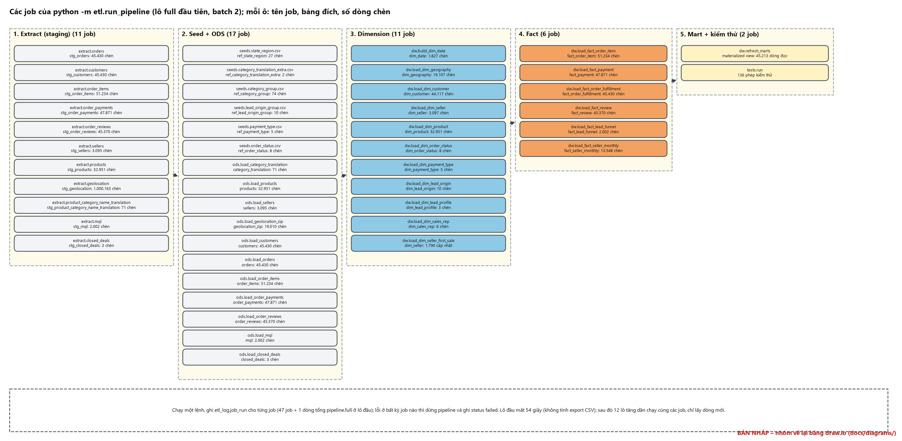

# P8-E2 – ETL: tóm tắt, job và kết quả nạp kho (số liệu từ etl_log của olist_dw)

*Sinh tự động bởi `scripts/p8_etl.py`.*

## Tóm tắt các giai đoạn

| Giai đoạn | Nội dung | Công cụ | Kết quả (từ etl_log) |
| --- | --- | --- | --- |
| Extract | Chép nguyên trạng 11 bảng nguồn vào staging, gắn mã lô và thời điểm nạp; full hoặc tăng dần (watermark theo ngày mua của đơn, các bảng khác theo khoá) | Python + SQL (SQLAlchemy) | lô đầu: 11 job, 1.273.620 dòng vào staging; tổng 13 lô: 1.559.764 dòng |
| Seed và ODS | Nạp 6 bảng tham chiếu từ file seed; làm sạch, chuẩn hoá, gắn cờ lỗi; dòng không nạp được ghi rejected_rows kèm lý do | SQL procedure (PL/pgSQL), Python đọc seed | lô đầu: 17 job, 292.593 dòng vào ODS, 42 dòng bị loại; tổng 13 lô: 580.249 dòng vào, 42 bị loại |
| Dimension và fact | Nạp 10 dimension (khoá thay thế, SCD1 và SCD2) rồi 6 fact (tra khoá theo phiên bản hiệu lực, tính thời gian từng chặng) | SQL procedure (PL/pgSQL) | lô đầu: 17 job, 306.586 dòng chèn; tổng 13 lô: 614.213 dòng chèn, 4.814 dòng cập nhật |
| Data mart | Làm mới các materialized view của bốn mart | SQL (REFRESH MATERIALIZED VIEW) | lô đầu: 45.213 dòng đọc, 0.9 giây |
| Kiểm thử | Chạy các truy vấn kiểm thử số dòng, tổng tiền, grain, khoá ngoại, logic nghiệp vụ; ghi dq_check | Python + SQL (sql/90_tests) | lô đầu: 142/142 phép đạt; lô cuối: 142/142 đạt |
| Xuất cho Power BI | Xuất bảng dw, mart và etl_log ra 37 file CSV (UTF-8 có BOM) | Python (pandas) | 37 file CSV trong exports/powerbi/ |

## Job của lô full đầu tiên (batch 2)

| run_id | job | lớp | bảng đích | giây | đọc | chèn | cập nhật | loại |
| ---: | --- | --- | --- | ---: | ---: | ---: | ---: | ---: |
| 13 | extract.orders | staging | staging.stg_orders | 0.41 | 45.430 | 45.430 | 0 | 0 |
| 14 | extract.customers | staging | staging.stg_customers | 0.4 | 45.430 | 45.430 | 0 | 0 |
| 15 | extract.order_items | staging | staging.stg_order_items | 0.37 | 51.234 | 51.234 | 0 | 0 |
| 16 | extract.order_payments | staging | staging.stg_order_payments | 0.4 | 47.871 | 47.871 | 0 | 0 |
| 17 | extract.order_reviews | staging | staging.stg_order_reviews | 0.41 | 45.370 | 45.370 | 0 | 0 |
| 18 | extract.sellers | staging | staging.stg_sellers | 0.02 | 3.095 | 3.095 | 0 | 0 |
| 19 | extract.products | staging | staging.stg_products | 0.27 | 32.951 | 32.951 | 0 | 0 |
| 20 | extract.geolocation | staging | staging.stg_geolocation | 6.48 | 1.000.163 | 1.000.163 | 0 | 0 |
| 21 | extract.product_category_name_translation | staging | staging.stg_product_category_name_translation | 0.01 | 71 | 71 | 0 | 0 |
| 22 | extract.mql | staging | staging.stg_mql | 0.02 | 2.002 | 2.002 | 0 | 0 |
| 23 | extract.closed_deals | staging | staging.stg_closed_deals | 0.01 | 3 | 3 | 0 | 0 |
| 24 | seeds.state_region.csv | ods | ods.ref_state_region | 0.02 | 27 | 27 | 0 | 0 |
| 25 | seeds.category_translation_extra.csv | ods | ods.ref_category_translation_extra | 0.01 | 2 | 2 | 0 | 0 |
| 26 | seeds.category_group.csv | ods | ods.ref_category_group | 0.01 | 74 | 74 | 0 | 0 |
| 27 | seeds.lead_origin_group.csv | ods | ods.ref_lead_origin_group | 0.0 | 10 | 10 | 0 | 0 |
| 28 | seeds.payment_type.csv | ods | ods.ref_payment_type | 0.0 | 5 | 5 | 0 | 0 |
| 29 | seeds.order_status.csv | ods | ods.ref_order_status | 0.01 | 8 | 8 | 0 | 0 |
| 30 | ods.load_category_translation | ods | ods.category_translation | 0.01 | 71 | 71 | 0 | 0 |
| 31 | ods.load_products | ods | ods.products | 0.38 | 32.951 | 32.951 | 0 | 0 |
| 32 | ods.load_sellers | ods | ods.sellers | 0.04 | 3.095 | 3.095 | 0 | 0 |
| 33 | ods.load_geolocation_zip | ods | ods.geolocation_zip | 7.32 | 1.000.163 | 19.010 | 0 | 42 |
| 34 | ods.load_customers | ods | ods.customers | 1.58 | 45.430 | 45.430 | 0 | 0 |
| 35 | ods.load_orders | ods | ods.orders | 1.03 | 45.430 | 45.430 | 0 | 0 |
| 36 | ods.load_order_items | ods | ods.order_items | 1.46 | 51.234 | 51.234 | 0 | 0 |
| 37 | ods.load_order_payments | ods | ods.order_payments | 0.84 | 47.871 | 47.871 | 0 | 0 |
| 38 | ods.load_order_reviews | ods | ods.order_reviews | 0.76 | 45.370 | 45.370 | 0 | 0 |
| 39 | ods.load_mql | ods | ods.mql | 0.02 | 2.002 | 2.002 | 0 | 0 |
| 40 | ods.load_closed_deals | ods | ods.closed_deals | 0.01 | 3 | 3 | 0 | 0 |
| 41 | dw.build_dim_date | dw | dw.dim_date | 0.04 | 1.827 | 1.827 | 0 | 0 |
| 42 | dw.load_dim_geography | dw | dw.dim_geography | 0.4 | 19.107 | 19.107 | 0 | 0 |
| 43 | dw.load_dim_customer | dw | dw.dim_customer | 1.36 | 44.034 | 44.117 | 0 | 0 |
| 44 | dw.load_dim_seller | dw | dw.dim_seller | 0.07 | 3.097 | 3.097 | 0 | 0 |
| 45 | dw.load_dim_product | dw | dw.dim_product | 0.53 | 32.951 | 32.951 | 0 | 0 |
| 46 | dw.load_dim_order_status | dw | dw.dim_order_status | 0.0 | 8 | 8 | 0 | 0 |
| 47 | dw.load_dim_payment_type | dw | dw.dim_payment_type | 0.0 | 5 | 5 | 0 | 0 |
| 48 | dw.load_dim_lead_origin | dw | dw.dim_lead_origin | 0.0 | 10 | 10 | 0 | 0 |
| 49 | dw.load_dim_lead_profile | dw | dw.dim_lead_profile | 0.0 | 3 | 3 | 0 | 0 |
| 50 | dw.load_dim_sales_rep | dw | dw.dim_sales_rep | 0.0 | 3 | 6 | 0 | 0 |
| 51 | dw.load_fact_order_item | dw | dw.fact_order_item | 4.94 | 51.234 | 51.234 | 0 | 0 |
| 52 | dw.load_fact_payment | dw | dw.fact_payment | 2.49 | 47.871 | 47.871 | 0 | 0 |
| 53 | dw.load_fact_order_fulfillment | dw | dw.fact_order_fulfillment | 5.19 | 45.430 | 45.430 | 0 | 0 |
| 54 | dw.load_fact_review | dw | dw.fact_review | 3.83 | 45.370 | 45.370 | 0 | 0 |
| 55 | dw.load_dim_seller_first_sale | dw | dw.dim_seller | 0.06 | 1.790 | 0 | 1.790 | 0 |
| 56 | dw.load_fact_lead_funnel | dw | dw.fact_lead_funnel | 0.13 | 2.002 | 2.002 | 0 | 0 |
| 57 | dw.load_fact_seller_monthly | dw | dw.fact_seller_monthly | 0.74 | 13.548 | 13.548 | 0 | 0 |
| 58 | dw.refresh_marts | mart | mart_*.v_* (materialized) | 0.9 | 45.213 | 0 | 0 | 0 |
| 59 | tests.run | test |  | 11.08 | 136 | 0 | 0 | 0 |

## Kết quả nạp kho dữ liệu (trạng thái cuối)

| Bảng | Loại | Số cột | Số dòng | Đối chiếu với nguồn | Test đạt |
| --- | --- | ---: | ---: | --- | --- |
| dim_date | dimension (role-playing) | 18 | 1.828 | 1.827 ngày 2016-01-01 → 2020-12-31: 1.827 (+1 dòng Unknown) khớp | 4/4 |
| dim_geography | dimension (SCD1) | 11 | 19.178 | số mã bưu chính trong geolocation ∪ customers ∪ sellers: 19.177 (+1 dòng Unknown) khớp | 8/8 |
| dim_customer | dimension (SCD2) | 12 | 96.339 | 96.096 khách thật + phiên bản khi đổi mã bưu chính | 8/8 |
| dim_seller | dimension (SCD1, conformed) | 17 | 3.558 | seller trong oltp ∪ crm: 3.557 (+1 dòng Unknown) khớp | 5/5 |
| dim_product | dimension (SCD1) | 16 | 32.952 | oltp.products: 32.951 (+1 dòng Unknown) khớp | 5/5 |
| dim_order_status | dimension (lookup) | 6 | 9 | seed order_status | 3/3 |
| dim_payment_type | dimension (lookup) | 6 | 6 | seed payment_type | 3/3 |
| dim_lead_origin | dimension (lookup) | 5 | 11 | seed lead_origin_group + unknown | 3/3 |
| dim_lead_profile | dimension (junk) | 10 | 503 | tổ hợp 7 thuộc tính của deal | 2/2 |
| dim_sales_rep | dimension (role-playing) | 5 | 55 | SDR và SR trong closed_deals | 2/2 |
| fact_order_item | fact giao dịch | 14 | 112.650 | oltp.order_items: 112.650 khớp | 11/11 |
| fact_order_fulfillment | fact snapshot tích luỹ | 30 | 99.441 | oltp.orders: 99.441 khớp | 13/13 |
| fact_payment | fact giao dịch | 8 | 103.886 | oltp.order_payments: 103.886 khớp | 3/3 |
| fact_review | fact giao dịch | 14 | 99.224 | oltp.order_reviews: 99.224 khớp | 7/7 |
| fact_lead_funnel | fact snapshot tích luỹ | 18 | 8.000 | crm.mql: 8.000 khớp | 9/9 |
| fact_seller_monthly | fact snapshot định kỳ | 14 | 36.583 | seller × tháng, lưới dày đặc | 8/8 |

Tổng price của fact_order_item: 13,591,643.70 BRL; tổng price nguồn: 13,591,643.70 BRL (khớp từng đồng).

## Giám sát ETL (trước đây là dashboard D7; P8b chuyển thành bảng ở mục 3.3 của báo cáo)

### Số dòng qua từng lớp

| Lớp | Số dòng | Ghi chú |
| --- | ---: | --- |
| Nguồn (oltp, crm) | 1.559.764 | dòng đã nạp hoặc mô phỏng vào hai hệ thống nguồn qua mọi đợt |
| Staging | 1.559.764 | dòng chép vào staging (extract); bằng số dòng nguồn |
| ODS | 578.611 | dòng vào ODS (không tính các bảng seed nạp lại mỗi lô; bảng toạ độ đã gom về mã bưu chính); 42 dòng bị loại |
| Kho dw | 614.213 | dòng chèn vào dimension và fact; 4.814 dòng cập nhật (snapshot tích luỹ, ngày bán đầu tiên của seller) |

### Dòng bị loại theo lý do

| Job | Bảng nguồn | Lý do | Số dòng |
| --- | --- | --- | ---: |
| ods.load_geolocation_zip | staging.stg_geolocation | coordinates outside Brazil bounding box | 42 |

Dòng mồ côi (`orphan:`) trong `rejected_rows`: 0.

| Fact | Vấn đề ghi nhận | Số dòng |
| --- | --- | ---: |
| fact_order_fulfillment | handling_days | 1.359 |
| fact_order_fulfillment | transit_days | 23 |
| fact_lead_funnel | days_to_close (won before first contact) | 1 |

### Các đợt nạp

| Đợt | Lô | Dòng mới vào staging | Dòng bị loại | Dòng chèn vào kho | Thời gian (giây) | Test đạt | MQL | Deal | Seller có đơn |
| --- | --- | --- | --- | --- | --- | --- | --- | --- | --- |
| đầu | 2 | 1.273.620 | 42 | 306.586 | 54,7 | 136/136 | 2.002 | 3 | 0 |
| 1 | 7 | 38.768 | 0 | 40.535 | 21,9 | 136/136 | 3.143 | 76 | 3 |
| 2 | 12 | 35.979 | 0 | 37.817 | 24,0 | 136/136 | 4.171 | 189 | 30 |
| 3 | 17 | 38.659 | 0 | 40.668 | 22,8 | 136/136 | 5.345 | 336 | 55 |
| 4 | 22 | 37.515 | 0 | 39.700 | 24,6 | 136/136 | 6.697 | 543 | 117 |
| 5 | 27 | 37.079 | 0 | 39.402 | 24,8 | 136/136 | 8.000 | 665 | 198 |
| 6 | 32 | 32.035 | 0 | 34.594 | 25,5 | 136/136 | 8.000 | 722 | 280 |
| 7 | 37 | 32.489 | 0 | 35.245 | 25,6 | 136/136 | 8.000 | 759 | 340 |
| 8 | 42 | 33.490 | 0 | 36.399 | 27,6 | 136/136 | 8.000 | 792 | 379 |
| 9 | 47 | 87 | 0 | 3.195 | 21,9 | 136/136 | 8.000 | 815 | 379 |
| 10 | 52 | 37 | 0 | 54 | 21,5 | 136/136 | 8.000 | 836 | 379 |
| 11 | 57 | 6 | 0 | 18 | 21,3 | 136/136 | 8.000 | 842 | 379 |

- 11 đợt tăng dần: thời gian nhỏ nhất 21.3, trung bình 23.8, lớn nhất 27.6 giây; lô kiểm thử cuối: 136/136 phép đạt (100.0%), đối chiếu EDA 6/6.
