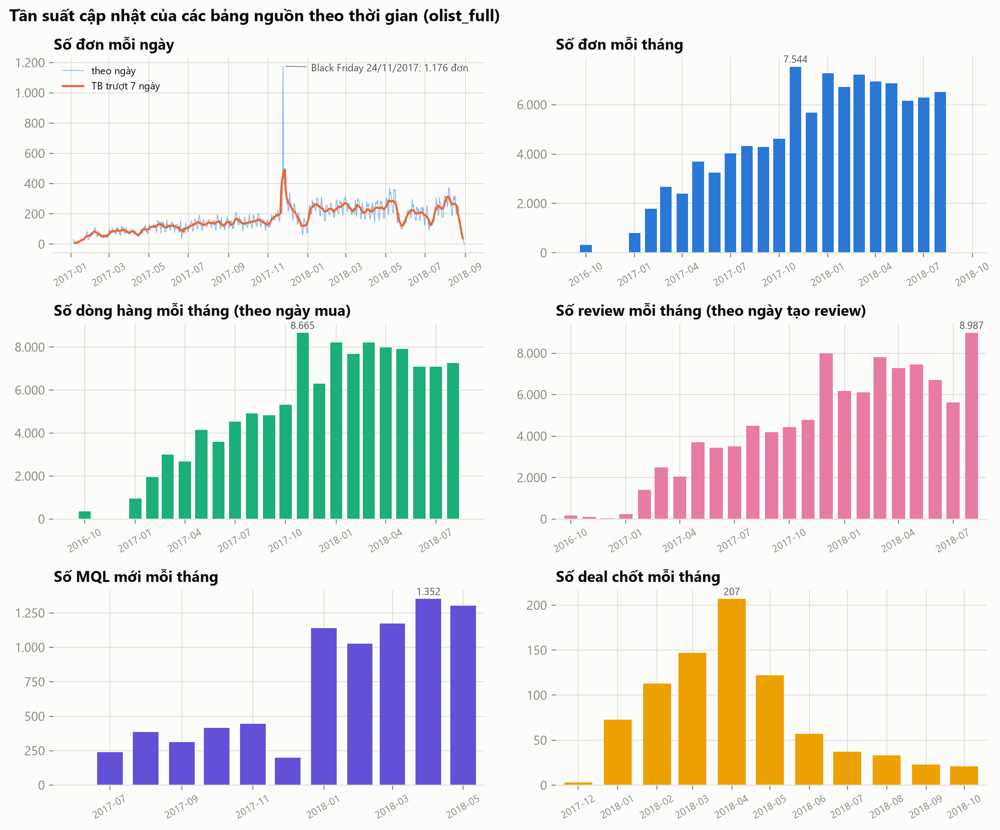
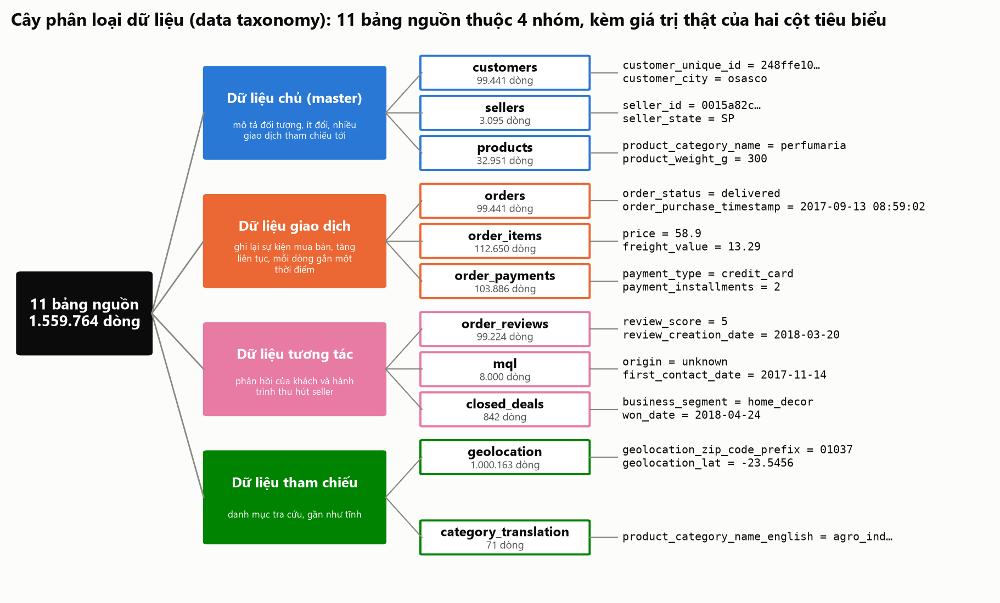

# P8-C1 – Dữ liệu nguồn: tần suất cập nhật và data taxonomy (14/11/2026)

*Sinh tự động bởi `scripts/eda/source_profile.py` trên database `olist_full`; chạy lại script để cập nhật số liệu.*

Cửa sổ tính trung bình và đỉnh: **2017-01-01 → 2018-08-31** (608 ngày, giai đoạn chứa 99,6% số đơn). Toàn bộ dữ liệu đơn: 04/09/2016 → 17/10/2018.

## 1. Tần suất cập nhật và công nghệ xử lý đề xuất

| Bảng nguồn | Trung bình / ngày | Đỉnh một ngày | Tần suất cập nhật | Công nghệ xử lý đề xuất |
| --- | ---: | --- | --- | --- |
| oltp.orders | 163,0 | 1.176 (24/11/2017) | liên tục: mỗi đơn đổi trạng thái 4–5 lần (mua, duyệt, bàn giao, giao) | lô hằng ngày bằng procedure PostgreSQL; nếu cần gần thời gian thực: CDC + Kafka (chương 5) |
| oltp.order_items | 184,7 | 1.366 (24/11/2017) | cùng lúc với đơn (ghi một lần khi đặt) | lô hằng ngày, nạp theo khoá (order_id, order_item_id) |
| oltp.order_payments | 170,3 | 1.214 (24/11/2017) | cùng lúc với đơn | lô hằng ngày; có thể gộp chung job với đơn |
| oltp.order_reviews | 162,7 | 463 (19/12/2017) | sau khi giao hàng (trễ vài ngày đến hai tuần) | lô hằng ngày; thử lại dòng mồ côi khi đơn chưa về |
| oltp.customers | 157,5 | 1.143 (24/11/2017) | khi khách mới đặt đơn đầu tiên | lô hằng ngày; SCD2 khi đổi mã bưu chính |
| oltp.sellers | 4,9 | 24 (26/01/2017) | khi seller bán đơn đầu tiên | lô hằng ngày |
| oltp.products | 53,7 | 374 (24/11/2017) | khi sản phẩm bán lần đầu | lô hằng ngày |
| crm.mql | 13,2 | 93 (02/05/2018) | hằng ngày (khách tiềm năng để lại thông tin) | lô hằng ngày; luồng sự kiện nếu cần phản hồi nhanh cho đội sales |
| crm.closed_deals | 1,3 | 22 (30/04/2018) | vài ngày một lần (khi chốt hợp đồng) | lô hằng ngày |
| oltp.geolocation | 0 | 0 | tĩnh (bảng tham chiếu, đổi khi có bản đồ mới) | nạp lại toàn phần theo quý; gom về một điểm cho mỗi mã bưu chính |
| oltp.product_category_name_translation | 0 | 0 | tĩnh (71 dòng) | bảng seed, nạp lại khi có danh mục mới |

- Đơn hàng trung bình 163,0 đơn/ngày, đỉnh 1.176 đơn vào 24/11/2017 (Black Friday); đỉnh gấp 7,2 lần trung bình. Khối lượng này nhỏ: lô hằng ngày bằng procedure PostgreSQL xử lý trong vài giây, nên CDC + Kafka chỉ cần khi đòi hỏi gần thời gian thực.

## 2. Data taxonomy

| Bảng | Nhóm | Kiểu dữ liệu | Độ nhạy cảm | Tính biến động |
| --- | --- | --- | --- | --- |
| customers | Dữ liệu chủ (master) | định danh (khách, vị trí thành phố/bang) | nhạy cảm vừa: mã khách đã ẩn danh, có vị trí | thấp (đổi khi khách đổi địa chỉ) |
| sellers | Dữ liệu chủ (master) | định danh (seller, vị trí) | nhạy cảm vừa: mã seller ẩn danh, có vị trí | thấp |
| products | Dữ liệu chủ (master) | thuộc tính (danh mục, kích thước) | không nhạy cảm | thấp |
| orders | Dữ liệu giao dịch | thời gian và trạng thái | nhạy cảm thấp: gắn với khách qua customer_id | cao (trạng thái đổi theo từng mốc) |
| order_items | Dữ liệu giao dịch | số tiền và khoá | thông tin thương mại (giá, phí) | thấp (ghi một lần) |
| order_payments | Dữ liệu giao dịch | số tiền, hình thức | thông tin thanh toán (đã tổng hợp, không có số thẻ) | thấp |
| order_reviews | Dữ liệu tương tác | điểm số và văn bản tự do | nhạy cảm vừa: văn bản có thể nêu thông tin cá nhân | thấp (hiếm khi sửa) |
| mql | Dữ liệu tương tác | ngày, kênh (phân loại) | thông tin kinh doanh nội bộ | thấp |
| closed_deals | Dữ liệu tương tác | phân loại và số liệu doanh nghiệp seller | thông tin kinh doanh nội bộ | thấp |
| geolocation | Dữ liệu tham chiếu | vị trí (vĩ độ, kinh độ) | vị trí: chỉ ở mức mã bưu chính | rất thấp (tĩnh) |
| category_translation | Dữ liệu tham chiếu | văn bản tra cứu | không nhạy cảm | rất thấp (tĩnh) |
