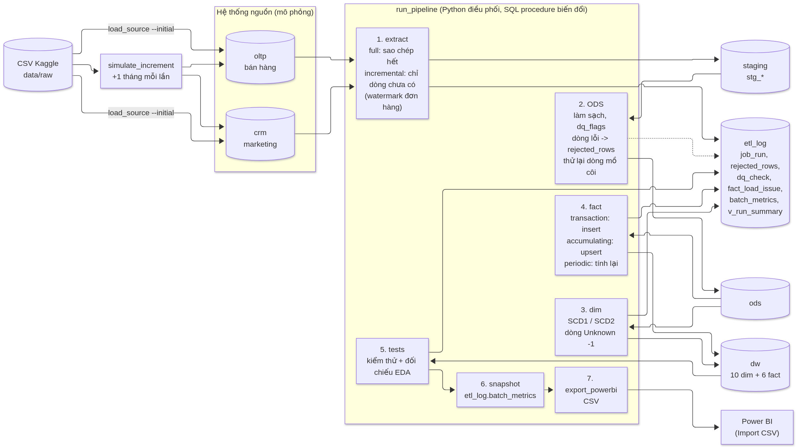

# 01 – Pipeline bằng lời: dữ liệu đi qua từng lớp như thế nào

*Tài liệu này giải thích từng lớp của pipeline bằng ví dụ thật. Đọc khoảng 25 phút; thuật ngữ ở `02-thuat-ngu.md`. Mọi giá trị trong các bảng ví dụ ở dưới lấy từ truy vấn thật trên `olist_dw` (sinh tự động bằng `python scripts/gen_trace_examples.py`, có thể chạy lại).*

## 1. Bức tranh chung

Dữ liệu đi một chiều qua 6 lớp. Mỗi lớp có **một việc** và là chỗ để kiểm tra lỗi riêng:

| Lớp (schema) | Làm gì | Vì sao cần lớp này |
| --- | --- | --- |
| **Nguồn** `oltp` (bán hàng), `crm` (marketing) | Hai hệ thống nghiệp vụ mô phỏng từ 11 file CSV Kaggle. Giữ nguyên "bẩn" như thật (kể cả tên cột sai chính tả `product_name_lenght`). | Là điểm xuất phát có thể đối chiếu; ETL không bao giờ sửa dữ liệu ở đây. |
| **Staging** `staging` (`stg_*`) | Sao chép nguyên văn dữ liệu mới của nguồn, thêm `load_batch_id` (lô nào nạp) và `loaded_at`. | Tách việc "lấy dữ liệu" khỏi việc "biến đổi": nạp tăng dần chỉ lấy dòng chưa có; có bằng chứng dòng nào đến từ lô nào. |
| **ODS** `ods` | Làm sạch và chuẩn hoá: zip thành `char(5)`, tên thành phố bỏ dấu + chữ thường, `NULL` thành `unknown`, khử trùng review, gắn cờ lỗi `dq_flags`. Dòng không dùng được ghi vào `etl_log.rejected_rows` kèm lý do. | Một nơi duy nhất để làm sạch; không xoá âm thầm. Staging = ODS + dòng bị loại (đối soát được). |
| **Kho** `dw` | 10 bảng chiều + 6 bảng fact theo lược đồ hình sao: khoá thay thế số nguyên, SCD2 cho khách, các khoảng thời gian đã tính sẵn. | Dạng dễ phân tích nhất: truy vấn ngắn, nhất quán, một định nghĩa cho mỗi KPI. |
| **Data mart** `mart_sales`, `mart_fulfillment`, `mart_cx`, `mart_acquisition` | View (4 cái là materialized view) tổng hợp sẵn cho từng chủ đề dashboard. | Nhanh (dưới 1 ms thay vì 150–750 ms) và gọn khi dựng dashboard. |
| **Power BI** | 37 file CSV xuất từ kho → mô hình quan hệ + measure DAX → 7 dashboard. | Lớp ngữ nghĩa và tương tác kéo thả cho người dùng cuối. |

Song song có **`etl_log`**: ghi mỗi lần chạy (thời gian, số dòng đọc/chèn/cập nhật/loại), dòng bị loại, kết quả kiểm thử (133 phép), khoá rơi về Unknown. Đây là nguồn của dashboard D7.

**Hai cách nạp**: `full` (xoá và dựng lại toàn bộ) và `incremental` (chỉ lấy dòng mới). Dự án nạp ban đầu đến 31/12/2017 (45.430 đơn) rồi **11 đợt hằng tháng** để mô phỏng cập nhật; kết quả cuối giống hệt một lần nạp full.

## 2. Đi theo một đơn hàng thật
Đơn được chọn vì có đủ các điều kiện hay để học: **đã giao** (đủ 5 mốc thời gian), **3 dòng hàng** của cùng một seller, **có thanh toán và review**, và **khách có 2 phiên bản địa chỉ (SCD2)**: đơn này được mua khi khách còn ở địa chỉ cũ. Hãy đọc bảng theo thứ tự lớp; các nhận xét ở cuối mục tóm tắt "chỗ nào đã đổi".

<!-- TRACE_ORDER:START -->
Đơn được theo dõi: `order_id = 19c36691fd116059bf49b7960f1db743`; `customer_id = 02625456293ab29f0b11a84835a8c0ab` (mã sinh riêng cho đơn này); khách thật `customer_unique_id = 570eb70ff97166b85ea96be3bfb65fef`.

#### Lớp 1 – Nguồn bán hàng `oltp` (nguyên bản, chưa làm sạch)

**oltp.orders**

| Cột | Giá trị |
| --- | --- |
| `order_id` | 19c36691fd116059bf49b7960f1db743 |
| `customer_id` | 02625456293ab29f0b11a84835a8c0ab |
| `order_status` | delivered |
| `order_purchase_timestamp` | 2017-10-24 14:33:12 |
| `order_approved_at` | 2017-10-26 03:09:41 |
| `order_delivered_carrier_date` | 2017-10-26 20:10:03 |
| `order_delivered_customer_date` | 2017-11-08 16:18:46 |
| `order_estimated_delivery_date` | 2017-11-14 00:00:00 |

**oltp.customers**

| Cột | Giá trị |
| --- | --- |
| `customer_id` | 02625456293ab29f0b11a84835a8c0ab |
| `customer_unique_id` | 570eb70ff97166b85ea96be3bfb65fef |
| `customer_zip_code_prefix` | 31930 |
| `customer_city` | belo horizonte |
| `customer_state` | MG |

**oltp.order_items (3 dòng hàng)**

| order_item_id | product_id | seller_id | shipping_limit_date | price | freight_value |
| --- | --- | --- | --- | --- | --- |
| 1 | 94972ba3b1856e8453d8a0b4d522aa36 | 1900267e848ceeba8fa32d80c1a5f5a8 | 2017-11-01 03:09:41 | 14.00 | 6.47 |
| 2 | 46d9734c42793de762a7ca5db95ecdd1 | 1900267e848ceeba8fa32d80c1a5f5a8 | 2017-11-01 03:09:41 | 15.00 | 32.36 |
| 3 | 94972ba3b1856e8453d8a0b4d522aa36 | 1900267e848ceeba8fa32d80c1a5f5a8 | 2017-11-01 03:09:41 | 14.00 | 6.47 |

**oltp.order_payments**

| order_id | payment_sequential | payment_type | payment_installments | payment_value |
| --- | --- | --- | --- | --- |
| 19c36691fd116059bf49b7960f1db743 | 1 | boleto | 1 | 88.30 |

**oltp.order_reviews**

| Cột | Giá trị |
| --- | --- |
| `review_id` | 5b84de92df997c614e5dbb2165bc0eee |
| `review_score` | 3 |
| `review_comment_title` | *(trống)* |
| `review_comment_message` | bem, nao fiquei muito satisfeita porque comprei errado, nao … |
| `review_creation_date` | 2017-11-09 00:00:00 |
| `review_answer_timestamp` | 2017-11-09 19:16:09 |

Khách này còn một đơn khác ở nơi ở mới (khác mã bưu chính), nên kho tạo hai phiên bản địa chỉ cho cùng một người:

**oltp.customers của khách thật này (mỗi đơn một `customer_id`)**

| customer_id | customer_zip_code_prefix | customer_city | customer_state | order_purchase_timestamp |
| --- | --- | --- | --- | --- |
| 02625456293ab29f0b11a84835a8c0ab | 31930 | belo horizonte | MG | 2017-10-24 14:33:12 |
| 00796be07bfc87dad2e31ef15490a718 | 31130 | belo horizonte | MG | 2017-11-09 14:07:54 |

#### Lớp 2 – Staging `staging` (bản sao thô + mã lô nạp)

**staging.stg_orders**

| Cột | Giá trị |
| --- | --- |
| `order_id` | 19c36691fd116059bf49b7960f1db743 |
| `order_status` | delivered |
| `order_purchase_timestamp` | 2017-10-24 14:33:12 |
| `load_batch_id` | 2 |
| `loaded_at` | 2026-11-05 20:27:36.076592+07:00 |

#### Lớp 3 – ODS `ods` (đã làm sạch, chuẩn hoá, có cờ chất lượng)

**ods.orders**

| Cột | Giá trị |
| --- | --- |
| `order_id` | 19c36691fd116059bf49b7960f1db743 |
| `order_status` | delivered |
| `order_purchase_timestamp` | 2017-10-24 14:33:12 |
| `order_approved_at` | 2017-10-26 03:09:41 |
| `order_delivered_carrier_date` | 2017-10-26 20:10:03 |
| `order_delivered_customer_date` | 2017-11-08 16:18:46 |
| `order_estimated_delivery_date` | 2017-11-14 00:00:00 |
| `dq_flags` | [] |
| `dq_flag_count` | 0 |
| `etl_batch_id` | 2 |

**ods.customers (zip thành `char(5)`, thành phố bỏ dấu và chữ thường)**

| Cột | Giá trị |
| --- | --- |
| `customer_id` | 02625456293ab29f0b11a84835a8c0ab |
| `customer_unique_id` | 570eb70ff97166b85ea96be3bfb65fef |
| `zip_code_prefix` | 31930 |
| `city` | belo horizonte |
| `state_code` | MG |
| `etl_batch_id` | 2 |

**ods.customer_map**

| Cột | Giá trị |
| --- | --- |
| `customer_id` | 02625456293ab29f0b11a84835a8c0ab |
| `customer_unique_id` | 570eb70ff97166b85ea96be3bfb65fef |
| `etl_batch_id` | 2 |

**ods.order_payments (có cờ lỗi)**

| order_id | payment_sequential | payment_type | payment_installments | payment_value | dq_flags |
| --- | --- | --- | --- | --- | --- |
| 19c36691fd116059bf49b7960f1db743 | 1 | boleto | 1 | 88.30 | [] |

#### Lớp 4 – Kho `dw`: bảng chiều

**dw.dim_customer – hai phiên bản địa chỉ của khách (SCD2); đơn này thuộc phiên bản 1**

| customer_key | customer_unique_id | zip_code_prefix | city | state_code | geography_key | effective_from | effective_to | is_current | version_no |
| --- | --- | --- | --- | --- | --- | --- | --- | --- | --- |
| 15081 | 570eb70ff97166b85ea96be3bfb65fef | 31930 | belo horizonte | MG | 8248 | 1900-01-01 | 2017-11-08 | False | 1 |
| 15082 | 570eb70ff97166b85ea96be3bfb65fef | 31130 | belo horizonte | MG | 8173 | 2017-11-09 | 9999-12-31 | True | 2 |

**dw.dim_geography (zip của phiên bản 1)**

| Cột | Giá trị |
| --- | --- |
| `geography_key` | 8248 |
| `zip_code_prefix` | 31930 |
| `city` | belo horizonte |
| `state_code` | MG |
| `state_name` | Minas Gerais |
| `region` | Sudeste |
| `country` | Brazil |
| `latitude` | -19.863121316406 |
| `longitude` | -43.90741456855559 |
| `dw_created_at` | 2026-11-05 20:28:02.607568+07:00 |
| `dw_updated_at` | *(trống)* |

**dw.dim_seller, dim_product của dòng hàng đầu tiên**

| Cột | Giá trị |
| --- | --- |
| `seller_key` | 2997 |
| `seller_id` | 1900267e848ceeba8fa32d80c1a5f5a8 |
| `city` | ibitinga |
| `state_code` | SP |
| `is_from_funnel` | False |
| `acquisition_channel` | Not from funnel |
| `first_sale_date` | 2017-05-17 |
| `product_key` | 16902 |
| `category_name_en` | bed_bath_table |
| `category_group` | Home & Furniture |
| `size_class` | S |

**dw.dim_date (ngày mua) và dim_order_status**

| Cột | Giá trị |
| --- | --- |
| `date_key` | 20171024 |
| `full_date` | 2017-10-24 |
| `day_name` | Tuesday |
| `year_month` | 2017-10 |
| `year_quarter` | 2017-Q4 |
| `is_weekend` | False |
| `is_holiday_br` | False |
| `order_status` | delivered |
| `status_group` | Completed |

#### Lớp 4 – Kho `dw`: bảng fact

**dw.fact_order_fulfillment (accumulating snapshot, 1 dòng cho cả đơn)**

| Cột | Giá trị |
| --- | --- |
| `order_id` | 19c36691fd116059bf49b7960f1db743 |
| `customer_key` | 15081 |
| `customer_geography_key` | 8248 |
| `order_status_key` | 1 |
| `purchase_date_key` | 20171024 |
| `approved_date_key` | 20171026 |
| `carrier_date_key` | 20171026 |
| `delivered_date_key` | 20171108 |
| `estimated_date_key` | 20171114 |
| `purchase_ts` | 2017-10-24 14:33:12 |
| `approved_ts` | 2017-10-26 03:09:41 |
| `carrier_ts` | 2017-10-26 20:10:03 |
| `delivered_ts` | 2017-11-08 16:18:46 |
| `estimated_ts` | 2017-11-14 00:00:00 |
| `approval_hours` | 36.61 |
| `handling_days` | 0.71 |
| `transit_days` | 12.84 |
| `lead_days` | 15.07 |
| `delay_days` | -6 |
| `promised_days` | 21 |
| `is_delivered` | 1 |
| `is_late` | 0 |
| `is_canceled` | 0 |
| `item_count` | 3 |
| `seller_count` | 1 |
| `order_value` | 43.00 |
| `freight_total` | 45.30 |
| `payment_total` | 88.30 |
| `dq_flag_count` | 0 |
| `etl_batch_id` | 2 |

**dw.fact_order_item (3 dòng, khoá số nguyên thay cho mã chữ)**

| order_item_id | purchase_date_key | shipping_limit_date_key | customer_key | customer_geography_key | seller_geography_key | seller_key | product_key | order_status_key | price | freight_value | item_total |
| --- | --- | --- | --- | --- | --- | --- | --- | --- | --- | --- | --- |
| 1 | 20171024 | 20171101 | 15081 | 8248 | 5463 | 2997 | 16902 | 1 | 14.00 | 6.47 | 20.47 |
| 2 | 20171024 | 20171101 | 15081 | 8248 | 5463 | 2997 | 32241 | 1 | 15.00 | 32.36 | 47.36 |
| 3 | 20171024 | 20171101 | 15081 | 8248 | 5463 | 2997 | 16902 | 1 | 14.00 | 6.47 | 20.47 |

**dw.fact_payment và dw.fact_review**

| fact | k | a | b | c |
| --- | --- | --- | --- | --- |
| payment | 1 | 3 | 1 | 88.30 |
| review | 3 | 0 | 0 | 19.27 |

#### Lớp 5 – Data mart

**mart_fulfillment.v_fulfillment_order (1 dòng cho đơn; đã ghép tên bang, ngày dạng date, nhóm trễ)**

| Cột | Giá trị |
| --- | --- |
| `order_id` | 19c36691fd116059bf49b7960f1db743 |
| `purchase_date` | 2017-10-24 |
| `status_group` | Completed |
| `customer_region` | Sudeste |
| `customer_state` | MG |
| `approved_date` | 2017-10-26 |
| `carrier_date` | 2017-10-26 |
| `delivered_date` | 2017-11-08 |
| `estimated_date` | 2017-11-14 |
| `lead_days` | 15.07 |
| `promised_days` | 21 |
| `delay_days` | -6 |
| `delay_bucket` | Giao sớm |

**mart_fulfillment.v_shipping_distance (khoảng cách seller → khách cho từng dòng hàng)**

| order_item_id | seller_state | customer_state | distance_km | distance_band | price | freight_value | freight_ratio |
| --- | --- | --- | --- | --- | --- | --- | --- |
| 1 | SP | MG | 553.30 | 500-1000 km | 14.00 | 6.47 | 0.46 |
| 2 | SP | MG | 553.30 | 500-1000 km | 15.00 | 32.36 | 2.16 |
| 3 | SP | MG | 553.30 | 500-1000 km | 14.00 | 6.47 | 0.46 |

**Đơn này góp vào dòng của ngày mua trong mart_sales.v_sales_daily**

| Cột | Giá trị |
| --- | --- |
| `date_key` | 20171024 |
| `full_date` | 2017-10-24 |
| `year` | 2017 |
| `quarter` | 4 |
| `year_month` | 2017-10 |
| `is_weekend` | False |
| `is_holiday_br` | False |
| `is_black_friday` | False |
| `in_window` | True |
| `orders` | 163 |
| `items` | 192 |
| `gmv` | 22,051.37 |
| `freight` | 3,659.61 |
| `aov` | 135.28 |

<!-- TRACE_ORDER:END -->

### Chỗ nào đã làm sạch hoặc biến đổi (đơn hàng)
1. **Nguồn → staging**: không đổi giá trị, chỉ thêm `load_batch_id` (lô 2 = lần nạp full đầu tiên) và `loaded_at`.
2. **Staging → ODS**: kiểu dữ liệu và chuẩn hoá (zip `31930` thành `char(5)`, `belo horizonte` đã ở dạng chuẩn nên không đổi); thêm `dq_flags` (ở đơn này là `[]` vì các mốc thời gian đúng thứ tự: mua 24/10 → duyệt 26/10 → bàn giao 26/10 → giao 08/11). Bảng `customer_map` ghi `customer_id → customer_unique_id`. Đơn có lỗi sẽ có cờ như `carrier_before_approved` (có **1.359** đơn như vậy trên toàn bộ dữ liệu).
3. **ODS → kho (chiều)**: mã chữ dài 32 ký tự được đổi thành **khoá thay thế số nguyên** (`seller_id 1900267e…` → `seller_key 2997`, `product_id` → `product_key`). Khách thật `570eb70f…` có **2 dòng** trong `dim_customer`: phiên bản 1 (zip 31930, hiệu lực đến 08/11/2017) và phiên bản 2 (zip 31130, từ 09/11/2017, chính là ngày mua đơn thứ hai của khách). Đơn này mua ngày 24/10/2017 nên được gắn `customer_key = 15081` (phiên bản 1) – nhờ vậy báo cáo theo địa lý vẫn đúng nơi khách ở lúc mua.
4. **ODS → kho (fact)**: `fact_order_fulfillment` gom **cả đơn thành 1 dòng** và **tính sẵn** thời gian từng chặng: `approval_hours = 36,61` (mua → duyệt), `handling_days = 0,71` (duyệt → bàn giao), `transit_days = 12,84` (bàn giao → giao), `lead_days = 15,07` (mua → giao); `promised_days = 21` (ngày hứa giao) và `delay_days = −6` (giao sớm 6 ngày so với ngày dự kiến); `order_value = 43,00 = 14 + 15 + 14`, `freight_total = 45,30`, `payment_total = 88,30 = 43,00 + 45,30` (khớp với thanh toán boleto 88,30 ở nguồn). `fact_order_item` giữ 3 dòng, mỗi dòng có `item_total = price + freight_value`. `fact_review` tính thêm `is_negative = 0` (điểm 3 không ≤ 2), `delivered_late = 0` và `response_hours = 19,27`.
5. **Kho → mart**: `v_fulfillment_order` đổi khoá ngày thành ngày thật, gắn tên vùng/bang và nhãn **"Giao sớm"**; `v_shipping_distance` tính khoảng cách seller (SP) → khách (MG) = **553,3 km** bằng công thức haversine, nhóm 500–1000 km (phí vận chuyển dòng 2 là 32,36 BRL, gấp 2,16 lần giá hàng 15 BRL); đơn này góp 43 BRL vào GMV của ngày 24/10/2017 trong `v_sales_daily` (163 đơn, GMV 22.051,37 trong ngày đó).
6. **Power BI**: dòng của đơn này nằm trong `fact_order_fulfillment.csv`; measure `GMV`, `Avg lead days`, `On-time rate` (đơn này tính là đúng hạn vì `delay_days ≤ 0`), `Avg review`… cộng dồn từ các dòng như thế.

## 3. Đi theo một MQL từ lúc liên hệ đến khi seller có đơn
MQL (Marketing Qualified Lead) là một doanh nghiệp quan tâm đến việc bán trên Olist. Hành trình: **liên hệ đầu → đội sales chốt thành seller (deal) → seller có đơn đầu tiên**. Đây là MQL đã đi hết hành trình (đã chốt, và seller đã có đơn).

<!-- TRACE_MQL:START -->
MQL được theo dõi: `mql_id = 08fdf1038af7dd3070bdcd18922e23b2`; sau khi chốt thành seller `seller_id = 850913d59ce317156b00f3705f1c3edb`.

#### Lớp 1 – Nguồn marketing `crm`

**crm.mql**

| Cột | Giá trị |
| --- | --- |
| `mql_id` | 08fdf1038af7dd3070bdcd18922e23b2 |
| `first_contact_date` | 2018-02-06 |
| `landing_page_id` | 864a3926849a5f8043323b1a6ef0fb26 |
| `origin` | paid_search |

**crm.closed_deals (deal đã chốt; đây là 1 dòng với nhiều cột có thể trống)**

| Cột | Giá trị |
| --- | --- |
| `mql_id` | 08fdf1038af7dd3070bdcd18922e23b2 |
| `seller_id` | 850913d59ce317156b00f3705f1c3edb |
| `sdr_id` | 4b339f9567d060bcea4f5136b9f5949e |
| `sr_id` | d3d1e91a157ea7f90548eef82f1955e3 |
| `won_date` | 2018-02-08 17:29:13 |
| `business_segment` | phone_mobile |
| `lead_type` | online_medium |
| `lead_behaviour_profile` | *(trống)* |
| `has_company` | *(trống)* |
| `has_gtin` | *(trống)* |
| `average_stock` | *(trống)* |
| `business_type` | reseller |
| `declared_product_catalog_size` | *(trống)* |
| `declared_monthly_revenue` | 0.00 |

#### Lớp 2–3 – Staging và ODS

**staging.stg_mql / ods.mql (`origin` rỗng sẽ thành `unknown`; ở MQL này đã có giá trị)**

| Cột | Giá trị |
| --- | --- |
| `mql_id` | 08fdf1038af7dd3070bdcd18922e23b2 |
| `origin_goc` | paid_search |
| `origin_ods` | paid_search |
| `stg_batch` | 12 |
| `ods_batch` | 12 |

**ods.closed_deals (`has_company`, `has_gtin` đổi từ boolean sang chữ; cột trống → `unknown`; cờ `dq_flags`)**

| Cột | Giá trị |
| --- | --- |
| `mql_id` | 08fdf1038af7dd3070bdcd18922e23b2 |
| `seller_id` | 850913d59ce317156b00f3705f1c3edb |
| `sdr_id` | 4b339f9567d060bcea4f5136b9f5949e |
| `sr_id` | d3d1e91a157ea7f90548eef82f1955e3 |
| `won_date` | 2018-02-08 17:29:13 |
| `business_segment` | phone_mobile |
| `lead_type` | online_medium |
| `lead_behaviour_profile` | unknown |
| `business_type` | reseller |
| `has_company` | unknown |
| `has_gtin` | unknown |
| `average_stock` | unknown |
| `declared_product_catalog_size` | *(trống)* |
| `declared_monthly_revenue` | 0.00 |
| `dq_flags` | ['declared_revenue_zero'] |
| `etl_batch_id` | 12 |

#### Lớp 4 – Kho `dw`

**dw.dim_seller – seller nối hai quy trình: bán hàng và funnel (chiều dùng chung)**

| Cột | Giá trị |
| --- | --- |
| `seller_key` | 2775 |
| `seller_id` | 850913d59ce317156b00f3705f1c3edb |
| `city` | atibaia |
| `state_code` | SP |
| `is_from_funnel` | True |
| `mql_id` | 08fdf1038af7dd3070bdcd18922e23b2 |
| `acquisition_origin` | paid_search |
| `acquisition_channel` | Paid |
| `business_segment` | phone_mobile |
| `lead_type` | online_medium |
| `business_type` | reseller |
| `won_date` | 2018-02-08 |
| `first_sale_date` | 2018-03-07 |

**dw.dim_lead_origin, dim_lead_profile (junk dimension) và dim_sales_rep của MQL**

| Cột | Giá trị |
| --- | --- |
| `origin` | paid_search |
| `channel_group` | Paid |
| `lead_profile_key` | 171 |
| `business_segment` | phone_mobile |
| `lead_behaviour_profile` | unknown |
| `has_company` | unknown |
| `has_gtin` | unknown |
| `average_stock` | unknown |
| `sdr_id` | 4b339f9567d060bcea4f5136b9f5949e |
| `sr_id` | d3d1e91a157ea7f90548eef82f1955e3 |

**dw.fact_lead_funnel (accumulating snapshot: 3 mốc ngày + các khoảng thời gian)**

| Cột | Giá trị |
| --- | --- |
| `mql_id` | 08fdf1038af7dd3070bdcd18922e23b2 |
| `first_contact_date_key` | 20180206 |
| `won_date_key` | 20180208 |
| `first_sale_date_key` | 20180307 |
| `seller_key` | 2775 |
| `is_won` | 1 |
| `has_first_sale` | 1 |
| `days_to_close` | 2 |
| `days_won_to_first_sale` | 27 |
| `declared_product_catalog_size` | *(trống)* |
| `declared_monthly_revenue` | 0.00 |
| `seller_gmv_first_90d` | 2,325.00 |

**dw.fact_seller_monthly – 4 tháng đầu có đơn của seller (periodic snapshot)**

| year_month | orders | items | gmv | late_orders | avg_review_score | is_active | months_since_first_sale |
| --- | --- | --- | --- | --- | --- | --- | --- |
| 2018-03 | 12 | 14 | 952.00 | 4 | 3.08 | 1 | 0 |
| 2018-04 | 12 | 12 | 1,240.00 | 1 | 3.75 | 1 | 1 |
| 2018-05 | 3 | 3 | 133.00 | 0 | 4.67 | 1 | 2 |
| 2018-06 | 4 | 4 | 274.00 | 0 | 2.25 | 1 | 3 |

#### Lớp 5 – Data mart

**mart_acquisition.v_seller_scorecard (1 dòng tổng hợp cho seller)**

| Cột | Giá trị |
| --- | --- |
| `seller_id` | 850913d59ce317156b00f3705f1c3edb |
| `acquisition_channel` | Paid |
| `acquisition_origin` | paid_search |
| `first_sale_date` | 2018-03-07 |
| `active_months` | 5 |
| `orders` | 32 |
| `gmv` | 2,648.00 |
| `late_rate_pct` | 17.24 |
| `avg_review_score` | 3.44 |
| `gmv_rank` | 881 |
| `cum_share_pct` | 89.57 |
| `abc_class` | B |
| `small_sample` | False |

**mart_acquisition.v_funnel_by_origin_month – dòng của tháng liên hệ đầu và origin của MQL**

| Cột | Giá trị |
| --- | --- |
| `first_contact_month` | 2018-02 |
| `origin` | paid_search |
| `channel_group` | Paid |
| `mqls` | 212 |
| `won` | 43 |
| `won_with_sale` | 26 |
| `win_rate_pct` | 20.28 |
| `won_to_sale_rate_pct` | 60.47 |
| `avg_days_to_close` | 53.90 |
| `avg_days_won_to_first_sale` | 53.30 |
| `seller_gmv_first_90d` | 21,325.37 |

<!-- TRACE_MQL:END -->

### Chỗ nào đã làm sạch hoặc biến đổi (MQL → seller)
1. **Nguồn → ODS**: các cột phân loại bị trống ở nguồn (`lead_behaviour_profile`, `has_company`, `has_gtin`, `average_stock`) thành `unknown` để nhóm được trong báo cáo thay vì mất dòng; `has_company`/`has_gtin` đổi từ boolean sang chữ `true`/`false`/`unknown`; `declared_monthly_revenue = 0` được **giữ nguyên nhưng gắn cờ** `declared_revenue_zero` (không tự đoán giá trị). Nếu `origin` của MQL trống thì thành `unknown` (một nhóm kênh riêng, vì `unknown` có tỷ lệ chốt cao nhất 16,7%).
2. **ODS → `dim_seller`**: seller **vừa có trong bán hàng vừa có trong funnel**: dòng `dim_seller` gộp thông tin địa chỉ (từ `oltp.sellers`) với thông tin funnel (`mql_id`, `acquisition_origin = paid_search`, `acquisition_channel = Paid`, `won_date`) và `first_sale_date = 2018-03-07` được **điền sau khi nạp fact** (ngày mua của đơn đầu tiên). Đây là lý do `dim_seller` gọi là **chiều dùng chung (conformed)**.
3. **Chiều nhỏ**: tổ hợp thuộc tính deal (`business_segment`, `lead_behaviour_profile`, `has_company`, …) được gom vào **một dòng của `dim_lead_profile`** (junk dimension, khoá 171) thay vì rải 7 cột vào fact; nhân viên sales tách thành hai dòng `dim_sales_rep` với vai trò SDR và SR.
4. **Fact snapshot**: `fact_lead_funnel` là **accumulating snapshot**: 1 dòng cho MQL, ban đầu chỉ có mốc liên hệ (06/02/2018), khi chốt thì điền mốc 08/02/2018 (`days_to_close = 2`), khi seller có đơn thì điền mốc 07/03/2018 (`days_won_to_first_sale = 27`) và `seller_gmv_first_90d = 2.325`. `fact_seller_monthly` là **periodic snapshot**: mỗi tháng một dòng của seller (tháng đầu 03/2018: 12 đơn, GMV 952, 4 đơn trễ).
5. **Mart**: `v_seller_scorecard` tổng hợp seller này (32 đơn, GMV 2.648, trễ 17,24%, review 3,44, hạng ABC = B, `small_sample = False` vì ≥ 10 đơn); `v_funnel_by_origin_month` cho thấy nhóm cùng tháng liên hệ và cùng origin: 212 MQL, 43 chốt (20,3%), 26 có đơn (60,5% trong số đã chốt).
6. **Power BI**: funnel D6 (MQLs → Won deals → Sellers with first sale) cộng dồn các dòng `fact_lead_funnel`; seller này xuất hiện ở bảng scorecard của D6 trang 2.

## 4. Vì sao thiết kế như vậy (tóm tắt)
- **Staging riêng**: nếu ODS lỗi, không phải lấy lại dữ liệu từ nguồn; đối soát số dòng từng lớp.
- **Không xoá âm thầm**: mọi dòng bị loại nằm trong `etl_log.rejected_rows` (42 dòng toạ độ ngoài Brazil ở toàn bộ dữ liệu); mọi khoảng thời gian âm bị đặt trống và đếm lại (`etl_log.fact_load_issue`).
- **Khoá thay thế**: khoá số nguyên nhỏ, nhanh, và cho phép SCD2 (một khách nhiều phiên bản địa chỉ).
- **Tính sẵn trong fact**: lead time, số ngày trễ, ngày hứa giao… tính một lần ở ETL để mọi dashboard dùng cùng một định nghĩa.
- **Mart + materialized view**: tổng hợp sẵn các truy vấn nặng; làm mới tự động mỗi lần chạy pipeline (~2 giây).
- **Kiểm thử mỗi lần chạy**: 133 phép (đối soát số dòng và tổng tiền nguồn → kho, khoá ngoại hợp lệ, SCD2 không chồng thời gian, mart khớp fact…).

Tiếp theo: thuật ngữ ở `02-thuat-ngu.md`, tra cứu từng cột ở `03-tu-dien-du-lieu.md`.
