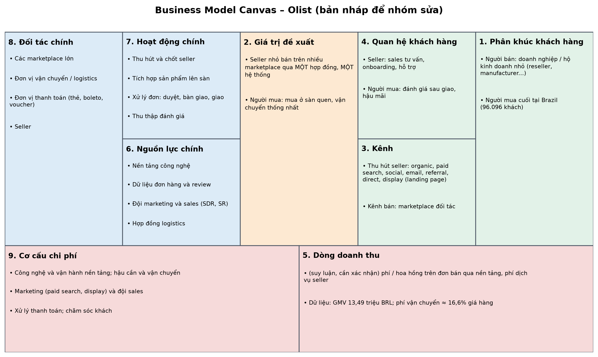
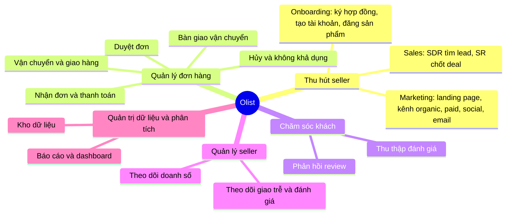
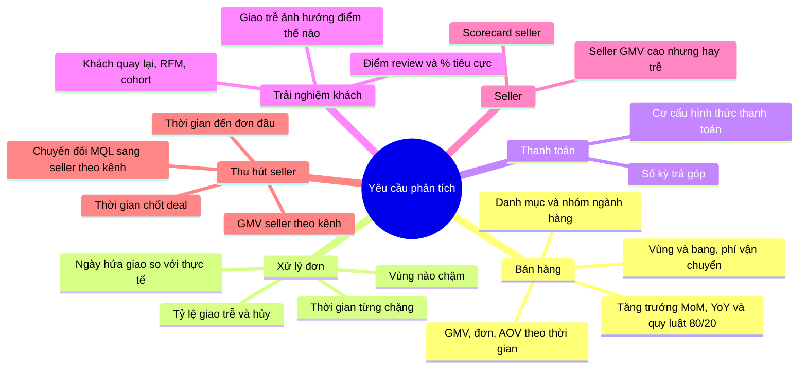
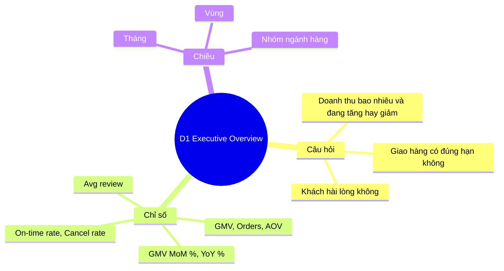
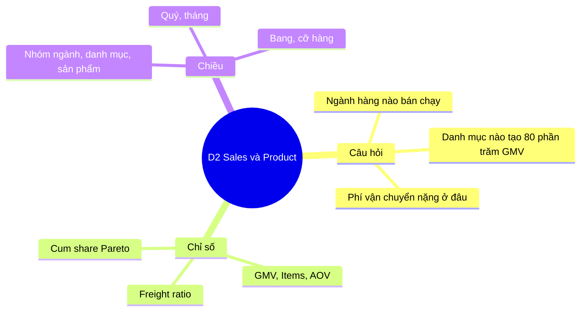
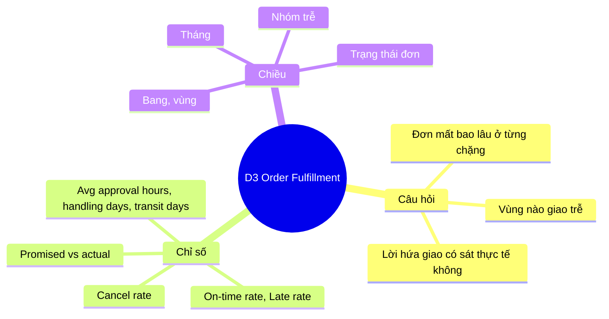
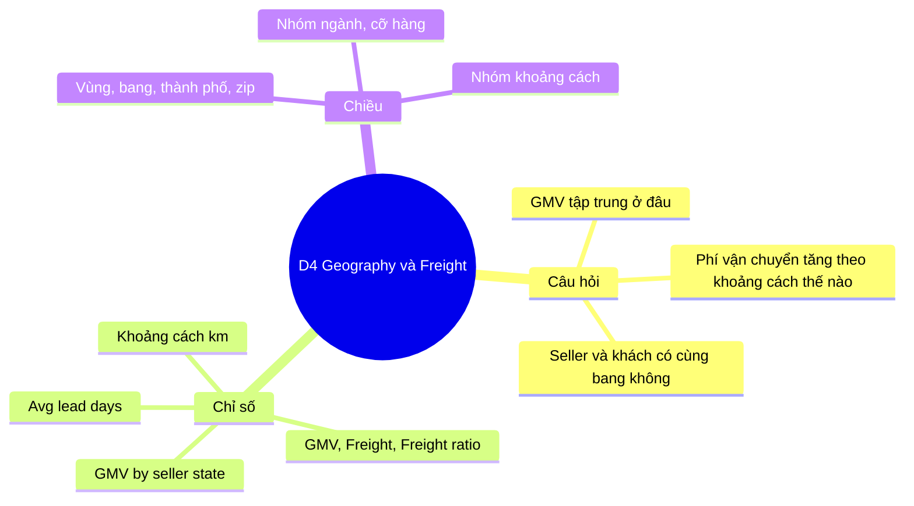
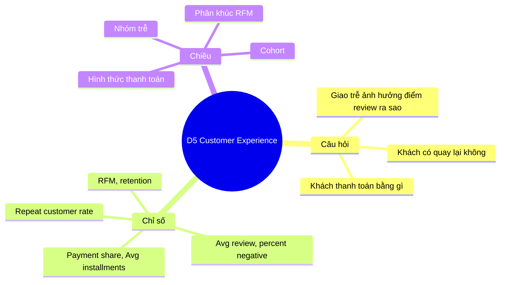
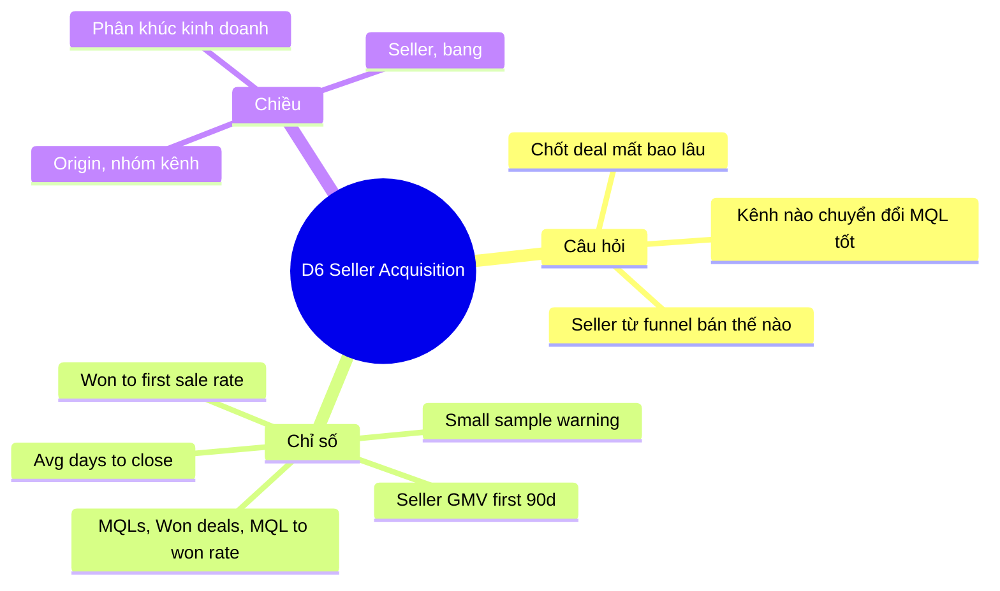
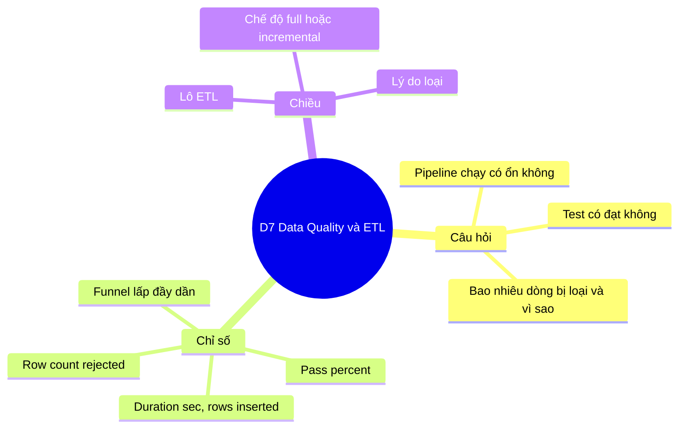

# 05 – Nghiệp vụ (BẢN NHÁP để nhóm sửa và vẽ lại)

> **Đây là bản nháp.** Quy trình dựa trên các cột thời gian của dữ liệu Olist (mỗi mốc là một cột) và mô tả công khai về Olist; **không phải tài liệu chính thức của doanh nghiệp**. Nhóm cần đọc, sửa cho đúng cách hiểu của mình, rồi vẽ lại bằng draw.io / Visio (đúng ký hiệu BPMN) cho báo cáo mục 3.1 và 3.2.1–3.2.2.
> Hình PNG được render tự động từ các khối Mermaid trong file này bằng `python scripts/render_mermaid.py` (sửa khối Mermaid rồi chạy lại để có hình mới). Ký hiệu: **hình thoi vàng "📊" = điểm kho dữ liệu thu thập** (cột/bảng ghi lại sự kiện để phân tích).

## 1. Quy trình xử lý đơn hàng (BPMN nháp)
Các mốc có dữ liệu: `order_purchase_timestamp` → `order_approved_at` → `order_delivered_carrier_date` → `order_delivered_customer_date`; `order_estimated_delivery_date` được tính lúc đặt hàng; review sau khi giao. Trạng thái đơn: created, approved, invoiced, processing, shipped, delivered, canceled, unavailable.

<!-- png: 3-2-1_bpmn_don_hang.png -->

| Bước | Mốc dữ liệu (cột) | Nơi kho lưu | Phân tích được |
| --- | --- | --- | --- |
| Đặt hàng, thanh toán | `order_purchase_timestamp`, `payment_type`, `payment_installments` | `fact_order_fulfillment.purchase_ts`, `fact_payment` | số đơn, cơ cấu thanh toán, trả góp |
| Duyệt | `order_approved_at` | `approval_hours` | tốc độ duyệt (TB 10,3 giờ) |
| Bàn giao vận chuyển | `order_delivered_carrier_date`, `shipping_limit_date` | `handling_days` | seller xử lý chậm hay nhanh (TB 2,9 ngày) |
| Giao khách | `order_delivered_customer_date` | `transit_days`, `lead_days`, `delay_days`, `is_late` | vận chuyển (TB 9,3 ngày), đúng hạn 93,2% |
| Đánh giá | `review_score`, `review_creation_date`, `review_answer_timestamp` | `fact_review` | điểm TB 4,09; ảnh hưởng của trễ |
| Hủy / không khả dụng | `order_status` | `is_canceled`, `dim_order_status` | tỷ lệ Failed 1,24% |

## 2. Quy trình thu hút seller (BPMN nháp)
Dữ liệu CRM có hai mốc: `first_contact_date` (MQL liên hệ đầu) và `won_date` (chốt deal); mốc thứ ba (đơn đầu tiên) lấy từ hệ thống bán hàng nhờ nối `seller_id`.

<!-- png: 3-2-2_bpmn_thu_hut_seller.png -->

Số liệu: 8.000 MQL → 842 chốt (10,5%, TB 48,5 ngày) → 379 seller có đơn bán được (45,0% số đã chốt; TB 51,9 ngày từ chốt đến đơn đầu).

## 3. Business Model Canvas của Olist (9 ô, bản nháp)
*Suy luận từ dữ liệu và mô tả công khai về Olist (sàn kết nối người bán nhỏ với các marketplace lớn ở Brazil); các ô về doanh thu và đối tác cần nhóm kiểm tra lại.*

| Ô | Nội dung |
| --- | --- |
| **1. Phân khúc khách hàng** | **Người bán**: doanh nghiệp / hộ kinh doanh nhỏ (reseller, manufacturer; các `business_segment` như đồ gia dụng, điện thoại, sức khoẻ-làm đẹp…). **Người mua cuối** tại Brazil (96.096 khách, 65% GMV ở vùng Sudeste). |
| **2. Giá trị đề xuất** | Seller nhỏ bán được trên nhiều marketplace qua **một hợp đồng và một hệ thống** (đơn, hậu cần, thanh toán); người mua mua ở sàn quen thuộc với vận chuyển thống nhất. |
| **3. Kênh** | Kênh thu hút seller: `organic_search`, `paid_search`, `social`, `email`, `referral`, `direct_traffic`, `display`… (landing page); kênh bán: các marketplace đối tác. |
| **4. Quan hệ khách hàng** | Với seller: đội sales (SDR tìm, SR chốt), onboarding, hỗ trợ; với người mua: đánh giá sau giao, dịch vụ hậu mãi. |
| **5. Dòng doanh thu** | *(suy luận, cần xác nhận)* phí/hoa hồng trên đơn bán qua nền tảng và phí dịch vụ cho seller. Dữ liệu cho biết giá hàng và phí vận chuyển (GMV 13,49 triệu BRL; phí vận chuyển ≈ 16,6% giá hàng), không có doanh thu của Olist. |
| **6. Nguồn lực chính** | Nền tảng công nghệ tích hợp marketplace, dữ liệu đơn hàng và đánh giá, đội marketing và sales, hợp đồng logistics. |
| **7. Hoạt động chính** | Thu hút và chốt seller; tích hợp sản phẩm; xử lý đơn (duyệt, theo dõi bàn giao, vận chuyển); thanh toán; chăm sóc sau giao và thu thập đánh giá. |
| **8. Đối tác chính** | Các marketplace lớn; đơn vị vận chuyển / logistics; đơn vị thanh toán (thẻ, boleto, voucher); seller. |
| **9. Cơ cấu chi phí** | Công nghệ và vận hành nền tảng; hậu cần và vận chuyển; marketing (paid search, display) và đội sales; xử lý thanh toán; chăm sóc khách. |

## 4. Cây nghiệp vụ (các hoạt động của doanh nghiệp)
<!-- png: 3-2-5_cay_nghiep_vu.png -->

## 5. Cây yêu cầu phân tích
<!-- png: 3-2-6_cay_yeu_cau_phan_tich.png -->

## 6. Cây phân tích của từng dashboard
Mỗi cây: mục tiêu → câu hỏi → chỉ số (measure) → chiều. Chi tiết từng dashboard ở `huong-dan/dashboards/D1.md … D7.md`.

<!-- png: 3-2-7_cay_phan_tich_D1.png -->

<!-- png: 3-2-7_cay_phan_tich_D2.png -->

<!-- png: 3-2-7_cay_phan_tich_D3.png -->

<!-- png: 3-2-7_cay_phan_tich_D4.png -->

<!-- png: 3-2-7_cay_phan_tich_D5.png -->

<!-- png: 3-2-7_cay_phan_tich_D6.png -->

<!-- png: 3-2-7_cay_phan_tich_D7.png -->

## 7. Việc cho nhóm
- Đọc kỹ mục 1–2 và **sửa cho khớp cách nhóm hiểu nghiệp vụ**; vẽ lại BPMN chuẩn trong draw.io (có thể dùng thư viện hình BPMN sẵn có), giữ nguyên các **điểm thu thập dữ liệu** (📊).
- Kiểm tra mục 3 (Business Model Canvas): ô doanh thu và đối tác cần nguồn công khai để dẫn chứng; chỉnh lại câu chữ.
- Dùng mục 4–6 làm cơ sở cho mục báo cáo 3.2.1–3.2.2 và 3.3.5; ghép hình `3-2-*.png`.
