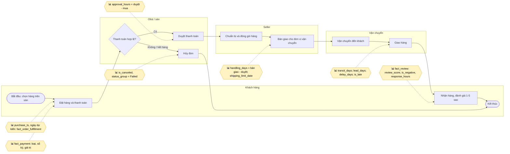
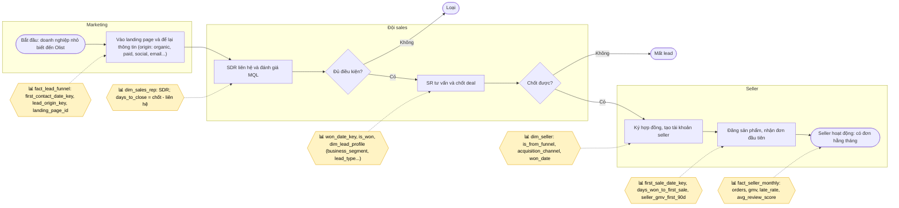
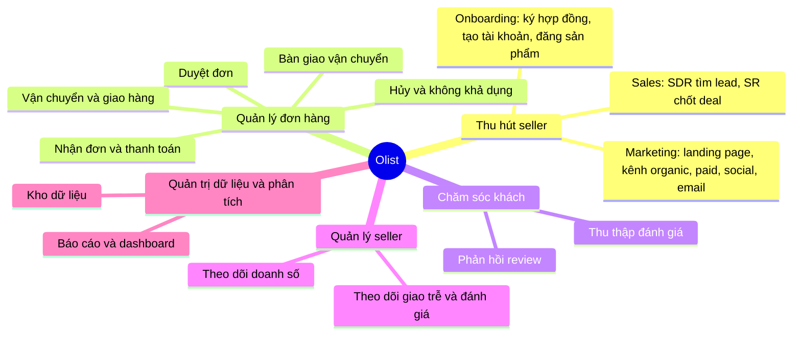
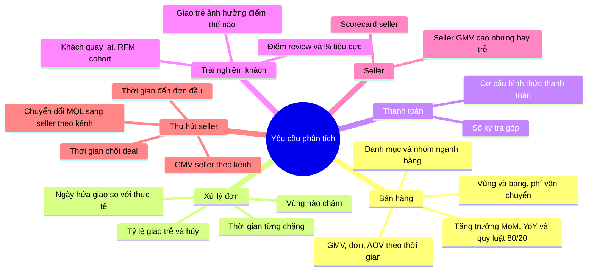
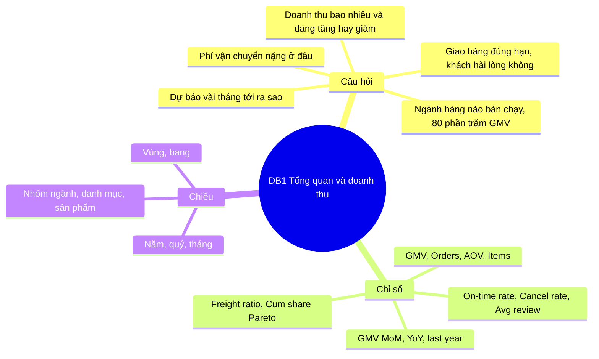
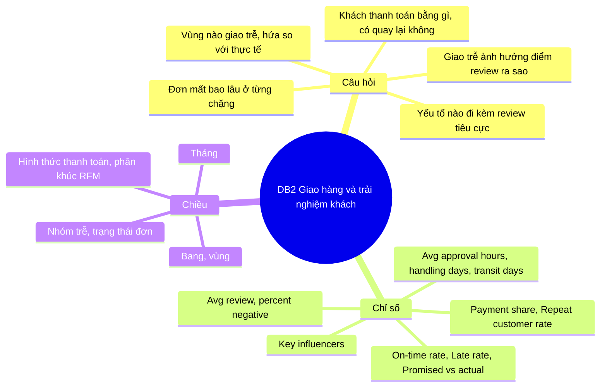
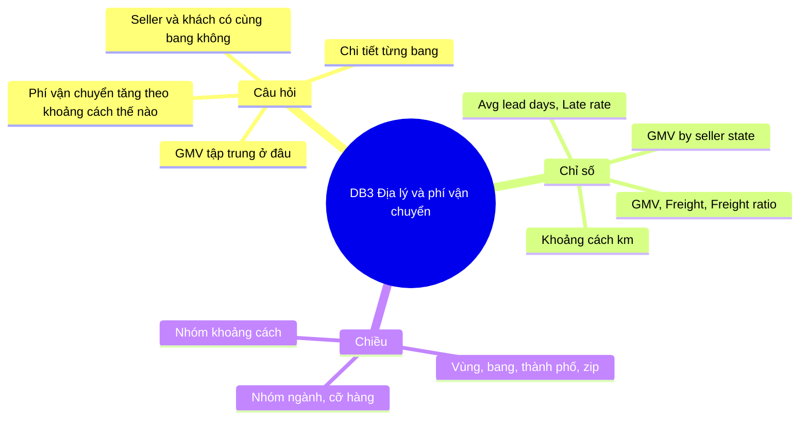
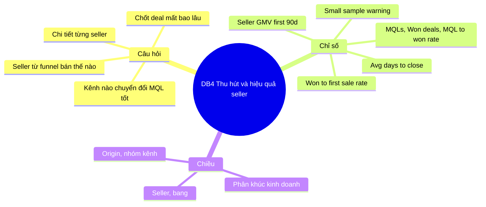

# 05 – Nghiệp vụ (BẢN NHÁP để nhóm sửa và vẽ lại)

> **Đây là bản nháp.** Quy trình dựa trên các cột thời gian của dữ liệu Olist (mỗi mốc là một cột) và mô tả công khai về Olist; **không phải tài liệu chính thức của doanh nghiệp**. Nhóm cần đọc, sửa cho đúng cách hiểu của mình, rồi vẽ lại bằng draw.io / Visio (đúng ký hiệu BPMN) cho báo cáo mục 3.1 và 3.2.1–3.2.2.
> Hình PNG được render tự động từ các khối Mermaid trong file này bằng `python scripts/render_mermaid.py` (sửa khối Mermaid rồi chạy lại để có hình mới). Ký hiệu: **hình thoi vàng "📊" = điểm kho dữ liệu thu thập** (cột/bảng ghi lại sự kiện để phân tích).

## 1. Quy trình xử lý đơn hàng (BPMN nháp)
Các mốc có dữ liệu: `order_purchase_timestamp` → `order_approved_at` → `order_delivered_carrier_date` → `order_delivered_customer_date`; `order_estimated_delivery_date` được tính lúc đặt hàng; review sau khi giao. Trạng thái đơn: created, approved, invoiced, processing, shipped, delivered, canceled, unavailable.

<!-- png: 3-2-1_bpmn_don_hang.png -->

| Bước | Mốc dữ liệu (cột) | Nơi kho lưu | Phân tích được |
| --- | --- | --- | --- |
| Đặt hàng, thanh toán | `order_purchase_timestamp`, `payment_type`, `payment_installments` | `fact_order_fulfillment.purchase_ts`, `fact_payment` | số đơn, cơ cấu thanh toán, trả góp |
| Duyệt | `order_approved_at` | `approval_hours` | tốc độ duyệt (TB 10,3 giờ) |
| Bàn giao vận chuyển | `order_delivered_carrier_date`, `shipping_limit_date` | `handling_days` | seller xử lý chậm hay nhanh (TB 2,9 ngày) |
| Giao khách | `order_delivered_customer_date` | `transit_days`, `lead_days`, `delay_days`, `is_late` | vận chuyển (TB 9,3 ngày), đúng hạn 93,2% |
| Đánh giá | `review_score`, `review_creation_date`, `review_answer_timestamp` | `fact_review` | điểm TB 4,09; ảnh hưởng của trễ |
| Hủy / không khả dụng | `order_status` | `is_canceled`, `dim_order_status` | tỷ lệ Failed 1,24% |

## 2. Quy trình thu hút seller (BPMN nháp)
Dữ liệu CRM có hai mốc: `first_contact_date` (MQL liên hệ đầu) và `won_date` (chốt deal); mốc thứ ba (đơn đầu tiên) lấy từ hệ thống bán hàng nhờ nối `seller_id`.

<!-- png: 3-2-2_bpmn_thu_hut_seller.png -->

Số liệu: 8.000 MQL → 842 chốt (10,5%, TB 48,5 ngày) → 379 seller có đơn bán được (45,0% số đã chốt; TB 51,9 ngày từ chốt đến đơn đầu).

## 3. Business Model Canvas của Olist (9 ô, bản nháp)
*Suy luận từ dữ liệu và mô tả công khai về Olist (sàn kết nối người bán nhỏ với các marketplace lớn ở Brazil); các ô về doanh thu và đối tác cần nhóm kiểm tra lại.*

| Ô | Nội dung |
| --- | --- |
| **1. Phân khúc khách hàng** | **Người bán**: doanh nghiệp / hộ kinh doanh nhỏ (reseller, manufacturer; các `business_segment` như đồ gia dụng, điện thoại, sức khoẻ-làm đẹp…). **Người mua cuối** tại Brazil (96.096 khách, 65% GMV ở vùng Sudeste). |
| **2. Giá trị đề xuất** | Seller nhỏ bán được trên nhiều marketplace qua **một hợp đồng và một hệ thống** (đơn, hậu cần, thanh toán); người mua mua ở sàn quen thuộc với vận chuyển thống nhất. |
| **3. Kênh** | Kênh thu hút seller: `organic_search`, `paid_search`, `social`, `email`, `referral`, `direct_traffic`, `display`… (landing page); kênh bán: các marketplace đối tác. |
| **4. Quan hệ khách hàng** | Với seller: đội sales (SDR tìm, SR chốt), onboarding, hỗ trợ; với người mua: đánh giá sau giao, dịch vụ hậu mãi. |
| **5. Dòng doanh thu** | *(suy luận, cần xác nhận)* phí/hoa hồng trên đơn bán qua nền tảng và phí dịch vụ cho seller. Dữ liệu cho biết giá hàng và phí vận chuyển (GMV 13,49 triệu BRL; phí vận chuyển ≈ 16,6% giá hàng), không có doanh thu của Olist. |
| **6. Nguồn lực chính** | Nền tảng công nghệ tích hợp marketplace, dữ liệu đơn hàng và đánh giá, đội marketing và sales, hợp đồng logistics. |
| **7. Hoạt động chính** | Thu hút và chốt seller; tích hợp sản phẩm; xử lý đơn (duyệt, theo dõi bàn giao, vận chuyển); thanh toán; chăm sóc sau giao và thu thập đánh giá. |
| **8. Đối tác chính** | Các marketplace lớn; đơn vị vận chuyển / logistics; đơn vị thanh toán (thẻ, boleto, voucher); seller. |
| **9. Cơ cấu chi phí** | Công nghệ và vận hành nền tảng; hậu cần và vận chuyển; marketing (paid search, display) và đội sales; xử lý thanh toán; chăm sóc khách. |

## 4. Cây nghiệp vụ (các hoạt động của doanh nghiệp)
<!-- png: 3-2-5_cay_nghiep_vu.png -->

## 5. Cây yêu cầu phân tích
<!-- png: 3-2-6_cay_yeu_cau_phan_tich.png -->

## 6. Cây phân tích của từng dashboard (DB1–DB4)
Mỗi cây: mục tiêu → câu hỏi → chỉ số (measure) → chiều. Chi tiết từng dashboard ở `huong-dan/dashboards/DB1.md … DB4.md`. Bộ dashboard có 4 cây (gộp từ 7 cây ở bản trước); hình sinh bằng `python scripts/render_mermaid.py`.

<!-- png: 2-3_cay_phan_tich_DB1.png -->

<!-- png: 2-3_cay_phan_tich_DB2.png -->

<!-- png: 2-3_cay_phan_tich_DB3.png -->

<!-- png: 2-3_cay_phan_tich_DB4.png -->

## 7. Việc cho nhóm
- Đọc kỹ mục 1–2 và **sửa cho khớp cách nhóm hiểu nghiệp vụ**; vẽ lại BPMN chuẩn trong draw.io (có thể dùng thư viện hình BPMN sẵn có), giữ nguyên các **điểm thu thập dữ liệu** (📊).
- Kiểm tra mục 3 (Business Model Canvas): ô doanh thu và đối tác cần nguồn công khai để dẫn chứng; chỉnh lại câu chữ.
- Dùng mục 4–6 làm cơ sở cho mục báo cáo 2.1–2.3; ghép hình `3-2-*.png`.

<!-- p8:start (sinh bởi scripts/p8_business.py; đừng sửa tay trong khối này) -->
## 8. Điểm phân tích trên quy trình (P8)
Mỗi điểm phân tích có mã A1, A2… đặt trên BPMN (các hình thoi vàng "📊" ở mục 1 và 2): bước nào của quy trình, dashboard nào, KPI nào và phân tích theo khía cạnh nào.

| Mã | Bước trên quy trình (BPMN) | Dashboard | KPI | Khía cạnh phân tích |
| --- | --- | --- | --- | --- |
| A1 | Quy trình đơn: đặt hàng và thanh toán | DB1, DB2 | GMV, Orders, AOV, cơ cấu thanh toán, số kỳ trả góp | thời gian, sản phẩm, địa lý, hình thức thanh toán |
| A2 | Quy trình đơn: duyệt thanh toán | DB2 | approval_hours (trung bình 10,3 giờ) | thời gian, trạng thái đơn |
| A3 | Quy trình đơn: seller chuẩn bị và bàn giao | DB2, DB4 | handling_days (trung bình 2,9 ngày) | seller, vùng, thời gian |
| A4 | Quy trình đơn: vận chuyển và giao hàng | DB2, DB3 | Avg lead days, On-time rate, Promised vs actual, Freight ratio | bang và vùng, khoảng cách, thời gian |
| A5 | Quy trình đơn: khách đánh giá | DB2 | Avg review, % negative, Repeat customer rate | mức trễ giao hàng, nhóm ngành, khách |
| A6 | Quy trình đơn: hủy hoặc không khả dụng | DB1, DB2 | Cancel rate, phễu trạng thái đơn | trạng thái, thời gian |
| A7 | Quy trình seller: khách tiềm năng để lại thông tin (MQL) | DB4 | MQLs theo tháng liên hệ đầu | kênh (origin), thời gian |
| A8 | Quy trình seller: SDR sàng lọc, SR tư vấn | DB4 | Avg days to close | nhân viên sales (SDR, SR), phân khúc |
| A9 | Quy trình seller: chốt thương vụ | DB4 | Won deals, MQL to won rate | kênh, phân khúc kinh doanh |
| A10 | Quy trình seller: seller bán đơn đầu tiên | DB4, DB1 | Sellers with first sale, Won to first sale rate, GMV 90 ngày đầu | kênh, thời gian, seller |
| A11 | Vận hành dữ liệu: nạp và kiểm thử kho | mục 3.3 (bảng giám sát ETL) | số dòng nạp, thời gian chạy, số dòng bị loại, số kiểm thử đạt | lô nạp, bảng |

## 9. Business Model Canvas: từ khối Canvas đến dashboard
| Khối Canvas | Câu hỏi quản trị | Chỉ số | Dashboard |
| --- | --- | --- | --- |
| Phân khúc khách hàng | Ai mua và mua ở đâu; ai là seller bán tốt? | số khách, Repeat customer rate, tỷ trọng vùng (Sudeste 65,4% GMV) | DB1, DB3, DB2 |
| Giá trị đề xuất | Giao có đúng hạn và đủ rẻ để seller nhỏ vẫn bán được? | On-time rate, Promised vs actual, Freight ratio (16,6%) | DB2, DB3 |
| Kênh | Kênh marketing nào đưa về seller chốt được? | MQLs, MQL to won rate theo kênh | DB4 |
| Quan hệ khách hàng | Khách có hài lòng không; đội sales chốt nhanh không? | Avg review (4,09), % negative, Avg days to close | DB2, DB4 |
| Dòng doanh thu | Doanh số trên sàn tăng hay giảm? | GMV, Orders, AOV (dữ liệu không có doanh thu của Olist) | DB1 |
| Nguồn lực chính | Nền tảng và đội sales đang phục vụ bao nhiêu seller? | số seller có đơn, số thương vụ trên mỗi nhân viên sales | DB4 |
| Hoạt động chính | Xử lý đơn và thu hút seller mất bao lâu ở từng chặng? | approval_hours, handling_days, Avg lead days, Avg days to close | DB2, DB4 |
| Đối tác chính | Seller và đơn vị vận chuyển nào làm chậm đơn? | tỷ lệ trễ theo seller và bang, scorecard seller | DB2, DB3, DB4 |
| Cấu trúc chi phí | Chi phí vận chuyển chiếm bao nhiêu giá hàng? | Freight ratio theo vùng và nhóm ngành (dữ liệu không có chi phí marketing) | DB1, DB3 |

Lưu ý: dữ liệu chỉ có giá hàng và phí vận chuyển, không có doanh thu hay chi phí marketing của Olist; vì vậy ô *dòng doanh thu* và *cấu trúc chi phí* chỉ có thể dùng GMV và phí vận chuyển làm chỉ số thay thế.

## 10. Hiện trạng và yêu cầu cải tiến
| Hiện trạng | Yêu cầu cải tiến | Mục báo cáo |
| --- | --- | --- |
| Hai hệ thống nguồn (bán hàng, CRM) tách rời, chỉ gặp nhau qua seller_id | Tích hợp bằng chiều dùng chung dim_seller để hỏi được seller đến từ kênh nào thì bán tốt | 2.4, 3.4 |
| Báo cáo phải nối nhiều bảng chuẩn hóa của hệ thống giao dịch | Mô hình chiều (fact và dimension) và data mart tổng hợp sẵn cho từng chủ điểm | 3.5 |
| Trạng thái đơn chỉ là giá trị hiện tại, không có lịch sử các mốc | Bảng fact snapshot tích luỹ ghi 5 mốc thời gian và thời gian từng chặng | 3.5 |
| Địa chỉ khách chỉ giữ bản mới nhất | SCD loại 2 cho dim_customer để gắn đơn với địa chỉ tại ngày mua | 3.4 |
| Dữ liệu có nhiều lỗi (45 loại bất thường, 58 phép kiểm tra) | Tầng ODS gắn cờ lỗi và ghi dòng bị loại kèm lý do, không xoá âm thầm | 3.3 |
| Mỗi báo cáo có thể định nghĩa KPI khác nhau (GMV, Orders) | Định nghĩa mỗi KPI một lần bằng DAX và đối chiếu với SQL | 2.3 |
| Ngày dự kiến giao quá rộng (trung bình 24,4 ngày so với thực tế 12,6 ngày) nên chỉ số đúng hạn không phản ánh trải nghiệm | KPI ngày hứa giao so với ngày giao thực tế, phân tích theo mức trễ | 2.3, 3.1 |
| Không có công cụ giám sát chất lượng nạp dữ liệu | Nhật ký etl_log và bảng giám sát ở mục 3.3 | 3.3 |

## 11. Đối tượng sử dụng dashboard
| Người dùng | Câu hỏi | Dashboard | Tần suất xem |
| --- | --- | --- | --- |
| Ban điều hành | Doanh thu có tăng không? Giao hàng và khách hàng ra sao? | DB1 | hằng tuần, hằng tháng |
| Quản lý kinh doanh và danh mục | Nhóm ngành nào bán chạy; giá và phí vận chuyển theo ngành? | DB1 | hằng tuần |
| Quản lý vận hành và logistics | Chặng nào chậm; bang nào trễ nhiều; phí vận chuyển theo khoảng cách? | DB2, DB3 | hằng ngày đến hằng tuần |
| Chăm sóc khách hàng | Vì sao review thấp; khách nào quay lại? | DB2 | hằng tuần |
| Quản lý seller và đội sales (SDR, SR) | Kênh nào chuyển đổi tốt; seller từ funnel bán ra sao? | DB4 | hằng tuần, hằng tháng |
| Quản trị dữ liệu | Lần nạp gần nhất có đúng không; dòng nào bị loại? | mục 3.3 (bảng giám sát ETL) | hằng ngày (mỗi lần chạy ETL) |

## 12. Chủ điểm, khía cạnh và chỉ số
| Chủ điểm | Khía cạnh | Chỉ số |
| --- | --- | --- |
| Bán hàng | thời gian, sản phẩm (danh mục, nhóm ngành), địa lý | GMV, Orders, AOV, tăng trưởng MoM và YoY, tỷ trọng 80/20 |
| Xử lý đơn | thời gian, địa lý, trạng thái, seller | approval_hours, handling_days, transit_days, Avg lead days, On-time rate, Promised vs actual, Cancel rate |
| Thanh toán | thời gian, hình thức thanh toán | cơ cấu hình thức, số kỳ trả góp, giá trị thanh toán |
| Trải nghiệm khách | mức trễ, nhóm ngành, khách, vùng | Avg review, % negative, Repeat customer rate, RFM, cohort |
| Seller | seller, thời gian, vùng | GMV theo seller, tỷ lệ trễ, điểm review, tháng không bán |
| Thu hút seller | kênh (origin), thời gian, phân khúc, nhân viên sales | MQLs, Won deals, MQL to won rate, Avg days to close, Won to first sale rate, GMV 90 ngày đầu |

## 13. Giới hạn của dữ liệu ảnh hưởng tới KPI
| Giới hạn | Số liệu | Cách xử lý trong KPI |
| --- | --- | --- |
| GMV có hai cách đo | GMV (chỉ đơn không thuộc nhóm Failed) là 13.494.400,74 BRL; tổng giá hàng của mọi đơn là 13.591.643,70 BRL (chênh 97.242,96 BRL) | Dashboard dùng GMV loại đơn Failed; ghi rõ định nghĩa cạnh con số |
| Orders khác Orders placed | Orders (đơn có doanh thu) là 98.199; Orders placed (mọi đơn đã đặt) là 99.441; chênh 1.242 đơn gồm 1.234 đơn hủy hoặc không khả dụng và 8 đơn không có dòng hàng | AOV = GMV chia Orders; Cancel rate chia Orders placed |
| 380 so với 379 seller có đơn | 380 deal đã chốt có đơn ở mọi trạng thái; chỉ 379 seller có đơn không thuộc nhóm Failed (first_sale_date) | KPI Sellers with first sale dùng 379; con số 380 chỉ xuất hiện ở khám phá dữ liệu |
| Năm 2016 thưa, tháng 2018-09 bị cắt | 2016 chỉ có 329 đơn; 2018-09 có 16 đơn và 2018-10 có 4 đơn (nguồn dừng giữa tháng) | Dashboard DB1 đến DB4 lọc cửa sổ 2017-01 đến 2018-08 (cột InWindow); xu hướng ngoài cửa sổ không diễn giải |
| Đơn có nhiều review | 547 trong 98.673 đơn có review có từ 2 đến 3 review (tổng 99.224 review); điểm trung bình tính theo review là 4,0864, theo đơn là 4,0868 | Avg review tính theo review; chênh lệch nhỏ nên không đổi kết luận |
| Điểm review nhóm đúng hạn | Trước 07/11 đơn chưa giao bị tính vào nhóm đúng hạn nên điểm là 4,21; sau khi thêm is_delivered vào fact_review điểm đúng là 4,29 | Sửa ở tầng kho (cột is_delivered), không sửa ở Power BI |
<!-- p8:end -->
